# Restaurant-service contract plan and execution graph

**Status:** RF-05 draft documentation authority, based on RF-01 merged [PR #63](https://github.com/anmolsansi/OrderlyApp/pull/63), baseline `f9ac1b198427e28175e3ab9e1cfe3447fdc402d6`. No live implementation, external sends, collection, migration, hosted proof or U1–U4 acceptance is implied.

## Contract authority and reading order

1. [RS-01 frozen synthetic COMMON/DTO/DB and CON-01–67 registry](restaurant-service-v1.md) is the **authoritative shared live-v1 contract definition**. Its schema v1 examples and [cross-language synthetic fixture bundle](../../tests/fixtures/restaurant-service/v1.json) are frozen by [PR #61](https://github.com/anmolsansi/OrderlyApp/pull/61). The source is not replaced or silently rewritten by RF-05.
2. [RF-01 DEMO-SALES extension contract](../demo/restaurant-sales-walkthrough.md#3-four-capability-inventory-with-exact-owners) is the **authoritative proposed demo-only** route, role, isolation, simulated marketing, and UI/negative-test overlay. It is **not** a frozen API or a working provider. For the detailed additional DTOs and security rules, read its [sections 4–5](../demo/restaurant-sales-walkthrough.md#4-synthetic-authority-and-exact-route-boundary) and [six-child handoff](../demo/restaurant-sales-walkthrough.md#6-implementation-handoff-six-bounded-child-packets).
3. The DAG and waves below are the canonical **proposed execution schedule** after merged RF-01. They are not runtime gates and do not supersede the release acceptance conditions.
4. Each [RS/RF/DS packet](../tickets/restaurant-service/) is a separately executable **snapshot of consumed contracts**. Its copied DTO/SQL/error examples are execution context, not an independent maintained source of truth. Before assigning work, the integrator compares the packet with sources 1–3 and attaches the exact referenced schema/DTO/route definitions and [repo context](../repo_context.md). A changed public contract requires an architect-reviewed change record plus producer, fixture and consumer updates together. A mismatch is `Needs Architect Decision`, never silent implementation.
5. [Prior 9,014-line master plan](../plans/orderly-history.md) preserves historical evidence, old anchors and superseded draft copies, **read-only**. Historical prose must not be used to override the accepted RF-01 graph or current packets.

**Required sequencing correction:** RS-20 is the provider-independent read queue. RS-20 **precedes** RS-30 to serialize `backend/app/staff_routes.py`; RS-30 still gates real MSG91/SendGrid send work, never DEMO-SALES. RS-19 → DS-01 → DS-02 → RS-58 for `backend/app/live_routes.py`; DS-03 → RS-58 for gateway/client; DS-06 → RS-59 for shared demo UI/E2E. Production RS-INT01–04, RS-64/65, RS-RELEASE and U1–U4 are preserved.

**Never claim acceptance from a plan:** RS-01 is a merged synthetic freeze, RF-01 is merged planning, RF-05 is an unmerged documentation handoff until its review PR is accepted, RS-02–67 and DS-01–06 are not implemented or accepted. Validate upstream implementation and exact CI/evidence before updating any ticket status.

---

### 18.7 Dependency DAG

The machine-readable edge list was accepted as the RF-01 planning graph in merged PR #63. It is authoritative for **proposed dependency sequencing**, not proof that runtime providers or DS packets exist. It includes six planned DS packets and DEMO-SALES, not implemented providers. The full-service release edges and their external acceptance gates are preserved. CON labels are provider outputs, not free-form arrows. Ordering IDs need not increase: RS-67 provisions the tenant needed before RS-04 bootstrap. No parallel agent/worktree is launched by this plan.

```mermaid
flowchart TD
 RS01 -->|CON-01| RS02
 RS01 -->|CON-01| RS03
 RS02 -->|CON-02| RS03
 RS01 -->|CON-01| RS04
 RS03 -->|CON-03| RS04
 RS67 -->|CON-67| RS04
 RS01 -->|CON-01| RS05
 RS04 -->|CON-04| RS05
 RS01 -->|CON-01| RS06
 RS05 -->|CON-05| RS06
 RS01 -->|CON-01| RS07
 RS06 -->|CON-06| RS07
 RS01 -->|CON-01| RS08
 RS07 -->|CON-07| RS08
 RS01 -->|CON-01| RS09
 RS06 -->|CON-06| RS09
 RS01 -->|CON-01| RS10
 RS09 -->|CON-09| RS10
 RS01 -->|CON-01| RS11
 RS01 -->|CON-01| RS12
 RS09 -->|CON-09| RS12
 RS10 -->|CON-10| RS12
 RS01 -->|CON-01| RS13
 RS10 -->|CON-10| RS13
 RS12 -->|CON-12| RS13
 RS06 -->|CON-06| RS13
 RS01 -->|CON-01| RS14
 RS03 -->|CON-03| RS14
 RS13 -->|CON-13| RS14
 RS01 -->|CON-01| RS15
 RS11 -->|CON-11| RS15
 RS14 -->|CON-14| RS15
 RS01 -->|CON-01| RS16
 RS09 -->|CON-09| RS16
 RS12 -->|CON-12| RS16
 RS01 -->|CON-01| RS17
 RS15 -->|CON-15| RS17
 RS16 -->|CON-16| RS17
 RS01 -->|CON-01| RS18
 RS17 -->|CON-17| RS18
 RS15 -->|CON-15| RS18
 RS01 -->|CON-01| RS19
 RS18 -->|CON-18| RS19
 RS01 -->|CON-01| RS20
 RS06 -->|CON-06| RS20
 RS18 -->|CON-18| RS20
 RS01 -->|CON-01| RS21
 RS20 -->|CON-20| RS21
 RS01 -->|CON-01| RS22
 RS20 -->|CON-20| RS22
 RS21 -->|CON-21| RS22
 RS01 -->|CON-01| RS23
 RS21 -->|CON-21| RS23
 RS22 -->|CON-22| RS23
 RS01 -->|CON-01| RS24
 RS04 -->|CON-04| RS24
 RS16 -->|CON-16| RS24
 RS01 -->|CON-01| RS25
 RS24 -->|CON-24| RS25
 RS19 -->|CON-19| RS25
 RS26 -->|CON-26| RS25
 RS01 -->|CON-01| RS26
 RS24 -->|CON-24| RS26
 RS13 -->|CON-13| RS26
 RS01 -->|CON-01| RS27
 RS16 -->|CON-16| RS27
 RS24 -->|CON-24| RS27
 RS01 -->|CON-01| RS28
 RS27 -->|CON-27| RS28
 RS06 -->|CON-06| RS28
 RS16 -->|CON-16| RS28
 RS01 -->|CON-01| RS29
 RS28 -->|CON-28| RS29
 RS26 -->|CON-26| RS29
 RS01 -->|CON-01| RS30
 RS29 -->|CON-29| RS30
 RS01 -->|CON-01| RS31
 RS30 -->|CON-30| RS31
 RS01 -->|CON-01| RS32
 RS30 -->|CON-30| RS32
 RS01 -->|CON-01| RS33
 RS31 -->|CON-31| RS33
 RS32 -->|CON-32| RS33
 RS01 -->|CON-01| RS34
 RS33 -->|CON-33| RS34
 RS01 -->|CON-01| RS35
 RS34 -->|CON-34| RS35
 RS25 -->|CON-25| RS35
 RS01 -->|CON-01| RS36
 RS34 -->|CON-34| RS36
 RS01 -->|CON-01| RS37
 RS35 -->|CON-35| RS37
 RS36 -->|CON-36| RS37
 RS28 -->|CON-28| RS37
 RS23 -->|CON-23| RS37
 RS01 -->|CON-01| RS38
 RS23 -->|CON-23| RS38
 RS37 -->|CON-37| RS38
 RS01 -->|CON-01| RS39
 RS01 -->|CON-01| RS40
 RS08 -->|CON-08| RS40
 RS39 -->|CON-39| RS40
 RS07 -->|CON-07| RS41
 RS01 -->|CON-01| RS41
 RS01 -->|CON-01| RS42
 RS13 -->|CON-13| RS42
 RS40 -->|CON-40| RS42
 RS41 -->|CON-41| RS42
 RS01 -->|CON-01| RS43
 RS14 -->|CON-14| RS43
 RS42 -->|CON-42| RS43
 RS01 -->|CON-01| RS44
 RS18 -->|CON-18| RS44
 RS43 -->|CON-43| RS44
 RS41 -->|CON-41| RS44
 RS01 -->|CON-01| RS45
 RS44 -->|CON-44| RS45
 RS01 -->|CON-01| RS46
 RS19 -->|CON-19| RS46
 RS25 -->|CON-25| RS46
 RS45 -->|CON-45| RS46
 RS01 -->|CON-01| RS47
 RS20 -->|CON-20| RS47
 RS40 -->|CON-40| RS47
 RS41 -->|CON-41| RS47
 RS01 -->|CON-01| RS48
 RS21 -->|CON-21| RS48
 RS47 -->|CON-47| RS48
 RS01 -->|CON-01| RS49
 RS22 -->|CON-22| RS49
 RS23 -->|CON-23| RS49
 RS48 -->|CON-48| RS49
 RS01 -->|CON-01| RS50
 RS09 -->|CON-09| RS50
 RS12 -->|CON-12| RS50
 RS06 -->|CON-06| RS50
 RS40 -->|CON-40| RS50
 RS41 -->|CON-41| RS50
 RS01 -->|CON-01| RS51
 RS10 -->|CON-10| RS51
 RS40 -->|CON-40| RS51
 RS41 -->|CON-41| RS51
 RS01 -->|CON-01| RS52
 RS28 -->|CON-28| RS52
 RS40 -->|CON-40| RS52
 RS41 -->|CON-41| RS52
 RS01 -->|CON-01| RS53
 RS29 -->|CON-29| RS53
 RS52 -->|CON-52| RS53
 RS01 -->|CON-01| RS54
 RS37 -->|CON-37| RS54
 RS38 -->|CON-38| RS54
 RS53 -->|CON-53| RS54
 RS01 -->|CON-01| RS55
 RS42 -->|CON-42| RS55
 RS01 -->|CON-01| RS56
 RS13 -->|CON-13| RS56
 RS55 -->|CON-55| RS56
 RS01 -->|CON-01| RS57
 RS43 -->|CON-43| RS57
 RS56 -->|CON-56| RS57
 RS42 -->|CON-42| RS57
 RS01 -->|CON-01| RS58
 RS23 -->|CON-23| RS58
 RS37 -->|CON-37| RS58
 RS19 -->|CON-19| RS58
 RS07 -->|CON-07| RS58
 RS41 -->|CON-41| RS58
 RS01 -->|CON-01| RS59
 RS46 -->|CON-46| RS59
 RS49 -->|CON-49| RS59
 RS54 -->|CON-54| RS59
 RS57 -->|CON-57| RS59
 RS58 -->|CON-58| RS59
 RS01 -->|CON-01| RS60
 RS34 -->|CON-34| RS60
 RS58 -->|CON-58| RS60
 RS35 -->|CON-35| RS60
 RS01 -->|CON-01| RS61
 RS60 -->|CON-60| RS61
 RS63 -->|CON-63| RS61
 RS01 -->|CON-01| RS62
 RS59 -->|CON-59| RS62
 RS61 -->|CON-61| RS62
 RS01 -->|CON-01| RS63
 RS03 -->|CON-03| RS63
 RS24 -->|CON-24| RS63
 RS27 -->|CON-27| RS63
 RS01 -->|CON-01| RS64
 RS61 -->|CON-61| RS64
 RS62 -->|CON-62| RS64
 RS63 -->|CON-63| RS64
 RS01 -->|CON-01| RS65
 RS59 -->|CON-59| RS65
 RS64 -->|CON-64| RS65
 RS01 -->|CON-01| RS66
 RS16 -->|CON-16| RS66
 RS40 -->|CON-40| RS66
 RS41 -->|CON-41| RS66
 RS01 -->|CON-01| RS67
 RS02 -->|CON-02| RS67
 RS06 -->|CON-06| RSINT01
 RS14 -->|CON-14| RSINT01
 RS18 -->|CON-18| RSINT01
 RS19 -->|CON-19| RSINT01
 RSINT01 -->|gate| RS44
 RS23 -->|CON-23| RSINT02
 RS46 -->|CON-46| RSINT02
 RS49 -->|CON-49| RSINT02
 RSINT02 -->|gate| RS59
 RS37 -->|CON-37| RSINT03
 RS54 -->|CON-54| RSINT03
 RS66 -->|CON-66| RSINT03
 RSINT03 -->|gate| RS59
 RS59 -->|CON-59| RSINT04
 RS62 -->|CON-62| RSINT04
 RS63 -->|CON-63| RSINT04
 RSINT04 -->|gate| RS64
 RSINT01 -->|gate| RSRELEASE
 RSINT02 -->|gate| RSRELEASE
 RSINT03 -->|gate| RSRELEASE
 RSINT04 -->|gate| RSRELEASE
 RS65 -->|CON-65| RSRELEASE
 RS66 -->|CON-66| RSRELEASE
 RS20 -->|file| RS30
 RS01 -->|CON-01| DS01
 RS07 -->|CON-07| DS01
 RS19 -->|CON-19| DS01
 RS22 -->|CON-22| DS01
 RS29 -->|CON-29| DS01
 RS41 -->|CON-41| DS01
 DS01 -->|demo| DS02
 RS09 -->|CON-09| DS02
 RS10 -->|CON-10| DS02
 RS16 -->|CON-16| DS02
 RS29 -->|CON-29| DS02
 DS02 -->|demo| DS03
 RS07 -->|CON-07| DS03
 RS41 -->|CON-41| DS03
 DS03 -->|demo| DS04
 RS47 -->|CON-47| DS04
 RS48 -->|CON-48| DS04
 RS49 -->|CON-49| DS04
 DS03 -->|demo| DS05
 RS51 -->|CON-51| DS05
 RS52 -->|CON-52| DS05
 RS53 -->|CON-53| DS05
 DS04 -->|demo| DS06
 DS05 -->|demo| DS06
 RS44 -->|CON-44| DS06
 RS45 -->|CON-45| DS06
 RS46 -->|CON-46| DS06
 RS57 -->|CON-57| DS06
 DS06 -->|demo gate| DEMOSALES
 DS01 -->|demo| RS58
 DS02 -->|demo| RS58
 DS03 -->|demo| RS58
 DS06 -->|demo| RS59
```



```json
[
  {
    "from_task": "RS-01",
    "to_task": "RS-02",
    "contract_ids": [
      "CON-01"
    ],
    "gate": null,
    "start_dependency": "CON-01 fixtures plus CON-01 reviewed shape; existing-file read snapshot required",
    "merge_dependency": "RS-01 conformance and acceptance pass; shared-file provider merged first",
    "runtime_dependency": "implemented provider/config available when this capability is enabled; fixture contracts are build-time only",
    "verification": "Consumer asserts CON-01 positive and negative fixtures; python backend/scripts/migrate.py  # isolated test DATABASE_URL only; python -m pytest backend/tests/test_live_restaurant_schema.py"
  },
  {
    "from_task": "RS-01",
    "to_task": "RS-03",
    "contract_ids": [
      "CON-01"
    ],
    "gate": null,
    "start_dependency": "CON-01 fixtures plus CON-01 reviewed shape; existing-file read snapshot required",
    "merge_dependency": "RS-01 conformance and acceptance pass; shared-file provider merged first",
    "runtime_dependency": "implemented provider/config available when this capability is enabled; fixture contracts are build-time only",
    "verification": "Consumer asserts CON-01 positive and negative fixtures; python backend/scripts/migrate.py  # isolated test DATABASE_URL only; python -m pytest backend/tests/test_live_order_schema.py"
  },
  {
    "from_task": "RS-02",
    "to_task": "RS-03",
    "contract_ids": [
      "CON-02"
    ],
    "gate": null,
    "start_dependency": "CON-01 fixtures plus CON-02 reviewed shape; existing-file read snapshot required",
    "merge_dependency": "RS-02 conformance and acceptance pass; shared-file provider merged first",
    "runtime_dependency": "implemented provider/config available when this capability is enabled; fixture contracts are build-time only",
    "verification": "Consumer asserts CON-02 positive and negative fixtures; python backend/scripts/migrate.py  # isolated test DATABASE_URL only; python -m pytest backend/tests/test_live_order_schema.py"
  },
  {
    "from_task": "RS-01",
    "to_task": "RS-04",
    "contract_ids": [
      "CON-01"
    ],
    "gate": null,
    "start_dependency": "CON-01 fixtures plus CON-01 reviewed shape; existing-file read snapshot required",
    "merge_dependency": "RS-01 conformance and acceptance pass; shared-file provider merged first",
    "runtime_dependency": "implemented provider/config available when this capability is enabled; fixture contracts are build-time only",
    "verification": "Consumer asserts CON-01 positive and negative fixtures; python backend/scripts/migrate.py  # isolated test DATABASE_URL only; python -m pytest backend/tests/test_staff_bootstrap.py"
  },
  {
    "from_task": "RS-03",
    "to_task": "RS-04",
    "contract_ids": [
      "CON-03"
    ],
    "gate": null,
    "start_dependency": "CON-01 fixtures plus CON-03 reviewed shape; existing-file read snapshot required",
    "merge_dependency": "RS-03 conformance and acceptance pass; shared-file provider merged first",
    "runtime_dependency": "implemented provider/config available when this capability is enabled; fixture contracts are build-time only",
    "verification": "Consumer asserts CON-03 positive and negative fixtures; python backend/scripts/migrate.py  # isolated test DATABASE_URL only; python -m pytest backend/tests/test_staff_bootstrap.py"
  },
  {
    "from_task": "RS-67",
    "to_task": "RS-04",
    "contract_ids": [
      "CON-67"
    ],
    "gate": null,
    "start_dependency": "CON-01 fixtures plus CON-67 reviewed shape; existing-file read snapshot required",
    "merge_dependency": "RS-67 conformance and acceptance pass; shared-file provider merged first",
    "runtime_dependency": "implemented provider/config available when this capability is enabled; fixture contracts are build-time only",
    "verification": "Consumer asserts CON-67 positive and negative fixtures; python backend/scripts/migrate.py  # isolated test DATABASE_URL only; python -m pytest backend/tests/test_staff_bootstrap.py"
  },
  {
    "from_task": "RS-01",
    "to_task": "RS-05",
    "contract_ids": [
      "CON-01"
    ],
    "gate": null,
    "start_dependency": "CON-01 fixtures plus CON-01 reviewed shape; existing-file read snapshot required",
    "merge_dependency": "RS-01 conformance and acceptance pass; shared-file provider merged first",
    "runtime_dependency": "implemented provider/config available when this capability is enabled; fixture contracts are build-time only",
    "verification": "Consumer asserts CON-01 positive and negative fixtures; python -m pytest backend/tests/test_staff_identity.py"
  },
  {
    "from_task": "RS-04",
    "to_task": "RS-05",
    "contract_ids": [
      "CON-04"
    ],
    "gate": null,
    "start_dependency": "CON-01 fixtures plus CON-04 reviewed shape; existing-file read snapshot required",
    "merge_dependency": "RS-04 conformance and acceptance pass; shared-file provider merged first",
    "runtime_dependency": "implemented provider/config available when this capability is enabled; fixture contracts are build-time only",
    "verification": "Consumer asserts CON-04 positive and negative fixtures; python -m pytest backend/tests/test_staff_identity.py"
  },
  {
    "from_task": "RS-01",
    "to_task": "RS-06",
    "contract_ids": [
      "CON-01"
    ],
    "gate": null,
    "start_dependency": "CON-01 fixtures plus CON-01 reviewed shape; existing-file read snapshot required",
    "merge_dependency": "RS-01 conformance and acceptance pass; shared-file provider merged first",
    "runtime_dependency": "implemented provider/config available when this capability is enabled; fixture contracts are build-time only",
    "verification": "Consumer asserts CON-01 positive and negative fixtures; python -m pytest backend/tests/test_staff_memberships.py"
  },
  {
    "from_task": "RS-05",
    "to_task": "RS-06",
    "contract_ids": [
      "CON-05"
    ],
    "gate": null,
    "start_dependency": "CON-01 fixtures plus CON-05 reviewed shape; existing-file read snapshot required",
    "merge_dependency": "RS-05 conformance and acceptance pass; shared-file provider merged first",
    "runtime_dependency": "implemented provider/config available when this capability is enabled; fixture contracts are build-time only",
    "verification": "Consumer asserts CON-05 positive and negative fixtures; python -m pytest backend/tests/test_staff_memberships.py"
  },
  {
    "from_task": "RS-01",
    "to_task": "RS-07",
    "contract_ids": [
      "CON-01"
    ],
    "gate": null,
    "start_dependency": "CON-01 fixtures plus CON-01 reviewed shape; existing-file read snapshot required",
    "merge_dependency": "RS-01 conformance and acceptance pass; shared-file provider merged first",
    "runtime_dependency": "implemented provider/config available when this capability is enabled; fixture contracts are build-time only",
    "verification": "Consumer asserts CON-01 positive and negative fixtures; npm run test -- tests/gateway.test.ts"
  },
  {
    "from_task": "RS-06",
    "to_task": "RS-07",
    "contract_ids": [
      "CON-06"
    ],
    "gate": null,
    "start_dependency": "CON-01 fixtures plus CON-06 reviewed shape; existing-file read snapshot required",
    "merge_dependency": "RS-06 conformance and acceptance pass; shared-file provider merged first",
    "runtime_dependency": "implemented provider/config available when this capability is enabled; fixture contracts are build-time only",
    "verification": "Consumer asserts CON-06 positive and negative fixtures; npm run test -- tests/gateway.test.ts"
  },
  {
    "from_task": "RS-01",
    "to_task": "RS-08",
    "contract_ids": [
      "CON-01"
    ],
    "gate": null,
    "start_dependency": "CON-01 fixtures plus CON-01 reviewed shape; existing-file read snapshot required",
    "merge_dependency": "RS-01 conformance and acceptance pass; shared-file provider merged first",
    "runtime_dependency": "implemented provider/config available when this capability is enabled; fixture contracts are build-time only",
    "verification": "Consumer asserts CON-01 positive and negative fixtures; npm run test:e2e -- e2e/staff-sign-in.spec.ts; npm run lint; npm run typecheck"
  },
  {
    "from_task": "RS-07",
    "to_task": "RS-08",
    "contract_ids": [
      "CON-07"
    ],
    "gate": null,
    "start_dependency": "CON-01 fixtures plus CON-07 reviewed shape; existing-file read snapshot required",
    "merge_dependency": "RS-07 conformance and acceptance pass; shared-file provider merged first",
    "runtime_dependency": "implemented provider/config available when this capability is enabled; fixture contracts are build-time only",
    "verification": "Consumer asserts CON-07 positive and negative fixtures; npm run test:e2e -- e2e/staff-sign-in.spec.ts; npm run lint; npm run typecheck"
  },
  {
    "from_task": "RS-01",
    "to_task": "RS-09",
    "contract_ids": [
      "CON-01"
    ],
    "gate": null,
    "start_dependency": "CON-01 fixtures plus CON-01 reviewed shape; existing-file read snapshot required",
    "merge_dependency": "RS-01 conformance and acceptance pass; shared-file provider merged first",
    "runtime_dependency": "implemented provider/config available when this capability is enabled; fixture contracts are build-time only",
    "verification": "Consumer asserts CON-01 positive and negative fixtures; python -m pytest backend/tests/test_live_settings.py"
  },
  {
    "from_task": "RS-06",
    "to_task": "RS-09",
    "contract_ids": [
      "CON-06"
    ],
    "gate": null,
    "start_dependency": "CON-01 fixtures plus CON-06 reviewed shape; existing-file read snapshot required",
    "merge_dependency": "RS-06 conformance and acceptance pass; shared-file provider merged first",
    "runtime_dependency": "implemented provider/config available when this capability is enabled; fixture contracts are build-time only",
    "verification": "Consumer asserts CON-06 positive and negative fixtures; python -m pytest backend/tests/test_live_settings.py"
  },
  {
    "from_task": "RS-01",
    "to_task": "RS-10",
    "contract_ids": [
      "CON-01"
    ],
    "gate": null,
    "start_dependency": "CON-01 fixtures plus CON-01 reviewed shape; existing-file read snapshot required",
    "merge_dependency": "RS-01 conformance and acceptance pass; shared-file provider merged first",
    "runtime_dependency": "implemented provider/config available when this capability is enabled; fixture contracts are build-time only",
    "verification": "Consumer asserts CON-01 positive and negative fixtures; python -m pytest backend/tests/test_live_menu.py"
  },
  {
    "from_task": "RS-09",
    "to_task": "RS-10",
    "contract_ids": [
      "CON-09"
    ],
    "gate": null,
    "start_dependency": "CON-01 fixtures plus CON-09 reviewed shape; existing-file read snapshot required",
    "merge_dependency": "RS-09 conformance and acceptance pass; shared-file provider merged first",
    "runtime_dependency": "implemented provider/config available when this capability is enabled; fixture contracts are build-time only",
    "verification": "Consumer asserts CON-09 positive and negative fixtures; python -m pytest backend/tests/test_live_menu.py"
  },
  {
    "from_task": "RS-01",
    "to_task": "RS-11",
    "contract_ids": [
      "CON-01"
    ],
    "gate": null,
    "start_dependency": "CON-01 fixtures plus CON-01 reviewed shape; existing-file read snapshot required",
    "merge_dependency": "RS-01 conformance and acceptance pass; shared-file provider merged first",
    "runtime_dependency": "implemented provider/config available when this capability is enabled; fixture contracts are build-time only",
    "verification": "Consumer asserts CON-01 positive and negative fixtures; git diff --check"
  },
  {
    "from_task": "RS-01",
    "to_task": "RS-12",
    "contract_ids": [
      "CON-01"
    ],
    "gate": null,
    "start_dependency": "CON-01 fixtures plus CON-01 reviewed shape; existing-file read snapshot required",
    "merge_dependency": "RS-01 conformance and acceptance pass; shared-file provider merged first",
    "runtime_dependency": "implemented provider/config available when this capability is enabled; fixture contracts are build-time only",
    "verification": "Consumer asserts CON-01 positive and negative fixtures; python -m pytest backend/tests/test_live_tables.py"
  },
  {
    "from_task": "RS-09",
    "to_task": "RS-12",
    "contract_ids": [
      "CON-09"
    ],
    "gate": null,
    "start_dependency": "CON-01 fixtures plus CON-09 reviewed shape; existing-file read snapshot required",
    "merge_dependency": "RS-09 conformance and acceptance pass; shared-file provider merged first",
    "runtime_dependency": "implemented provider/config available when this capability is enabled; fixture contracts are build-time only",
    "verification": "Consumer asserts CON-09 positive and negative fixtures; python -m pytest backend/tests/test_live_tables.py"
  },
  {
    "from_task": "RS-10",
    "to_task": "RS-12",
    "contract_ids": [
      "CON-10"
    ],
    "gate": "serialized edits: backend/app/staff_routes.py",
    "start_dependency": "CON-01 fixtures plus CON-10 reviewed shape; existing-file read snapshot required",
    "merge_dependency": "RS-10 conformance and acceptance pass; shared-file provider merged first",
    "runtime_dependency": "implemented provider/config available when this capability is enabled; fixture contracts are build-time only",
    "verification": "Consumer asserts CON-10 positive and negative fixtures; python -m pytest backend/tests/test_live_tables.py"
  },
  {
    "from_task": "RS-01",
    "to_task": "RS-13",
    "contract_ids": [
      "CON-01"
    ],
    "gate": null,
    "start_dependency": "CON-01 fixtures plus CON-01 reviewed shape; existing-file read snapshot required",
    "merge_dependency": "RS-01 conformance and acceptance pass; shared-file provider merged first",
    "runtime_dependency": "implemented provider/config available when this capability is enabled; fixture contracts are build-time only",
    "verification": "Consumer asserts CON-01 positive and negative fixtures; python -m pytest backend/tests/test_live_catalog.py"
  },
  {
    "from_task": "RS-10",
    "to_task": "RS-13",
    "contract_ids": [
      "CON-10"
    ],
    "gate": null,
    "start_dependency": "CON-01 fixtures plus CON-10 reviewed shape; existing-file read snapshot required",
    "merge_dependency": "RS-10 conformance and acceptance pass; shared-file provider merged first",
    "runtime_dependency": "implemented provider/config available when this capability is enabled; fixture contracts are build-time only",
    "verification": "Consumer asserts CON-10 positive and negative fixtures; python -m pytest backend/tests/test_live_catalog.py"
  },
  {
    "from_task": "RS-12",
    "to_task": "RS-13",
    "contract_ids": [
      "CON-12"
    ],
    "gate": null,
    "start_dependency": "CON-01 fixtures plus CON-12 reviewed shape; existing-file read snapshot required",
    "merge_dependency": "RS-12 conformance and acceptance pass; shared-file provider merged first",
    "runtime_dependency": "implemented provider/config available when this capability is enabled; fixture contracts are build-time only",
    "verification": "Consumer asserts CON-12 positive and negative fixtures; python -m pytest backend/tests/test_live_catalog.py"
  },
  {
    "from_task": "RS-06",
    "to_task": "RS-13",
    "contract_ids": [
      "CON-06"
    ],
    "gate": "serialized edits: backend/app/main.py",
    "start_dependency": "CON-01 fixtures plus CON-06 reviewed shape; existing-file read snapshot required",
    "merge_dependency": "RS-06 conformance and acceptance pass; shared-file provider merged first",
    "runtime_dependency": "implemented provider/config available when this capability is enabled; fixture contracts are build-time only",
    "verification": "Consumer asserts CON-06 positive and negative fixtures; python -m pytest backend/tests/test_live_catalog.py"
  },
  {
    "from_task": "RS-01",
    "to_task": "RS-14",
    "contract_ids": [
      "CON-01"
    ],
    "gate": null,
    "start_dependency": "CON-01 fixtures plus CON-01 reviewed shape; existing-file read snapshot required",
    "merge_dependency": "RS-01 conformance and acceptance pass; shared-file provider merged first",
    "runtime_dependency": "implemented provider/config available when this capability is enabled; fixture contracts are build-time only",
    "verification": "Consumer asserts CON-01 positive and negative fixtures; python -m pytest backend/tests/test_live_cart.py"
  },
  {
    "from_task": "RS-03",
    "to_task": "RS-14",
    "contract_ids": [
      "CON-03"
    ],
    "gate": null,
    "start_dependency": "CON-01 fixtures plus CON-03 reviewed shape; existing-file read snapshot required",
    "merge_dependency": "RS-03 conformance and acceptance pass; shared-file provider merged first",
    "runtime_dependency": "implemented provider/config available when this capability is enabled; fixture contracts are build-time only",
    "verification": "Consumer asserts CON-03 positive and negative fixtures; python -m pytest backend/tests/test_live_cart.py"
  },
  {
    "from_task": "RS-13",
    "to_task": "RS-14",
    "contract_ids": [
      "CON-13"
    ],
    "gate": null,
    "start_dependency": "CON-01 fixtures plus CON-13 reviewed shape; existing-file read snapshot required",
    "merge_dependency": "RS-13 conformance and acceptance pass; shared-file provider merged first",
    "runtime_dependency": "implemented provider/config available when this capability is enabled; fixture contracts are build-time only",
    "verification": "Consumer asserts CON-13 positive and negative fixtures; python -m pytest backend/tests/test_live_cart.py"
  },
  {
    "from_task": "RS-01",
    "to_task": "RS-15",
    "contract_ids": [
      "CON-01"
    ],
    "gate": null,
    "start_dependency": "CON-01 fixtures plus CON-01 reviewed shape; existing-file read snapshot required",
    "merge_dependency": "RS-01 conformance and acceptance pass; shared-file provider merged first",
    "runtime_dependency": "implemented provider/config available when this capability is enabled; fixture contracts are build-time only",
    "verification": "Consumer asserts CON-01 positive and negative fixtures; python -m pytest backend/tests/test_live_pricing.py"
  },
  {
    "from_task": "RS-11",
    "to_task": "RS-15",
    "contract_ids": [
      "CON-11"
    ],
    "gate": null,
    "start_dependency": "CON-01 fixtures plus CON-11 reviewed shape; existing-file read snapshot required",
    "merge_dependency": "RS-11 conformance and acceptance pass; shared-file provider merged first",
    "runtime_dependency": "implemented provider/config available when this capability is enabled; fixture contracts are build-time only",
    "verification": "Consumer asserts CON-11 positive and negative fixtures; python -m pytest backend/tests/test_live_pricing.py"
  },
  {
    "from_task": "RS-14",
    "to_task": "RS-15",
    "contract_ids": [
      "CON-14"
    ],
    "gate": null,
    "start_dependency": "CON-01 fixtures plus CON-14 reviewed shape; existing-file read snapshot required",
    "merge_dependency": "RS-14 conformance and acceptance pass; shared-file provider merged first",
    "runtime_dependency": "implemented provider/config available when this capability is enabled; fixture contracts are build-time only",
    "verification": "Consumer asserts CON-14 positive and negative fixtures; python -m pytest backend/tests/test_live_pricing.py"
  },
  {
    "from_task": "RS-01",
    "to_task": "RS-16",
    "contract_ids": [
      "CON-01"
    ],
    "gate": null,
    "start_dependency": "CON-01 fixtures plus CON-01 reviewed shape; existing-file read snapshot required",
    "merge_dependency": "RS-01 conformance and acceptance pass; shared-file provider merged first",
    "runtime_dependency": "implemented provider/config available when this capability is enabled; fixture contracts are build-time only",
    "verification": "Consumer asserts CON-01 positive and negative fixtures; python backend/scripts/migrate.py  # isolated test DATABASE_URL only; python -m pytest backend/tests/test_live_promotions.py"
  },
  {
    "from_task": "RS-09",
    "to_task": "RS-16",
    "contract_ids": [
      "CON-09"
    ],
    "gate": null,
    "start_dependency": "CON-01 fixtures plus CON-09 reviewed shape; existing-file read snapshot required",
    "merge_dependency": "RS-09 conformance and acceptance pass; shared-file provider merged first",
    "runtime_dependency": "implemented provider/config available when this capability is enabled; fixture contracts are build-time only",
    "verification": "Consumer asserts CON-09 positive and negative fixtures; python backend/scripts/migrate.py  # isolated test DATABASE_URL only; python -m pytest backend/tests/test_live_promotions.py"
  },
  {
    "from_task": "RS-12",
    "to_task": "RS-16",
    "contract_ids": [
      "CON-12"
    ],
    "gate": "serialized edits: backend/app/staff_routes.py",
    "start_dependency": "CON-01 fixtures plus CON-12 reviewed shape; existing-file read snapshot required",
    "merge_dependency": "RS-12 conformance and acceptance pass; shared-file provider merged first",
    "runtime_dependency": "implemented provider/config available when this capability is enabled; fixture contracts are build-time only",
    "verification": "Consumer asserts CON-12 positive and negative fixtures; python backend/scripts/migrate.py  # isolated test DATABASE_URL only; python -m pytest backend/tests/test_live_promotions.py"
  },
  {
    "from_task": "RS-01",
    "to_task": "RS-17",
    "contract_ids": [
      "CON-01"
    ],
    "gate": null,
    "start_dependency": "CON-01 fixtures plus CON-01 reviewed shape; existing-file read snapshot required",
    "merge_dependency": "RS-01 conformance and acceptance pass; shared-file provider merged first",
    "runtime_dependency": "implemented provider/config available when this capability is enabled; fixture contracts are build-time only",
    "verification": "Consumer asserts CON-01 positive and negative fixtures; python -m pytest backend/tests/test_live_promotion_quote.py"
  },
  {
    "from_task": "RS-15",
    "to_task": "RS-17",
    "contract_ids": [
      "CON-15"
    ],
    "gate": null,
    "start_dependency": "CON-01 fixtures plus CON-15 reviewed shape; existing-file read snapshot required",
    "merge_dependency": "RS-15 conformance and acceptance pass; shared-file provider merged first",
    "runtime_dependency": "implemented provider/config available when this capability is enabled; fixture contracts are build-time only",
    "verification": "Consumer asserts CON-15 positive and negative fixtures; python -m pytest backend/tests/test_live_promotion_quote.py"
  },
  {
    "from_task": "RS-16",
    "to_task": "RS-17",
    "contract_ids": [
      "CON-16"
    ],
    "gate": null,
    "start_dependency": "CON-01 fixtures plus CON-16 reviewed shape; existing-file read snapshot required",
    "merge_dependency": "RS-16 conformance and acceptance pass; shared-file provider merged first",
    "runtime_dependency": "implemented provider/config available when this capability is enabled; fixture contracts are build-time only",
    "verification": "Consumer asserts CON-16 positive and negative fixtures; python -m pytest backend/tests/test_live_promotion_quote.py"
  },
  {
    "from_task": "RS-01",
    "to_task": "RS-18",
    "contract_ids": [
      "CON-01"
    ],
    "gate": null,
    "start_dependency": "CON-01 fixtures plus CON-01 reviewed shape; existing-file read snapshot required",
    "merge_dependency": "RS-01 conformance and acceptance pass; shared-file provider merged first",
    "runtime_dependency": "implemented provider/config available when this capability is enabled; fixture contracts are build-time only",
    "verification": "Consumer asserts CON-01 positive and negative fixtures; python -m pytest backend/tests/test_live_checkout.py"
  },
  {
    "from_task": "RS-17",
    "to_task": "RS-18",
    "contract_ids": [
      "CON-17"
    ],
    "gate": null,
    "start_dependency": "CON-01 fixtures plus CON-17 reviewed shape; existing-file read snapshot required",
    "merge_dependency": "RS-17 conformance and acceptance pass; shared-file provider merged first",
    "runtime_dependency": "implemented provider/config available when this capability is enabled; fixture contracts are build-time only",
    "verification": "Consumer asserts CON-17 positive and negative fixtures; python -m pytest backend/tests/test_live_checkout.py"
  },
  {
    "from_task": "RS-15",
    "to_task": "RS-18",
    "contract_ids": [
      "CON-15"
    ],
    "gate": "serialized edits: backend/app/live_routes.py",
    "start_dependency": "CON-01 fixtures plus CON-15 reviewed shape; existing-file read snapshot required",
    "merge_dependency": "RS-15 conformance and acceptance pass; shared-file provider merged first",
    "runtime_dependency": "implemented provider/config available when this capability is enabled; fixture contracts are build-time only",
    "verification": "Consumer asserts CON-15 positive and negative fixtures; python -m pytest backend/tests/test_live_checkout.py"
  },
  {
    "from_task": "RS-01",
    "to_task": "RS-19",
    "contract_ids": [
      "CON-01"
    ],
    "gate": null,
    "start_dependency": "CON-01 fixtures plus CON-01 reviewed shape; existing-file read snapshot required",
    "merge_dependency": "RS-01 conformance and acceptance pass; shared-file provider merged first",
    "runtime_dependency": "implemented provider/config available when this capability is enabled; fixture contracts are build-time only",
    "verification": "Consumer asserts CON-01 positive and negative fixtures; python -m pytest backend/tests/test_live_guest_access.py"
  },
  {
    "from_task": "RS-18",
    "to_task": "RS-19",
    "contract_ids": [
      "CON-18"
    ],
    "gate": null,
    "start_dependency": "CON-01 fixtures plus CON-18 reviewed shape; existing-file read snapshot required",
    "merge_dependency": "RS-18 conformance and acceptance pass; shared-file provider merged first",
    "runtime_dependency": "implemented provider/config available when this capability is enabled; fixture contracts are build-time only",
    "verification": "Consumer asserts CON-18 positive and negative fixtures; python -m pytest backend/tests/test_live_guest_access.py"
  },
  {
    "from_task": "RS-01",
    "to_task": "RS-20",
    "contract_ids": [
      "CON-01"
    ],
    "gate": null,
    "start_dependency": "CON-01 fixtures plus CON-01 reviewed shape; existing-file read snapshot required",
    "merge_dependency": "RS-01 conformance and acceptance pass; shared-file provider merged first",
    "runtime_dependency": "implemented provider/config available when this capability is enabled; fixture contracts are build-time only",
    "verification": "Consumer asserts CON-01 positive and negative fixtures; python -m pytest backend/tests/test_live_staff_queue.py"
  },
  {
    "from_task": "RS-06",
    "to_task": "RS-20",
    "contract_ids": [
      "CON-06"
    ],
    "gate": null,
    "start_dependency": "CON-01 fixtures plus CON-06 reviewed shape; existing-file read snapshot required",
    "merge_dependency": "RS-06 conformance and acceptance pass; shared-file provider merged first",
    "runtime_dependency": "implemented provider/config available when this capability is enabled; fixture contracts are build-time only",
    "verification": "Consumer asserts CON-06 positive and negative fixtures; python -m pytest backend/tests/test_live_staff_queue.py"
  },
  {
    "from_task": "RS-18",
    "to_task": "RS-20",
    "contract_ids": [
      "CON-18"
    ],
    "gate": null,
    "start_dependency": "CON-01 fixtures plus CON-18 reviewed shape; existing-file read snapshot required",
    "merge_dependency": "RS-18 conformance and acceptance pass; shared-file provider merged first",
    "runtime_dependency": "implemented provider/config available when this capability is enabled; fixture contracts are build-time only",
    "verification": "Consumer asserts CON-18 positive and negative fixtures; python -m pytest backend/tests/test_live_staff_queue.py"
  },
  {
    "from_task": "RS-01",
    "to_task": "RS-21",
    "contract_ids": [
      "CON-01"
    ],
    "gate": null,
    "start_dependency": "CON-01 fixtures plus CON-01 reviewed shape; existing-file read snapshot required",
    "merge_dependency": "RS-01 conformance and acceptance pass; shared-file provider merged first",
    "runtime_dependency": "implemented provider/config available when this capability is enabled; fixture contracts are build-time only",
    "verification": "Consumer asserts CON-01 positive and negative fixtures; python -m pytest backend/tests/test_live_transitions.py"
  },
  {
    "from_task": "RS-20",
    "to_task": "RS-21",
    "contract_ids": [
      "CON-20"
    ],
    "gate": null,
    "start_dependency": "CON-01 fixtures plus CON-20 reviewed shape; existing-file read snapshot required",
    "merge_dependency": "RS-20 conformance and acceptance pass; shared-file provider merged first",
    "runtime_dependency": "implemented provider/config available when this capability is enabled; fixture contracts are build-time only",
    "verification": "Consumer asserts CON-20 positive and negative fixtures; python -m pytest backend/tests/test_live_transitions.py"
  },
  {
    "from_task": "RS-01",
    "to_task": "RS-22",
    "contract_ids": [
      "CON-01"
    ],
    "gate": null,
    "start_dependency": "CON-01 fixtures plus CON-01 reviewed shape; existing-file read snapshot required",
    "merge_dependency": "RS-01 conformance and acceptance pass; shared-file provider merged first",
    "runtime_dependency": "implemented provider/config available when this capability is enabled; fixture contracts are build-time only",
    "verification": "Consumer asserts CON-01 positive and negative fixtures; python -m pytest backend/tests/test_live_payments.py"
  },
  {
    "from_task": "RS-20",
    "to_task": "RS-22",
    "contract_ids": [
      "CON-20"
    ],
    "gate": null,
    "start_dependency": "CON-01 fixtures plus CON-20 reviewed shape; existing-file read snapshot required",
    "merge_dependency": "RS-20 conformance and acceptance pass; shared-file provider merged first",
    "runtime_dependency": "implemented provider/config available when this capability is enabled; fixture contracts are build-time only",
    "verification": "Consumer asserts CON-20 positive and negative fixtures; python -m pytest backend/tests/test_live_payments.py"
  },
  {
    "from_task": "RS-21",
    "to_task": "RS-22",
    "contract_ids": [
      "CON-21"
    ],
    "gate": "serialized edits: backend/app/staff_routes.py",
    "start_dependency": "CON-01 fixtures plus CON-21 reviewed shape; existing-file read snapshot required",
    "merge_dependency": "RS-21 conformance and acceptance pass; shared-file provider merged first",
    "runtime_dependency": "implemented provider/config available when this capability is enabled; fixture contracts are build-time only",
    "verification": "Consumer asserts CON-21 positive and negative fixtures; python -m pytest backend/tests/test_live_payments.py"
  },
  {
    "from_task": "RS-01",
    "to_task": "RS-23",
    "contract_ids": [
      "CON-01"
    ],
    "gate": null,
    "start_dependency": "CON-01 fixtures plus CON-01 reviewed shape; existing-file read snapshot required",
    "merge_dependency": "RS-01 conformance and acceptance pass; shared-file provider merged first",
    "runtime_dependency": "implemented provider/config available when this capability is enabled; fixture contracts are build-time only",
    "verification": "Consumer asserts CON-01 positive and negative fixtures; python -m pytest backend/tests/test_live_payment_reversal.py"
  },
  {
    "from_task": "RS-21",
    "to_task": "RS-23",
    "contract_ids": [
      "CON-21"
    ],
    "gate": null,
    "start_dependency": "CON-01 fixtures plus CON-21 reviewed shape; existing-file read snapshot required",
    "merge_dependency": "RS-21 conformance and acceptance pass; shared-file provider merged first",
    "runtime_dependency": "implemented provider/config available when this capability is enabled; fixture contracts are build-time only",
    "verification": "Consumer asserts CON-21 positive and negative fixtures; python -m pytest backend/tests/test_live_payment_reversal.py"
  },
  {
    "from_task": "RS-22",
    "to_task": "RS-23",
    "contract_ids": [
      "CON-22"
    ],
    "gate": null,
    "start_dependency": "CON-01 fixtures plus CON-22 reviewed shape; existing-file read snapshot required",
    "merge_dependency": "RS-22 conformance and acceptance pass; shared-file provider merged first",
    "runtime_dependency": "implemented provider/config available when this capability is enabled; fixture contracts are build-time only",
    "verification": "Consumer asserts CON-22 positive and negative fixtures; python -m pytest backend/tests/test_live_payment_reversal.py"
  },
  {
    "from_task": "RS-01",
    "to_task": "RS-24",
    "contract_ids": [
      "CON-01"
    ],
    "gate": null,
    "start_dependency": "CON-01 fixtures plus CON-01 reviewed shape; existing-file read snapshot required",
    "merge_dependency": "RS-01 conformance and acceptance pass; shared-file provider merged first",
    "runtime_dependency": "implemented provider/config available when this capability is enabled; fixture contracts are build-time only",
    "verification": "Consumer asserts CON-01 positive and negative fixtures; python backend/scripts/migrate.py  # isolated test DATABASE_URL only; python -m pytest backend/tests/test_live_contacts.py"
  },
  {
    "from_task": "RS-04",
    "to_task": "RS-24",
    "contract_ids": [
      "CON-04"
    ],
    "gate": null,
    "start_dependency": "CON-01 fixtures plus CON-04 reviewed shape; existing-file read snapshot required",
    "merge_dependency": "RS-04 conformance and acceptance pass; shared-file provider merged first",
    "runtime_dependency": "implemented provider/config available when this capability is enabled; fixture contracts are build-time only",
    "verification": "Consumer asserts CON-04 positive and negative fixtures; python backend/scripts/migrate.py  # isolated test DATABASE_URL only; python -m pytest backend/tests/test_live_contacts.py"
  },
  {
    "from_task": "RS-16",
    "to_task": "RS-24",
    "contract_ids": [
      "CON-16"
    ],
    "gate": null,
    "start_dependency": "CON-01 fixtures plus CON-16 reviewed shape; existing-file read snapshot required",
    "merge_dependency": "RS-16 conformance and acceptance pass; shared-file provider merged first",
    "runtime_dependency": "implemented provider/config available when this capability is enabled; fixture contracts are build-time only",
    "verification": "Consumer asserts CON-16 positive and negative fixtures; python backend/scripts/migrate.py  # isolated test DATABASE_URL only; python -m pytest backend/tests/test_live_contacts.py"
  },
  {
    "from_task": "RS-01",
    "to_task": "RS-25",
    "contract_ids": [
      "CON-01"
    ],
    "gate": null,
    "start_dependency": "CON-01 fixtures plus CON-01 reviewed shape; existing-file read snapshot required",
    "merge_dependency": "RS-01 conformance and acceptance pass; shared-file provider merged first",
    "runtime_dependency": "implemented provider/config available when this capability is enabled; fixture contracts are build-time only",
    "verification": "Consumer asserts CON-01 positive and negative fixtures; python -m pytest backend/tests/test_live_consent.py"
  },
  {
    "from_task": "RS-24",
    "to_task": "RS-25",
    "contract_ids": [
      "CON-24"
    ],
    "gate": null,
    "start_dependency": "CON-01 fixtures plus CON-24 reviewed shape; existing-file read snapshot required",
    "merge_dependency": "RS-24 conformance and acceptance pass; shared-file provider merged first",
    "runtime_dependency": "implemented provider/config available when this capability is enabled; fixture contracts are build-time only",
    "verification": "Consumer asserts CON-24 positive and negative fixtures; python -m pytest backend/tests/test_live_consent.py"
  },
  {
    "from_task": "RS-19",
    "to_task": "RS-25",
    "contract_ids": [
      "CON-19"
    ],
    "gate": null,
    "start_dependency": "CON-01 fixtures plus CON-19 reviewed shape; existing-file read snapshot required",
    "merge_dependency": "RS-19 conformance and acceptance pass; shared-file provider merged first",
    "runtime_dependency": "implemented provider/config available when this capability is enabled; fixture contracts are build-time only",
    "verification": "Consumer asserts CON-19 positive and negative fixtures; python -m pytest backend/tests/test_live_consent.py"
  },
  {
    "from_task": "RS-26",
    "to_task": "RS-25",
    "contract_ids": [
      "CON-26"
    ],
    "gate": "serialized edits: backend/app/main.py",
    "start_dependency": "CON-01 fixtures plus CON-26 reviewed shape; existing-file read snapshot required",
    "merge_dependency": "RS-26 conformance and acceptance pass; shared-file provider merged first",
    "runtime_dependency": "implemented provider/config available when this capability is enabled; fixture contracts are build-time only",
    "verification": "Consumer asserts CON-26 positive and negative fixtures; python -m pytest backend/tests/test_live_consent.py"
  },
  {
    "from_task": "RS-01",
    "to_task": "RS-26",
    "contract_ids": [
      "CON-01"
    ],
    "gate": null,
    "start_dependency": "CON-01 fixtures plus CON-01 reviewed shape; existing-file read snapshot required",
    "merge_dependency": "RS-01 conformance and acceptance pass; shared-file provider merged first",
    "runtime_dependency": "implemented provider/config available when this capability is enabled; fixture contracts are build-time only",
    "verification": "Consumer asserts CON-01 positive and negative fixtures; python -m pytest backend/tests/test_live_unsubscribe.py"
  },
  {
    "from_task": "RS-24",
    "to_task": "RS-26",
    "contract_ids": [
      "CON-24"
    ],
    "gate": null,
    "start_dependency": "CON-01 fixtures plus CON-24 reviewed shape; existing-file read snapshot required",
    "merge_dependency": "RS-24 conformance and acceptance pass; shared-file provider merged first",
    "runtime_dependency": "implemented provider/config available when this capability is enabled; fixture contracts are build-time only",
    "verification": "Consumer asserts CON-24 positive and negative fixtures; python -m pytest backend/tests/test_live_unsubscribe.py"
  },
  {
    "from_task": "RS-13",
    "to_task": "RS-26",
    "contract_ids": [
      "CON-13"
    ],
    "gate": "serialized edits: backend/app/main.py",
    "start_dependency": "CON-01 fixtures plus CON-13 reviewed shape; existing-file read snapshot required",
    "merge_dependency": "RS-13 conformance and acceptance pass; shared-file provider merged first",
    "runtime_dependency": "implemented provider/config available when this capability is enabled; fixture contracts are build-time only",
    "verification": "Consumer asserts CON-13 positive and negative fixtures; python -m pytest backend/tests/test_live_unsubscribe.py"
  },
  {
    "from_task": "RS-01",
    "to_task": "RS-27",
    "contract_ids": [
      "CON-01"
    ],
    "gate": null,
    "start_dependency": "CON-01 fixtures plus CON-01 reviewed shape; existing-file read snapshot required",
    "merge_dependency": "RS-01 conformance and acceptance pass; shared-file provider merged first",
    "runtime_dependency": "implemented provider/config available when this capability is enabled; fixture contracts are build-time only",
    "verification": "Consumer asserts CON-01 positive and negative fixtures; python backend/scripts/migrate.py  # isolated test DATABASE_URL only; python -m pytest backend/tests/test_live_campaign_schema.py"
  },
  {
    "from_task": "RS-16",
    "to_task": "RS-27",
    "contract_ids": [
      "CON-16"
    ],
    "gate": null,
    "start_dependency": "CON-01 fixtures plus CON-16 reviewed shape; existing-file read snapshot required",
    "merge_dependency": "RS-16 conformance and acceptance pass; shared-file provider merged first",
    "runtime_dependency": "implemented provider/config available when this capability is enabled; fixture contracts are build-time only",
    "verification": "Consumer asserts CON-16 positive and negative fixtures; python backend/scripts/migrate.py  # isolated test DATABASE_URL only; python -m pytest backend/tests/test_live_campaign_schema.py"
  },
  {
    "from_task": "RS-24",
    "to_task": "RS-27",
    "contract_ids": [
      "CON-24"
    ],
    "gate": null,
    "start_dependency": "CON-01 fixtures plus CON-24 reviewed shape; existing-file read snapshot required",
    "merge_dependency": "RS-24 conformance and acceptance pass; shared-file provider merged first",
    "runtime_dependency": "implemented provider/config available when this capability is enabled; fixture contracts are build-time only",
    "verification": "Consumer asserts CON-24 positive and negative fixtures; python backend/scripts/migrate.py  # isolated test DATABASE_URL only; python -m pytest backend/tests/test_live_campaign_schema.py"
  },
  {
    "from_task": "RS-01",
    "to_task": "RS-28",
    "contract_ids": [
      "CON-01"
    ],
    "gate": null,
    "start_dependency": "CON-01 fixtures plus CON-01 reviewed shape; existing-file read snapshot required",
    "merge_dependency": "RS-01 conformance and acceptance pass; shared-file provider merged first",
    "runtime_dependency": "implemented provider/config available when this capability is enabled; fixture contracts are build-time only",
    "verification": "Consumer asserts CON-01 positive and negative fixtures; python -m pytest backend/tests/test_live_campaign_drafts.py"
  },
  {
    "from_task": "RS-27",
    "to_task": "RS-28",
    "contract_ids": [
      "CON-27"
    ],
    "gate": null,
    "start_dependency": "CON-01 fixtures plus CON-27 reviewed shape; existing-file read snapshot required",
    "merge_dependency": "RS-27 conformance and acceptance pass; shared-file provider merged first",
    "runtime_dependency": "implemented provider/config available when this capability is enabled; fixture contracts are build-time only",
    "verification": "Consumer asserts CON-27 positive and negative fixtures; python -m pytest backend/tests/test_live_campaign_drafts.py"
  },
  {
    "from_task": "RS-06",
    "to_task": "RS-28",
    "contract_ids": [
      "CON-06"
    ],
    "gate": null,
    "start_dependency": "CON-01 fixtures plus CON-06 reviewed shape; existing-file read snapshot required",
    "merge_dependency": "RS-06 conformance and acceptance pass; shared-file provider merged first",
    "runtime_dependency": "implemented provider/config available when this capability is enabled; fixture contracts are build-time only",
    "verification": "Consumer asserts CON-06 positive and negative fixtures; python -m pytest backend/tests/test_live_campaign_drafts.py"
  },
  {
    "from_task": "RS-16",
    "to_task": "RS-28",
    "contract_ids": [
      "CON-16"
    ],
    "gate": "serialized edits: backend/app/staff_routes.py",
    "start_dependency": "CON-01 fixtures plus CON-16 reviewed shape; existing-file read snapshot required",
    "merge_dependency": "RS-16 conformance and acceptance pass; shared-file provider merged first",
    "runtime_dependency": "implemented provider/config available when this capability is enabled; fixture contracts are build-time only",
    "verification": "Consumer asserts CON-16 positive and negative fixtures; python -m pytest backend/tests/test_live_campaign_drafts.py"
  },
  {
    "from_task": "RS-01",
    "to_task": "RS-29",
    "contract_ids": [
      "CON-01"
    ],
    "gate": null,
    "start_dependency": "CON-01 fixtures plus CON-01 reviewed shape; existing-file read snapshot required",
    "merge_dependency": "RS-01 conformance and acceptance pass; shared-file provider merged first",
    "runtime_dependency": "implemented provider/config available when this capability is enabled; fixture contracts are build-time only",
    "verification": "Consumer asserts CON-01 positive and negative fixtures; python -m pytest backend/tests/test_live_campaign_approval.py"
  },
  {
    "from_task": "RS-28",
    "to_task": "RS-29",
    "contract_ids": [
      "CON-28"
    ],
    "gate": null,
    "start_dependency": "CON-01 fixtures plus CON-28 reviewed shape; existing-file read snapshot required",
    "merge_dependency": "RS-28 conformance and acceptance pass; shared-file provider merged first",
    "runtime_dependency": "implemented provider/config available when this capability is enabled; fixture contracts are build-time only",
    "verification": "Consumer asserts CON-28 positive and negative fixtures; python -m pytest backend/tests/test_live_campaign_approval.py"
  },
  {
    "from_task": "RS-26",
    "to_task": "RS-29",
    "contract_ids": [
      "CON-26"
    ],
    "gate": null,
    "start_dependency": "CON-01 fixtures plus CON-26 reviewed shape; existing-file read snapshot required",
    "merge_dependency": "RS-26 conformance and acceptance pass; shared-file provider merged first",
    "runtime_dependency": "implemented provider/config available when this capability is enabled; fixture contracts are build-time only",
    "verification": "Consumer asserts CON-26 positive and negative fixtures; python -m pytest backend/tests/test_live_campaign_approval.py"
  },
  {
    "from_task": "RS-01",
    "to_task": "RS-30",
    "contract_ids": [
      "CON-01"
    ],
    "gate": null,
    "start_dependency": "CON-01 fixtures plus CON-01 reviewed shape; existing-file read snapshot required",
    "merge_dependency": "RS-01 conformance and acceptance pass; shared-file provider merged first",
    "runtime_dependency": "implemented provider/config available when this capability is enabled; fixture contracts are build-time only",
    "verification": "Consumer asserts CON-01 positive and negative fixtures; python -m pytest backend/tests/test_live_provider_config.py"
  },
  {
    "from_task": "RS-29",
    "to_task": "RS-30",
    "contract_ids": [
      "CON-29"
    ],
    "gate": null,
    "start_dependency": "CON-01 fixtures plus CON-29 reviewed shape; existing-file read snapshot required",
    "merge_dependency": "RS-29 conformance and acceptance pass; shared-file provider merged first",
    "runtime_dependency": "implemented provider/config available when this capability is enabled; fixture contracts are build-time only",
    "verification": "Consumer asserts CON-29 positive and negative fixtures; python -m pytest backend/tests/test_live_provider_config.py"
  },
  {
    "from_task": "RS-01",
    "to_task": "RS-31",
    "contract_ids": [
      "CON-01"
    ],
    "gate": null,
    "start_dependency": "CON-01 fixtures plus CON-01 reviewed shape; existing-file read snapshot required",
    "merge_dependency": "RS-01 conformance and acceptance pass; shared-file provider merged first",
    "runtime_dependency": "implemented provider/config available when this capability is enabled; fixture contracts are build-time only",
    "verification": "Consumer asserts CON-01 positive and negative fixtures; python -m pytest backend/tests/test_msg91_sms.py"
  },
  {
    "from_task": "RS-30",
    "to_task": "RS-31",
    "contract_ids": [
      "CON-30"
    ],
    "gate": null,
    "start_dependency": "CON-01 fixtures plus CON-30 reviewed shape; existing-file read snapshot required",
    "merge_dependency": "RS-30 conformance and acceptance pass; shared-file provider merged first",
    "runtime_dependency": "implemented provider/config available when this capability is enabled; fixture contracts are build-time only",
    "verification": "Consumer asserts CON-30 positive and negative fixtures; python -m pytest backend/tests/test_msg91_sms.py"
  },
  {
    "from_task": "RS-01",
    "to_task": "RS-32",
    "contract_ids": [
      "CON-01"
    ],
    "gate": null,
    "start_dependency": "CON-01 fixtures plus CON-01 reviewed shape; existing-file read snapshot required",
    "merge_dependency": "RS-01 conformance and acceptance pass; shared-file provider merged first",
    "runtime_dependency": "implemented provider/config available when this capability is enabled; fixture contracts are build-time only",
    "verification": "Consumer asserts CON-01 positive and negative fixtures; python -m pytest backend/tests/test_sendgrid_email.py"
  },
  {
    "from_task": "RS-30",
    "to_task": "RS-32",
    "contract_ids": [
      "CON-30"
    ],
    "gate": null,
    "start_dependency": "CON-01 fixtures plus CON-30 reviewed shape; existing-file read snapshot required",
    "merge_dependency": "RS-30 conformance and acceptance pass; shared-file provider merged first",
    "runtime_dependency": "implemented provider/config available when this capability is enabled; fixture contracts are build-time only",
    "verification": "Consumer asserts CON-30 positive and negative fixtures; python -m pytest backend/tests/test_sendgrid_email.py"
  },
  {
    "from_task": "RS-01",
    "to_task": "RS-33",
    "contract_ids": [
      "CON-01"
    ],
    "gate": null,
    "start_dependency": "CON-01 fixtures plus CON-01 reviewed shape; existing-file read snapshot required",
    "merge_dependency": "RS-01 conformance and acceptance pass; shared-file provider merged first",
    "runtime_dependency": "implemented provider/config available when this capability is enabled; fixture contracts are build-time only",
    "verification": "Consumer asserts CON-01 positive and negative fixtures; python -m pytest backend/tests/test_campaign_claim.py"
  },
  {
    "from_task": "RS-31",
    "to_task": "RS-33",
    "contract_ids": [
      "CON-31"
    ],
    "gate": null,
    "start_dependency": "CON-01 fixtures plus CON-31 reviewed shape; existing-file read snapshot required",
    "merge_dependency": "RS-31 conformance and acceptance pass; shared-file provider merged first",
    "runtime_dependency": "implemented provider/config available when this capability is enabled; fixture contracts are build-time only",
    "verification": "Consumer asserts CON-31 positive and negative fixtures; python -m pytest backend/tests/test_campaign_claim.py"
  },
  {
    "from_task": "RS-32",
    "to_task": "RS-33",
    "contract_ids": [
      "CON-32"
    ],
    "gate": null,
    "start_dependency": "CON-01 fixtures plus CON-32 reviewed shape; existing-file read snapshot required",
    "merge_dependency": "RS-32 conformance and acceptance pass; shared-file provider merged first",
    "runtime_dependency": "implemented provider/config available when this capability is enabled; fixture contracts are build-time only",
    "verification": "Consumer asserts CON-32 positive and negative fixtures; python -m pytest backend/tests/test_campaign_claim.py"
  },
  {
    "from_task": "RS-01",
    "to_task": "RS-34",
    "contract_ids": [
      "CON-01"
    ],
    "gate": null,
    "start_dependency": "CON-01 fixtures plus CON-01 reviewed shape; existing-file read snapshot required",
    "merge_dependency": "RS-01 conformance and acceptance pass; shared-file provider merged first",
    "runtime_dependency": "implemented provider/config available when this capability is enabled; fixture contracts are build-time only",
    "verification": "Consumer asserts CON-01 positive and negative fixtures; python -m pytest backend/tests/test_campaign_dispatch.py"
  },
  {
    "from_task": "RS-33",
    "to_task": "RS-34",
    "contract_ids": [
      "CON-33"
    ],
    "gate": null,
    "start_dependency": "CON-01 fixtures plus CON-33 reviewed shape; existing-file read snapshot required",
    "merge_dependency": "RS-33 conformance and acceptance pass; shared-file provider merged first",
    "runtime_dependency": "implemented provider/config available when this capability is enabled; fixture contracts are build-time only",
    "verification": "Consumer asserts CON-33 positive and negative fixtures; python -m pytest backend/tests/test_campaign_dispatch.py"
  },
  {
    "from_task": "RS-01",
    "to_task": "RS-35",
    "contract_ids": [
      "CON-01"
    ],
    "gate": null,
    "start_dependency": "CON-01 fixtures plus CON-01 reviewed shape; existing-file read snapshot required",
    "merge_dependency": "RS-01 conformance and acceptance pass; shared-file provider merged first",
    "runtime_dependency": "implemented provider/config available when this capability is enabled; fixture contracts are build-time only",
    "verification": "Consumer asserts CON-01 positive and negative fixtures; python -m pytest backend/tests/test_sendgrid_events.py"
  },
  {
    "from_task": "RS-34",
    "to_task": "RS-35",
    "contract_ids": [
      "CON-34"
    ],
    "gate": null,
    "start_dependency": "CON-01 fixtures plus CON-34 reviewed shape; existing-file read snapshot required",
    "merge_dependency": "RS-34 conformance and acceptance pass; shared-file provider merged first",
    "runtime_dependency": "implemented provider/config available when this capability is enabled; fixture contracts are build-time only",
    "verification": "Consumer asserts CON-34 positive and negative fixtures; python -m pytest backend/tests/test_sendgrid_events.py"
  },
  {
    "from_task": "RS-25",
    "to_task": "RS-35",
    "contract_ids": [
      "CON-25"
    ],
    "gate": "serialized edits: backend/app/main.py",
    "start_dependency": "CON-01 fixtures plus CON-25 reviewed shape; existing-file read snapshot required",
    "merge_dependency": "RS-25 conformance and acceptance pass; shared-file provider merged first",
    "runtime_dependency": "implemented provider/config available when this capability is enabled; fixture contracts are build-time only",
    "verification": "Consumer asserts CON-25 positive and negative fixtures; python -m pytest backend/tests/test_sendgrid_events.py"
  },
  {
    "from_task": "RS-01",
    "to_task": "RS-36",
    "contract_ids": [
      "CON-01"
    ],
    "gate": null,
    "start_dependency": "CON-01 fixtures plus CON-01 reviewed shape; existing-file read snapshot required",
    "merge_dependency": "RS-01 conformance and acceptance pass; shared-file provider merged first",
    "runtime_dependency": "implemented provider/config available when this capability is enabled; fixture contracts are build-time only",
    "verification": "Consumer asserts CON-01 positive and negative fixtures; python -m pytest backend/tests/test_msg91_events.py"
  },
  {
    "from_task": "RS-34",
    "to_task": "RS-36",
    "contract_ids": [
      "CON-34"
    ],
    "gate": null,
    "start_dependency": "CON-01 fixtures plus CON-34 reviewed shape; existing-file read snapshot required",
    "merge_dependency": "RS-34 conformance and acceptance pass; shared-file provider merged first",
    "runtime_dependency": "implemented provider/config available when this capability is enabled; fixture contracts are build-time only",
    "verification": "Consumer asserts CON-34 positive and negative fixtures; python -m pytest backend/tests/test_msg91_events.py"
  },
  {
    "from_task": "RS-01",
    "to_task": "RS-37",
    "contract_ids": [
      "CON-01"
    ],
    "gate": null,
    "start_dependency": "CON-01 fixtures plus CON-01 reviewed shape; existing-file read snapshot required",
    "merge_dependency": "RS-01 conformance and acceptance pass; shared-file provider merged first",
    "runtime_dependency": "implemented provider/config available when this capability is enabled; fixture contracts are build-time only",
    "verification": "Consumer asserts CON-01 positive and negative fixtures; python -m pytest backend/tests/test_campaign_controls.py"
  },
  {
    "from_task": "RS-35",
    "to_task": "RS-37",
    "contract_ids": [
      "CON-35"
    ],
    "gate": null,
    "start_dependency": "CON-01 fixtures plus CON-35 reviewed shape; existing-file read snapshot required",
    "merge_dependency": "RS-35 conformance and acceptance pass; shared-file provider merged first",
    "runtime_dependency": "implemented provider/config available when this capability is enabled; fixture contracts are build-time only",
    "verification": "Consumer asserts CON-35 positive and negative fixtures; python -m pytest backend/tests/test_campaign_controls.py"
  },
  {
    "from_task": "RS-36",
    "to_task": "RS-37",
    "contract_ids": [
      "CON-36"
    ],
    "gate": null,
    "start_dependency": "CON-01 fixtures plus CON-36 reviewed shape; existing-file read snapshot required",
    "merge_dependency": "RS-36 conformance and acceptance pass; shared-file provider merged first",
    "runtime_dependency": "implemented provider/config available when this capability is enabled; fixture contracts are build-time only",
    "verification": "Consumer asserts CON-36 positive and negative fixtures; python -m pytest backend/tests/test_campaign_controls.py"
  },
  {
    "from_task": "RS-28",
    "to_task": "RS-37",
    "contract_ids": [
      "CON-28"
    ],
    "gate": "serialized edits: backend/app/live_campaigns.py",
    "start_dependency": "CON-01 fixtures plus CON-28 reviewed shape; existing-file read snapshot required",
    "merge_dependency": "RS-28 conformance and acceptance pass; shared-file provider merged first",
    "runtime_dependency": "implemented provider/config available when this capability is enabled; fixture contracts are build-time only",
    "verification": "Consumer asserts CON-28 positive and negative fixtures; python -m pytest backend/tests/test_campaign_controls.py"
  },
  {
    "from_task": "RS-23",
    "to_task": "RS-37",
    "contract_ids": [
      "CON-23"
    ],
    "gate": "serialized edits: backend/app/staff_routes.py",
    "start_dependency": "CON-01 fixtures plus CON-23 reviewed shape; existing-file read snapshot required",
    "merge_dependency": "RS-23 conformance and acceptance pass; shared-file provider merged first",
    "runtime_dependency": "implemented provider/config available when this capability is enabled; fixture contracts are build-time only",
    "verification": "Consumer asserts CON-23 positive and negative fixtures; python -m pytest backend/tests/test_campaign_controls.py"
  },
  {
    "from_task": "RS-01",
    "to_task": "RS-38",
    "contract_ids": [
      "CON-01"
    ],
    "gate": null,
    "start_dependency": "CON-01 fixtures plus CON-01 reviewed shape; existing-file read snapshot required",
    "merge_dependency": "RS-01 conformance and acceptance pass; shared-file provider merged first",
    "runtime_dependency": "implemented provider/config available when this capability is enabled; fixture contracts are build-time only",
    "verification": "Consumer asserts CON-01 positive and negative fixtures; python -m pytest backend/tests/test_live_reports.py"
  },
  {
    "from_task": "RS-23",
    "to_task": "RS-38",
    "contract_ids": [
      "CON-23"
    ],
    "gate": null,
    "start_dependency": "CON-01 fixtures plus CON-23 reviewed shape; existing-file read snapshot required",
    "merge_dependency": "RS-23 conformance and acceptance pass; shared-file provider merged first",
    "runtime_dependency": "implemented provider/config available when this capability is enabled; fixture contracts are build-time only",
    "verification": "Consumer asserts CON-23 positive and negative fixtures; python -m pytest backend/tests/test_live_reports.py"
  },
  {
    "from_task": "RS-37",
    "to_task": "RS-38",
    "contract_ids": [
      "CON-37"
    ],
    "gate": null,
    "start_dependency": "CON-01 fixtures plus CON-37 reviewed shape; existing-file read snapshot required",
    "merge_dependency": "RS-37 conformance and acceptance pass; shared-file provider merged first",
    "runtime_dependency": "implemented provider/config available when this capability is enabled; fixture contracts are build-time only",
    "verification": "Consumer asserts CON-37 positive and negative fixtures; python -m pytest backend/tests/test_live_reports.py"
  },
  {
    "from_task": "RS-01",
    "to_task": "RS-39",
    "contract_ids": [
      "CON-01"
    ],
    "gate": null,
    "start_dependency": "CON-01 fixtures plus CON-01 reviewed shape; existing-file read snapshot required",
    "merge_dependency": "RS-01 conformance and acceptance pass; shared-file provider merged first",
    "runtime_dependency": "implemented provider/config available when this capability is enabled; fixture contracts are build-time only",
    "verification": "Consumer asserts CON-01 positive and negative fixtures; npm run test:e2e -- e2e/live-theme.spec.ts; npm run lint; npm run typecheck"
  },
  {
    "from_task": "RS-01",
    "to_task": "RS-40",
    "contract_ids": [
      "CON-01"
    ],
    "gate": null,
    "start_dependency": "CON-01 fixtures plus CON-01 reviewed shape; existing-file read snapshot required",
    "merge_dependency": "RS-01 conformance and acceptance pass; shared-file provider merged first",
    "runtime_dependency": "implemented provider/config available when this capability is enabled; fixture contracts are build-time only",
    "verification": "Consumer asserts CON-01 positive and negative fixtures; npm run test:e2e -- e2e/live-shell.spec.ts; npm run lint; npm run typecheck"
  },
  {
    "from_task": "RS-08",
    "to_task": "RS-40",
    "contract_ids": [
      "CON-08"
    ],
    "gate": null,
    "start_dependency": "CON-01 fixtures plus CON-08 reviewed shape; existing-file read snapshot required",
    "merge_dependency": "RS-08 conformance and acceptance pass; shared-file provider merged first",
    "runtime_dependency": "implemented provider/config available when this capability is enabled; fixture contracts are build-time only",
    "verification": "Consumer asserts CON-08 positive and negative fixtures; npm run test:e2e -- e2e/live-shell.spec.ts; npm run lint; npm run typecheck"
  },
  {
    "from_task": "RS-39",
    "to_task": "RS-40",
    "contract_ids": [
      "CON-39"
    ],
    "gate": null,
    "start_dependency": "CON-01 fixtures plus CON-39 reviewed shape; existing-file read snapshot required",
    "merge_dependency": "RS-39 conformance and acceptance pass; shared-file provider merged first",
    "runtime_dependency": "implemented provider/config available when this capability is enabled; fixture contracts are build-time only",
    "verification": "Consumer asserts CON-39 positive and negative fixtures; npm run test:e2e -- e2e/live-shell.spec.ts; npm run lint; npm run typecheck"
  },
  {
    "from_task": "RS-07",
    "to_task": "RS-41",
    "contract_ids": [
      "CON-07"
    ],
    "gate": null,
    "start_dependency": "CON-01 fixtures plus CON-07 reviewed shape; existing-file read snapshot required",
    "merge_dependency": "RS-07 conformance and acceptance pass; shared-file provider merged first",
    "runtime_dependency": "implemented provider/config available when this capability is enabled; fixture contracts are build-time only",
    "verification": "Consumer asserts CON-07 positive and negative fixtures; npm run test -- tests/live-api.test.ts"
  },
  {
    "from_task": "RS-01",
    "to_task": "RS-41",
    "contract_ids": [
      "CON-01"
    ],
    "gate": null,
    "start_dependency": "CON-01 fixtures plus CON-01 reviewed shape; existing-file read snapshot required",
    "merge_dependency": "RS-01 conformance and acceptance pass; shared-file provider merged first",
    "runtime_dependency": "implemented provider/config available when this capability is enabled; fixture contracts are build-time only",
    "verification": "Consumer asserts CON-01 positive and negative fixtures; npm run test -- tests/live-api.test.ts"
  },
  {
    "from_task": "RS-01",
    "to_task": "RS-42",
    "contract_ids": [
      "CON-01"
    ],
    "gate": null,
    "start_dependency": "CON-01 fixtures plus CON-01 reviewed shape; existing-file read snapshot required",
    "merge_dependency": "RS-01 conformance and acceptance pass; shared-file provider merged first",
    "runtime_dependency": "implemented provider/config available when this capability is enabled; fixture contracts are build-time only",
    "verification": "Consumer asserts CON-01 positive and negative fixtures; npm run test:e2e -- e2e/live-menu.spec.ts; npm run lint; npm run typecheck"
  },
  {
    "from_task": "RS-13",
    "to_task": "RS-42",
    "contract_ids": [
      "CON-13"
    ],
    "gate": null,
    "start_dependency": "CON-01 fixtures plus CON-13 reviewed shape; existing-file read snapshot required",
    "merge_dependency": "RS-13 conformance and acceptance pass; shared-file provider merged first",
    "runtime_dependency": "implemented provider/config available when this capability is enabled; fixture contracts are build-time only",
    "verification": "Consumer asserts CON-13 positive and negative fixtures; npm run test:e2e -- e2e/live-menu.spec.ts; npm run lint; npm run typecheck"
  },
  {
    "from_task": "RS-40",
    "to_task": "RS-42",
    "contract_ids": [
      "CON-40"
    ],
    "gate": null,
    "start_dependency": "CON-01 fixtures plus CON-40 reviewed shape; existing-file read snapshot required",
    "merge_dependency": "RS-40 conformance and acceptance pass; shared-file provider merged first",
    "runtime_dependency": "implemented provider/config available when this capability is enabled; fixture contracts are build-time only",
    "verification": "Consumer asserts CON-40 positive and negative fixtures; npm run test:e2e -- e2e/live-menu.spec.ts; npm run lint; npm run typecheck"
  },
  {
    "from_task": "RS-41",
    "to_task": "RS-42",
    "contract_ids": [
      "CON-41"
    ],
    "gate": null,
    "start_dependency": "CON-01 fixtures plus CON-41 reviewed shape; existing-file read snapshot required",
    "merge_dependency": "RS-41 conformance and acceptance pass; shared-file provider merged first",
    "runtime_dependency": "implemented provider/config available when this capability is enabled; fixture contracts are build-time only",
    "verification": "Consumer asserts CON-41 positive and negative fixtures; npm run test:e2e -- e2e/live-menu.spec.ts; npm run lint; npm run typecheck"
  },
  {
    "from_task": "RS-01",
    "to_task": "RS-43",
    "contract_ids": [
      "CON-01"
    ],
    "gate": null,
    "start_dependency": "CON-01 fixtures plus CON-01 reviewed shape; existing-file read snapshot required",
    "merge_dependency": "RS-01 conformance and acceptance pass; shared-file provider merged first",
    "runtime_dependency": "implemented provider/config available when this capability is enabled; fixture contracts are build-time only",
    "verification": "Consumer asserts CON-01 positive and negative fixtures; npm run test:e2e -- e2e/live-basket.spec.ts; npm run lint; npm run typecheck"
  },
  {
    "from_task": "RS-14",
    "to_task": "RS-43",
    "contract_ids": [
      "CON-14"
    ],
    "gate": null,
    "start_dependency": "CON-01 fixtures plus CON-14 reviewed shape; existing-file read snapshot required",
    "merge_dependency": "RS-14 conformance and acceptance pass; shared-file provider merged first",
    "runtime_dependency": "implemented provider/config available when this capability is enabled; fixture contracts are build-time only",
    "verification": "Consumer asserts CON-14 positive and negative fixtures; npm run test:e2e -- e2e/live-basket.spec.ts; npm run lint; npm run typecheck"
  },
  {
    "from_task": "RS-42",
    "to_task": "RS-43",
    "contract_ids": [
      "CON-42"
    ],
    "gate": null,
    "start_dependency": "CON-01 fixtures plus CON-42 reviewed shape; existing-file read snapshot required",
    "merge_dependency": "RS-42 conformance and acceptance pass; shared-file provider merged first",
    "runtime_dependency": "implemented provider/config available when this capability is enabled; fixture contracts are build-time only",
    "verification": "Consumer asserts CON-42 positive and negative fixtures; npm run test:e2e -- e2e/live-basket.spec.ts; npm run lint; npm run typecheck"
  },
  {
    "from_task": "RS-01",
    "to_task": "RS-44",
    "contract_ids": [
      "CON-01"
    ],
    "gate": null,
    "start_dependency": "CON-01 fixtures plus CON-01 reviewed shape; existing-file read snapshot required",
    "merge_dependency": "RS-01 conformance and acceptance pass; shared-file provider merged first",
    "runtime_dependency": "implemented provider/config available when this capability is enabled; fixture contracts are build-time only",
    "verification": "Consumer asserts CON-01 positive and negative fixtures; npm run test:e2e -- e2e/live-checkout.spec.ts; npm run lint; npm run typecheck"
  },
  {
    "from_task": "RS-18",
    "to_task": "RS-44",
    "contract_ids": [
      "CON-18"
    ],
    "gate": null,
    "start_dependency": "CON-01 fixtures plus CON-18 reviewed shape; existing-file read snapshot required",
    "merge_dependency": "RS-18 conformance and acceptance pass; shared-file provider merged first",
    "runtime_dependency": "implemented provider/config available when this capability is enabled; fixture contracts are build-time only",
    "verification": "Consumer asserts CON-18 positive and negative fixtures; npm run test:e2e -- e2e/live-checkout.spec.ts; npm run lint; npm run typecheck"
  },
  {
    "from_task": "RS-43",
    "to_task": "RS-44",
    "contract_ids": [
      "CON-43"
    ],
    "gate": null,
    "start_dependency": "CON-01 fixtures plus CON-43 reviewed shape; existing-file read snapshot required",
    "merge_dependency": "RS-43 conformance and acceptance pass; shared-file provider merged first",
    "runtime_dependency": "implemented provider/config available when this capability is enabled; fixture contracts are build-time only",
    "verification": "Consumer asserts CON-43 positive and negative fixtures; npm run test:e2e -- e2e/live-checkout.spec.ts; npm run lint; npm run typecheck"
  },
  {
    "from_task": "RS-41",
    "to_task": "RS-44",
    "contract_ids": [
      "CON-41"
    ],
    "gate": null,
    "start_dependency": "CON-01 fixtures plus CON-41 reviewed shape; existing-file read snapshot required",
    "merge_dependency": "RS-41 conformance and acceptance pass; shared-file provider merged first",
    "runtime_dependency": "implemented provider/config available when this capability is enabled; fixture contracts are build-time only",
    "verification": "Consumer asserts CON-41 positive and negative fixtures; npm run test:e2e -- e2e/live-checkout.spec.ts; npm run lint; npm run typecheck"
  },
  {
    "from_task": "RS-01",
    "to_task": "RS-45",
    "contract_ids": [
      "CON-01"
    ],
    "gate": null,
    "start_dependency": "CON-01 fixtures plus CON-01 reviewed shape; existing-file read snapshot required",
    "merge_dependency": "RS-01 conformance and acceptance pass; shared-file provider merged first",
    "runtime_dependency": "implemented provider/config available when this capability is enabled; fixture contracts are build-time only",
    "verification": "Consumer asserts CON-01 positive and negative fixtures; npm run test:e2e -- e2e/live-checkout-recovery.spec.ts; npm run lint; npm run typecheck"
  },
  {
    "from_task": "RS-44",
    "to_task": "RS-45",
    "contract_ids": [
      "CON-44"
    ],
    "gate": null,
    "start_dependency": "CON-01 fixtures plus CON-44 reviewed shape; existing-file read snapshot required",
    "merge_dependency": "RS-44 conformance and acceptance pass; shared-file provider merged first",
    "runtime_dependency": "implemented provider/config available when this capability is enabled; fixture contracts are build-time only",
    "verification": "Consumer asserts CON-44 positive and negative fixtures; npm run test:e2e -- e2e/live-checkout-recovery.spec.ts; npm run lint; npm run typecheck"
  },
  {
    "from_task": "RS-01",
    "to_task": "RS-46",
    "contract_ids": [
      "CON-01"
    ],
    "gate": null,
    "start_dependency": "CON-01 fixtures plus CON-01 reviewed shape; existing-file read snapshot required",
    "merge_dependency": "RS-01 conformance and acceptance pass; shared-file provider merged first",
    "runtime_dependency": "implemented provider/config available when this capability is enabled; fixture contracts are build-time only",
    "verification": "Consumer asserts CON-01 positive and negative fixtures; npm run test:e2e -- e2e/live-order-status.spec.ts; npm run lint; npm run typecheck"
  },
  {
    "from_task": "RS-19",
    "to_task": "RS-46",
    "contract_ids": [
      "CON-19"
    ],
    "gate": null,
    "start_dependency": "CON-01 fixtures plus CON-19 reviewed shape; existing-file read snapshot required",
    "merge_dependency": "RS-19 conformance and acceptance pass; shared-file provider merged first",
    "runtime_dependency": "implemented provider/config available when this capability is enabled; fixture contracts are build-time only",
    "verification": "Consumer asserts CON-19 positive and negative fixtures; npm run test:e2e -- e2e/live-order-status.spec.ts; npm run lint; npm run typecheck"
  },
  {
    "from_task": "RS-25",
    "to_task": "RS-46",
    "contract_ids": [
      "CON-25"
    ],
    "gate": null,
    "start_dependency": "CON-01 fixtures plus CON-25 reviewed shape; existing-file read snapshot required",
    "merge_dependency": "RS-25 conformance and acceptance pass; shared-file provider merged first",
    "runtime_dependency": "implemented provider/config available when this capability is enabled; fixture contracts are build-time only",
    "verification": "Consumer asserts CON-25 positive and negative fixtures; npm run test:e2e -- e2e/live-order-status.spec.ts; npm run lint; npm run typecheck"
  },
  {
    "from_task": "RS-45",
    "to_task": "RS-46",
    "contract_ids": [
      "CON-45"
    ],
    "gate": null,
    "start_dependency": "CON-01 fixtures plus CON-45 reviewed shape; existing-file read snapshot required",
    "merge_dependency": "RS-45 conformance and acceptance pass; shared-file provider merged first",
    "runtime_dependency": "implemented provider/config available when this capability is enabled; fixture contracts are build-time only",
    "verification": "Consumer asserts CON-45 positive and negative fixtures; npm run test:e2e -- e2e/live-order-status.spec.ts; npm run lint; npm run typecheck"
  },
  {
    "from_task": "RS-01",
    "to_task": "RS-47",
    "contract_ids": [
      "CON-01"
    ],
    "gate": null,
    "start_dependency": "CON-01 fixtures plus CON-01 reviewed shape; existing-file read snapshot required",
    "merge_dependency": "RS-01 conformance and acceptance pass; shared-file provider merged first",
    "runtime_dependency": "implemented provider/config available when this capability is enabled; fixture contracts are build-time only",
    "verification": "Consumer asserts CON-01 positive and negative fixtures; npm run test:e2e -- e2e/live-staff-queue.spec.ts; npm run lint; npm run typecheck"
  },
  {
    "from_task": "RS-20",
    "to_task": "RS-47",
    "contract_ids": [
      "CON-20"
    ],
    "gate": null,
    "start_dependency": "CON-01 fixtures plus CON-20 reviewed shape; existing-file read snapshot required",
    "merge_dependency": "RS-20 conformance and acceptance pass; shared-file provider merged first",
    "runtime_dependency": "implemented provider/config available when this capability is enabled; fixture contracts are build-time only",
    "verification": "Consumer asserts CON-20 positive and negative fixtures; npm run test:e2e -- e2e/live-staff-queue.spec.ts; npm run lint; npm run typecheck"
  },
  {
    "from_task": "RS-40",
    "to_task": "RS-47",
    "contract_ids": [
      "CON-40"
    ],
    "gate": null,
    "start_dependency": "CON-01 fixtures plus CON-40 reviewed shape; existing-file read snapshot required",
    "merge_dependency": "RS-40 conformance and acceptance pass; shared-file provider merged first",
    "runtime_dependency": "implemented provider/config available when this capability is enabled; fixture contracts are build-time only",
    "verification": "Consumer asserts CON-40 positive and negative fixtures; npm run test:e2e -- e2e/live-staff-queue.spec.ts; npm run lint; npm run typecheck"
  },
  {
    "from_task": "RS-41",
    "to_task": "RS-47",
    "contract_ids": [
      "CON-41"
    ],
    "gate": null,
    "start_dependency": "CON-01 fixtures plus CON-41 reviewed shape; existing-file read snapshot required",
    "merge_dependency": "RS-41 conformance and acceptance pass; shared-file provider merged first",
    "runtime_dependency": "implemented provider/config available when this capability is enabled; fixture contracts are build-time only",
    "verification": "Consumer asserts CON-41 positive and negative fixtures; npm run test:e2e -- e2e/live-staff-queue.spec.ts; npm run lint; npm run typecheck"
  },
  {
    "from_task": "RS-01",
    "to_task": "RS-48",
    "contract_ids": [
      "CON-01"
    ],
    "gate": null,
    "start_dependency": "CON-01 fixtures plus CON-01 reviewed shape; existing-file read snapshot required",
    "merge_dependency": "RS-01 conformance and acceptance pass; shared-file provider merged first",
    "runtime_dependency": "implemented provider/config available when this capability is enabled; fixture contracts are build-time only",
    "verification": "Consumer asserts CON-01 positive and negative fixtures; npm run test:e2e -- e2e/live-staff-detail.spec.ts; npm run lint; npm run typecheck"
  },
  {
    "from_task": "RS-21",
    "to_task": "RS-48",
    "contract_ids": [
      "CON-21"
    ],
    "gate": null,
    "start_dependency": "CON-01 fixtures plus CON-21 reviewed shape; existing-file read snapshot required",
    "merge_dependency": "RS-21 conformance and acceptance pass; shared-file provider merged first",
    "runtime_dependency": "implemented provider/config available when this capability is enabled; fixture contracts are build-time only",
    "verification": "Consumer asserts CON-21 positive and negative fixtures; npm run test:e2e -- e2e/live-staff-detail.spec.ts; npm run lint; npm run typecheck"
  },
  {
    "from_task": "RS-47",
    "to_task": "RS-48",
    "contract_ids": [
      "CON-47"
    ],
    "gate": null,
    "start_dependency": "CON-01 fixtures plus CON-47 reviewed shape; existing-file read snapshot required",
    "merge_dependency": "RS-47 conformance and acceptance pass; shared-file provider merged first",
    "runtime_dependency": "implemented provider/config available when this capability is enabled; fixture contracts are build-time only",
    "verification": "Consumer asserts CON-47 positive and negative fixtures; npm run test:e2e -- e2e/live-staff-detail.spec.ts; npm run lint; npm run typecheck"
  },
  {
    "from_task": "RS-01",
    "to_task": "RS-49",
    "contract_ids": [
      "CON-01"
    ],
    "gate": null,
    "start_dependency": "CON-01 fixtures plus CON-01 reviewed shape; existing-file read snapshot required",
    "merge_dependency": "RS-01 conformance and acceptance pass; shared-file provider merged first",
    "runtime_dependency": "implemented provider/config available when this capability is enabled; fixture contracts are build-time only",
    "verification": "Consumer asserts CON-01 positive and negative fixtures; npm run test:e2e -- e2e/live-staff-payment.spec.ts; npm run lint; npm run typecheck"
  },
  {
    "from_task": "RS-22",
    "to_task": "RS-49",
    "contract_ids": [
      "CON-22"
    ],
    "gate": null,
    "start_dependency": "CON-01 fixtures plus CON-22 reviewed shape; existing-file read snapshot required",
    "merge_dependency": "RS-22 conformance and acceptance pass; shared-file provider merged first",
    "runtime_dependency": "implemented provider/config available when this capability is enabled; fixture contracts are build-time only",
    "verification": "Consumer asserts CON-22 positive and negative fixtures; npm run test:e2e -- e2e/live-staff-payment.spec.ts; npm run lint; npm run typecheck"
  },
  {
    "from_task": "RS-23",
    "to_task": "RS-49",
    "contract_ids": [
      "CON-23"
    ],
    "gate": null,
    "start_dependency": "CON-01 fixtures plus CON-23 reviewed shape; existing-file read snapshot required",
    "merge_dependency": "RS-23 conformance and acceptance pass; shared-file provider merged first",
    "runtime_dependency": "implemented provider/config available when this capability is enabled; fixture contracts are build-time only",
    "verification": "Consumer asserts CON-23 positive and negative fixtures; npm run test:e2e -- e2e/live-staff-payment.spec.ts; npm run lint; npm run typecheck"
  },
  {
    "from_task": "RS-48",
    "to_task": "RS-49",
    "contract_ids": [
      "CON-48"
    ],
    "gate": null,
    "start_dependency": "CON-01 fixtures plus CON-48 reviewed shape; existing-file read snapshot required",
    "merge_dependency": "RS-48 conformance and acceptance pass; shared-file provider merged first",
    "runtime_dependency": "implemented provider/config available when this capability is enabled; fixture contracts are build-time only",
    "verification": "Consumer asserts CON-48 positive and negative fixtures; npm run test:e2e -- e2e/live-staff-payment.spec.ts; npm run lint; npm run typecheck"
  },
  {
    "from_task": "RS-01",
    "to_task": "RS-50",
    "contract_ids": [
      "CON-01"
    ],
    "gate": null,
    "start_dependency": "CON-01 fixtures plus CON-01 reviewed shape; existing-file read snapshot required",
    "merge_dependency": "RS-01 conformance and acceptance pass; shared-file provider merged first",
    "runtime_dependency": "implemented provider/config available when this capability is enabled; fixture contracts are build-time only",
    "verification": "Consumer asserts CON-01 positive and negative fixtures; npm run test:e2e -- e2e/live-owner-settings.spec.ts; npm run lint; npm run typecheck"
  },
  {
    "from_task": "RS-09",
    "to_task": "RS-50",
    "contract_ids": [
      "CON-09"
    ],
    "gate": null,
    "start_dependency": "CON-01 fixtures plus CON-09 reviewed shape; existing-file read snapshot required",
    "merge_dependency": "RS-09 conformance and acceptance pass; shared-file provider merged first",
    "runtime_dependency": "implemented provider/config available when this capability is enabled; fixture contracts are build-time only",
    "verification": "Consumer asserts CON-09 positive and negative fixtures; npm run test:e2e -- e2e/live-owner-settings.spec.ts; npm run lint; npm run typecheck"
  },
  {
    "from_task": "RS-12",
    "to_task": "RS-50",
    "contract_ids": [
      "CON-12"
    ],
    "gate": null,
    "start_dependency": "CON-01 fixtures plus CON-12 reviewed shape; existing-file read snapshot required",
    "merge_dependency": "RS-12 conformance and acceptance pass; shared-file provider merged first",
    "runtime_dependency": "implemented provider/config available when this capability is enabled; fixture contracts are build-time only",
    "verification": "Consumer asserts CON-12 positive and negative fixtures; npm run test:e2e -- e2e/live-owner-settings.spec.ts; npm run lint; npm run typecheck"
  },
  {
    "from_task": "RS-06",
    "to_task": "RS-50",
    "contract_ids": [
      "CON-06"
    ],
    "gate": null,
    "start_dependency": "CON-01 fixtures plus CON-06 reviewed shape; existing-file read snapshot required",
    "merge_dependency": "RS-06 conformance and acceptance pass; shared-file provider merged first",
    "runtime_dependency": "implemented provider/config available when this capability is enabled; fixture contracts are build-time only",
    "verification": "Consumer asserts CON-06 positive and negative fixtures; npm run test:e2e -- e2e/live-owner-settings.spec.ts; npm run lint; npm run typecheck"
  },
  {
    "from_task": "RS-40",
    "to_task": "RS-50",
    "contract_ids": [
      "CON-40"
    ],
    "gate": null,
    "start_dependency": "CON-01 fixtures plus CON-40 reviewed shape; existing-file read snapshot required",
    "merge_dependency": "RS-40 conformance and acceptance pass; shared-file provider merged first",
    "runtime_dependency": "implemented provider/config available when this capability is enabled; fixture contracts are build-time only",
    "verification": "Consumer asserts CON-40 positive and negative fixtures; npm run test:e2e -- e2e/live-owner-settings.spec.ts; npm run lint; npm run typecheck"
  },
  {
    "from_task": "RS-41",
    "to_task": "RS-50",
    "contract_ids": [
      "CON-41"
    ],
    "gate": null,
    "start_dependency": "CON-01 fixtures plus CON-41 reviewed shape; existing-file read snapshot required",
    "merge_dependency": "RS-41 conformance and acceptance pass; shared-file provider merged first",
    "runtime_dependency": "implemented provider/config available when this capability is enabled; fixture contracts are build-time only",
    "verification": "Consumer asserts CON-41 positive and negative fixtures; npm run test:e2e -- e2e/live-owner-settings.spec.ts; npm run lint; npm run typecheck"
  },
  {
    "from_task": "RS-01",
    "to_task": "RS-51",
    "contract_ids": [
      "CON-01"
    ],
    "gate": null,
    "start_dependency": "CON-01 fixtures plus CON-01 reviewed shape; existing-file read snapshot required",
    "merge_dependency": "RS-01 conformance and acceptance pass; shared-file provider merged first",
    "runtime_dependency": "implemented provider/config available when this capability is enabled; fixture contracts are build-time only",
    "verification": "Consumer asserts CON-01 positive and negative fixtures; npm run test:e2e -- e2e/live-owner-menu.spec.ts; npm run lint; npm run typecheck"
  },
  {
    "from_task": "RS-10",
    "to_task": "RS-51",
    "contract_ids": [
      "CON-10"
    ],
    "gate": null,
    "start_dependency": "CON-01 fixtures plus CON-10 reviewed shape; existing-file read snapshot required",
    "merge_dependency": "RS-10 conformance and acceptance pass; shared-file provider merged first",
    "runtime_dependency": "implemented provider/config available when this capability is enabled; fixture contracts are build-time only",
    "verification": "Consumer asserts CON-10 positive and negative fixtures; npm run test:e2e -- e2e/live-owner-menu.spec.ts; npm run lint; npm run typecheck"
  },
  {
    "from_task": "RS-40",
    "to_task": "RS-51",
    "contract_ids": [
      "CON-40"
    ],
    "gate": null,
    "start_dependency": "CON-01 fixtures plus CON-40 reviewed shape; existing-file read snapshot required",
    "merge_dependency": "RS-40 conformance and acceptance pass; shared-file provider merged first",
    "runtime_dependency": "implemented provider/config available when this capability is enabled; fixture contracts are build-time only",
    "verification": "Consumer asserts CON-40 positive and negative fixtures; npm run test:e2e -- e2e/live-owner-menu.spec.ts; npm run lint; npm run typecheck"
  },
  {
    "from_task": "RS-41",
    "to_task": "RS-51",
    "contract_ids": [
      "CON-41"
    ],
    "gate": null,
    "start_dependency": "CON-01 fixtures plus CON-41 reviewed shape; existing-file read snapshot required",
    "merge_dependency": "RS-41 conformance and acceptance pass; shared-file provider merged first",
    "runtime_dependency": "implemented provider/config available when this capability is enabled; fixture contracts are build-time only",
    "verification": "Consumer asserts CON-41 positive and negative fixtures; npm run test:e2e -- e2e/live-owner-menu.spec.ts; npm run lint; npm run typecheck"
  },
  {
    "from_task": "RS-01",
    "to_task": "RS-52",
    "contract_ids": [
      "CON-01"
    ],
    "gate": null,
    "start_dependency": "CON-01 fixtures plus CON-01 reviewed shape; existing-file read snapshot required",
    "merge_dependency": "RS-01 conformance and acceptance pass; shared-file provider merged first",
    "runtime_dependency": "implemented provider/config available when this capability is enabled; fixture contracts are build-time only",
    "verification": "Consumer asserts CON-01 positive and negative fixtures; npm run test:e2e -- e2e/live-campaign-draft.spec.ts; npm run lint; npm run typecheck"
  },
  {
    "from_task": "RS-28",
    "to_task": "RS-52",
    "contract_ids": [
      "CON-28"
    ],
    "gate": null,
    "start_dependency": "CON-01 fixtures plus CON-28 reviewed shape; existing-file read snapshot required",
    "merge_dependency": "RS-28 conformance and acceptance pass; shared-file provider merged first",
    "runtime_dependency": "implemented provider/config available when this capability is enabled; fixture contracts are build-time only",
    "verification": "Consumer asserts CON-28 positive and negative fixtures; npm run test:e2e -- e2e/live-campaign-draft.spec.ts; npm run lint; npm run typecheck"
  },
  {
    "from_task": "RS-40",
    "to_task": "RS-52",
    "contract_ids": [
      "CON-40"
    ],
    "gate": null,
    "start_dependency": "CON-01 fixtures plus CON-40 reviewed shape; existing-file read snapshot required",
    "merge_dependency": "RS-40 conformance and acceptance pass; shared-file provider merged first",
    "runtime_dependency": "implemented provider/config available when this capability is enabled; fixture contracts are build-time only",
    "verification": "Consumer asserts CON-40 positive and negative fixtures; npm run test:e2e -- e2e/live-campaign-draft.spec.ts; npm run lint; npm run typecheck"
  },
  {
    "from_task": "RS-41",
    "to_task": "RS-52",
    "contract_ids": [
      "CON-41"
    ],
    "gate": null,
    "start_dependency": "CON-01 fixtures plus CON-41 reviewed shape; existing-file read snapshot required",
    "merge_dependency": "RS-41 conformance and acceptance pass; shared-file provider merged first",
    "runtime_dependency": "implemented provider/config available when this capability is enabled; fixture contracts are build-time only",
    "verification": "Consumer asserts CON-41 positive and negative fixtures; npm run test:e2e -- e2e/live-campaign-draft.spec.ts; npm run lint; npm run typecheck"
  },
  {
    "from_task": "RS-01",
    "to_task": "RS-53",
    "contract_ids": [
      "CON-01"
    ],
    "gate": null,
    "start_dependency": "CON-01 fixtures plus CON-01 reviewed shape; existing-file read snapshot required",
    "merge_dependency": "RS-01 conformance and acceptance pass; shared-file provider merged first",
    "runtime_dependency": "implemented provider/config available when this capability is enabled; fixture contracts are build-time only",
    "verification": "Consumer asserts CON-01 positive and negative fixtures; npm run test:e2e -- e2e/live-campaign-approval.spec.ts; npm run lint; npm run typecheck"
  },
  {
    "from_task": "RS-29",
    "to_task": "RS-53",
    "contract_ids": [
      "CON-29"
    ],
    "gate": null,
    "start_dependency": "CON-01 fixtures plus CON-29 reviewed shape; existing-file read snapshot required",
    "merge_dependency": "RS-29 conformance and acceptance pass; shared-file provider merged first",
    "runtime_dependency": "implemented provider/config available when this capability is enabled; fixture contracts are build-time only",
    "verification": "Consumer asserts CON-29 positive and negative fixtures; npm run test:e2e -- e2e/live-campaign-approval.spec.ts; npm run lint; npm run typecheck"
  },
  {
    "from_task": "RS-52",
    "to_task": "RS-53",
    "contract_ids": [
      "CON-52"
    ],
    "gate": null,
    "start_dependency": "CON-01 fixtures plus CON-52 reviewed shape; existing-file read snapshot required",
    "merge_dependency": "RS-52 conformance and acceptance pass; shared-file provider merged first",
    "runtime_dependency": "implemented provider/config available when this capability is enabled; fixture contracts are build-time only",
    "verification": "Consumer asserts CON-52 positive and negative fixtures; npm run test:e2e -- e2e/live-campaign-approval.spec.ts; npm run lint; npm run typecheck"
  },
  {
    "from_task": "RS-01",
    "to_task": "RS-54",
    "contract_ids": [
      "CON-01"
    ],
    "gate": null,
    "start_dependency": "CON-01 fixtures plus CON-01 reviewed shape; existing-file read snapshot required",
    "merge_dependency": "RS-01 conformance and acceptance pass; shared-file provider merged first",
    "runtime_dependency": "implemented provider/config available when this capability is enabled; fixture contracts are build-time only",
    "verification": "Consumer asserts CON-01 positive and negative fixtures; npm run test:e2e -- e2e/live-owner-summary.spec.ts; npm run lint; npm run typecheck"
  },
  {
    "from_task": "RS-37",
    "to_task": "RS-54",
    "contract_ids": [
      "CON-37"
    ],
    "gate": null,
    "start_dependency": "CON-01 fixtures plus CON-37 reviewed shape; existing-file read snapshot required",
    "merge_dependency": "RS-37 conformance and acceptance pass; shared-file provider merged first",
    "runtime_dependency": "implemented provider/config available when this capability is enabled; fixture contracts are build-time only",
    "verification": "Consumer asserts CON-37 positive and negative fixtures; npm run test:e2e -- e2e/live-owner-summary.spec.ts; npm run lint; npm run typecheck"
  },
  {
    "from_task": "RS-38",
    "to_task": "RS-54",
    "contract_ids": [
      "CON-38"
    ],
    "gate": null,
    "start_dependency": "CON-01 fixtures plus CON-38 reviewed shape; existing-file read snapshot required",
    "merge_dependency": "RS-38 conformance and acceptance pass; shared-file provider merged first",
    "runtime_dependency": "implemented provider/config available when this capability is enabled; fixture contracts are build-time only",
    "verification": "Consumer asserts CON-38 positive and negative fixtures; npm run test:e2e -- e2e/live-owner-summary.spec.ts; npm run lint; npm run typecheck"
  },
  {
    "from_task": "RS-53",
    "to_task": "RS-54",
    "contract_ids": [
      "CON-53"
    ],
    "gate": null,
    "start_dependency": "CON-01 fixtures plus CON-53 reviewed shape; existing-file read snapshot required",
    "merge_dependency": "RS-53 conformance and acceptance pass; shared-file provider merged first",
    "runtime_dependency": "implemented provider/config available when this capability is enabled; fixture contracts are build-time only",
    "verification": "Consumer asserts CON-53 positive and negative fixtures; npm run test:e2e -- e2e/live-owner-summary.spec.ts; npm run lint; npm run typecheck"
  },
  {
    "from_task": "RS-01",
    "to_task": "RS-55",
    "contract_ids": [
      "CON-01"
    ],
    "gate": null,
    "start_dependency": "CON-01 fixtures plus CON-01 reviewed shape; existing-file read snapshot required",
    "merge_dependency": "RS-01 conformance and acceptance pass; shared-file provider merged first",
    "runtime_dependency": "implemented provider/config available when this capability is enabled; fixture contracts are build-time only",
    "verification": "Consumer asserts CON-01 positive and negative fixtures; npm run test:e2e -- e2e/live-voice-capture.spec.ts; npm run lint; npm run typecheck"
  },
  {
    "from_task": "RS-42",
    "to_task": "RS-55",
    "contract_ids": [
      "CON-42"
    ],
    "gate": null,
    "start_dependency": "CON-01 fixtures plus CON-42 reviewed shape; existing-file read snapshot required",
    "merge_dependency": "RS-42 conformance and acceptance pass; shared-file provider merged first",
    "runtime_dependency": "implemented provider/config available when this capability is enabled; fixture contracts are build-time only",
    "verification": "Consumer asserts CON-42 positive and negative fixtures; npm run test:e2e -- e2e/live-voice-capture.spec.ts; npm run lint; npm run typecheck"
  },
  {
    "from_task": "RS-01",
    "to_task": "RS-56",
    "contract_ids": [
      "CON-01"
    ],
    "gate": null,
    "start_dependency": "CON-01 fixtures plus CON-01 reviewed shape; existing-file read snapshot required",
    "merge_dependency": "RS-01 conformance and acceptance pass; shared-file provider merged first",
    "runtime_dependency": "implemented provider/config available when this capability is enabled; fixture contracts are build-time only",
    "verification": "Consumer asserts CON-01 positive and negative fixtures; npm run test -- tests/live-voice.test.ts"
  },
  {
    "from_task": "RS-13",
    "to_task": "RS-56",
    "contract_ids": [
      "CON-13"
    ],
    "gate": null,
    "start_dependency": "CON-01 fixtures plus CON-13 reviewed shape; existing-file read snapshot required",
    "merge_dependency": "RS-13 conformance and acceptance pass; shared-file provider merged first",
    "runtime_dependency": "implemented provider/config available when this capability is enabled; fixture contracts are build-time only",
    "verification": "Consumer asserts CON-13 positive and negative fixtures; npm run test -- tests/live-voice.test.ts"
  },
  {
    "from_task": "RS-55",
    "to_task": "RS-56",
    "contract_ids": [
      "CON-55"
    ],
    "gate": null,
    "start_dependency": "CON-01 fixtures plus CON-55 reviewed shape; existing-file read snapshot required",
    "merge_dependency": "RS-55 conformance and acceptance pass; shared-file provider merged first",
    "runtime_dependency": "implemented provider/config available when this capability is enabled; fixture contracts are build-time only",
    "verification": "Consumer asserts CON-55 positive and negative fixtures; npm run test -- tests/live-voice.test.ts"
  },
  {
    "from_task": "RS-01",
    "to_task": "RS-57",
    "contract_ids": [
      "CON-01"
    ],
    "gate": null,
    "start_dependency": "CON-01 fixtures plus CON-01 reviewed shape; existing-file read snapshot required",
    "merge_dependency": "RS-01 conformance and acceptance pass; shared-file provider merged first",
    "runtime_dependency": "implemented provider/config available when this capability is enabled; fixture contracts are build-time only",
    "verification": "Consumer asserts CON-01 positive and negative fixtures; npm run test:e2e -- e2e/live-voice-apply.spec.ts; npm run lint; npm run typecheck"
  },
  {
    "from_task": "RS-43",
    "to_task": "RS-57",
    "contract_ids": [
      "CON-43"
    ],
    "gate": null,
    "start_dependency": "CON-01 fixtures plus CON-43 reviewed shape; existing-file read snapshot required",
    "merge_dependency": "RS-43 conformance and acceptance pass; shared-file provider merged first",
    "runtime_dependency": "implemented provider/config available when this capability is enabled; fixture contracts are build-time only",
    "verification": "Consumer asserts CON-43 positive and negative fixtures; npm run test:e2e -- e2e/live-voice-apply.spec.ts; npm run lint; npm run typecheck"
  },
  {
    "from_task": "RS-56",
    "to_task": "RS-57",
    "contract_ids": [
      "CON-56"
    ],
    "gate": null,
    "start_dependency": "CON-01 fixtures plus CON-56 reviewed shape; existing-file read snapshot required",
    "merge_dependency": "RS-56 conformance and acceptance pass; shared-file provider merged first",
    "runtime_dependency": "implemented provider/config available when this capability is enabled; fixture contracts are build-time only",
    "verification": "Consumer asserts CON-56 positive and negative fixtures; npm run test:e2e -- e2e/live-voice-apply.spec.ts; npm run lint; npm run typecheck"
  },
  {
    "from_task": "RS-42",
    "to_task": "RS-57",
    "contract_ids": [
      "CON-42"
    ],
    "gate": "serialized edits: app/components/LiveMenu.tsx",
    "start_dependency": "CON-01 fixtures plus CON-42 reviewed shape; existing-file read snapshot required",
    "merge_dependency": "RS-42 conformance and acceptance pass; shared-file provider merged first",
    "runtime_dependency": "implemented provider/config available when this capability is enabled; fixture contracts are build-time only",
    "verification": "Consumer asserts CON-42 positive and negative fixtures; npm run test:e2e -- e2e/live-voice-apply.spec.ts; npm run lint; npm run typecheck"
  },
  {
    "from_task": "RS-01",
    "to_task": "RS-58",
    "contract_ids": [
      "CON-01"
    ],
    "gate": null,
    "start_dependency": "CON-01 fixtures plus CON-01 reviewed shape; existing-file read snapshot required",
    "merge_dependency": "RS-01 conformance and acceptance pass; shared-file provider merged first",
    "runtime_dependency": "implemented provider/config available when this capability is enabled; fixture contracts are build-time only",
    "verification": "Consumer asserts CON-01 positive and negative fixtures; python -m pytest backend/tests/test_live_demo_isolation.py; npm run test -- tests/live-api.test.ts"
  },
  {
    "from_task": "RS-23",
    "to_task": "RS-58",
    "contract_ids": [
      "CON-23"
    ],
    "gate": null,
    "start_dependency": "CON-01 fixtures plus CON-23 reviewed shape; existing-file read snapshot required",
    "merge_dependency": "RS-23 conformance and acceptance pass; shared-file provider merged first",
    "runtime_dependency": "implemented provider/config available when this capability is enabled; fixture contracts are build-time only",
    "verification": "Consumer asserts CON-23 positive and negative fixtures; python -m pytest backend/tests/test_live_demo_isolation.py; npm run test -- tests/live-api.test.ts"
  },
  {
    "from_task": "RS-37",
    "to_task": "RS-58",
    "contract_ids": [
      "CON-37"
    ],
    "gate": null,
    "start_dependency": "CON-01 fixtures plus CON-37 reviewed shape; existing-file read snapshot required",
    "merge_dependency": "RS-37 conformance and acceptance pass; shared-file provider merged first",
    "runtime_dependency": "implemented provider/config available when this capability is enabled; fixture contracts are build-time only",
    "verification": "Consumer asserts CON-37 positive and negative fixtures; python -m pytest backend/tests/test_live_demo_isolation.py; npm run test -- tests/live-api.test.ts"
  },
  {
    "from_task": "RS-19",
    "to_task": "RS-58",
    "contract_ids": [
      "CON-19"
    ],
    "gate": "serialized edits: backend/app/live_routes.py",
    "start_dependency": "CON-01 fixtures plus CON-19 reviewed shape; existing-file read snapshot required",
    "merge_dependency": "RS-19 conformance and acceptance pass; shared-file provider merged first",
    "runtime_dependency": "implemented provider/config available when this capability is enabled; fixture contracts are build-time only",
    "verification": "Consumer asserts CON-19 positive and negative fixtures; python -m pytest backend/tests/test_live_demo_isolation.py; npm run test -- tests/live-api.test.ts"
  },
  {
    "from_task": "RS-07",
    "to_task": "RS-58",
    "contract_ids": [
      "CON-07"
    ],
    "gate": "serialized edits: app/api/orderly/[...path]/route.ts",
    "start_dependency": "CON-01 fixtures plus CON-07 reviewed shape; existing-file read snapshot required",
    "merge_dependency": "RS-07 conformance and acceptance pass; shared-file provider merged first",
    "runtime_dependency": "implemented provider/config available when this capability is enabled; fixture contracts are build-time only",
    "verification": "Consumer asserts CON-07 positive and negative fixtures; python -m pytest backend/tests/test_live_demo_isolation.py; npm run test -- tests/live-api.test.ts"
  },
  {
    "from_task": "RS-41",
    "to_task": "RS-58",
    "contract_ids": [
      "CON-41"
    ],
    "gate": "serialized edits: lib/live-api.ts",
    "start_dependency": "CON-01 fixtures plus CON-41 reviewed shape; existing-file read snapshot required",
    "merge_dependency": "RS-41 conformance and acceptance pass; shared-file provider merged first",
    "runtime_dependency": "implemented provider/config available when this capability is enabled; fixture contracts are build-time only",
    "verification": "Consumer asserts CON-41 positive and negative fixtures; python -m pytest backend/tests/test_live_demo_isolation.py; npm run test -- tests/live-api.test.ts"
  },
  {
    "from_task": "RS-01",
    "to_task": "RS-59",
    "contract_ids": [
      "CON-01"
    ],
    "gate": null,
    "start_dependency": "CON-01 fixtures plus CON-01 reviewed shape; existing-file read snapshot required",
    "merge_dependency": "RS-01 conformance and acceptance pass; shared-file provider merged first",
    "runtime_dependency": "implemented provider/config available when this capability is enabled; fixture contracts are build-time only",
    "verification": "Consumer asserts CON-01 positive and negative fixtures; npm run test:e2e -- e2e/live-demo.spec.ts; npm run lint; npm run typecheck"
  },
  {
    "from_task": "RS-46",
    "to_task": "RS-59",
    "contract_ids": [
      "CON-46"
    ],
    "gate": null,
    "start_dependency": "CON-01 fixtures plus CON-46 reviewed shape; existing-file read snapshot required",
    "merge_dependency": "RS-46 conformance and acceptance pass; shared-file provider merged first",
    "runtime_dependency": "implemented provider/config available when this capability is enabled; fixture contracts are build-time only",
    "verification": "Consumer asserts CON-46 positive and negative fixtures; npm run test:e2e -- e2e/live-demo.spec.ts; npm run lint; npm run typecheck"
  },
  {
    "from_task": "RS-49",
    "to_task": "RS-59",
    "contract_ids": [
      "CON-49"
    ],
    "gate": null,
    "start_dependency": "CON-01 fixtures plus CON-49 reviewed shape; existing-file read snapshot required",
    "merge_dependency": "RS-49 conformance and acceptance pass; shared-file provider merged first",
    "runtime_dependency": "implemented provider/config available when this capability is enabled; fixture contracts are build-time only",
    "verification": "Consumer asserts CON-49 positive and negative fixtures; npm run test:e2e -- e2e/live-demo.spec.ts; npm run lint; npm run typecheck"
  },
  {
    "from_task": "RS-54",
    "to_task": "RS-59",
    "contract_ids": [
      "CON-54"
    ],
    "gate": null,
    "start_dependency": "CON-01 fixtures plus CON-54 reviewed shape; existing-file read snapshot required",
    "merge_dependency": "RS-54 conformance and acceptance pass; shared-file provider merged first",
    "runtime_dependency": "implemented provider/config available when this capability is enabled; fixture contracts are build-time only",
    "verification": "Consumer asserts CON-54 positive and negative fixtures; npm run test:e2e -- e2e/live-demo.spec.ts; npm run lint; npm run typecheck"
  },
  {
    "from_task": "RS-57",
    "to_task": "RS-59",
    "contract_ids": [
      "CON-57"
    ],
    "gate": null,
    "start_dependency": "CON-01 fixtures plus CON-57 reviewed shape; existing-file read snapshot required",
    "merge_dependency": "RS-57 conformance and acceptance pass; shared-file provider merged first",
    "runtime_dependency": "implemented provider/config available when this capability is enabled; fixture contracts are build-time only",
    "verification": "Consumer asserts CON-57 positive and negative fixtures; npm run test:e2e -- e2e/live-demo.spec.ts; npm run lint; npm run typecheck"
  },
  {
    "from_task": "RS-58",
    "to_task": "RS-59",
    "contract_ids": [
      "CON-58"
    ],
    "gate": null,
    "start_dependency": "CON-01 fixtures plus CON-58 reviewed shape; existing-file read snapshot required",
    "merge_dependency": "RS-58 conformance and acceptance pass; shared-file provider merged first",
    "runtime_dependency": "implemented provider/config available when this capability is enabled; fixture contracts are build-time only",
    "verification": "Consumer asserts CON-58 positive and negative fixtures; npm run test:e2e -- e2e/live-demo.spec.ts; npm run lint; npm run typecheck"
  },
  {
    "from_task": "RS-01",
    "to_task": "RS-60",
    "contract_ids": [
      "CON-01"
    ],
    "gate": null,
    "start_dependency": "CON-01 fixtures plus CON-01 reviewed shape; existing-file read snapshot required",
    "merge_dependency": "RS-01 conformance and acceptance pass; shared-file provider merged first",
    "runtime_dependency": "implemented provider/config available when this capability is enabled; fixture contracts are build-time only",
    "verification": "Consumer asserts CON-01 positive and negative fixtures; python -m pytest backend/tests/test_live_health.py"
  },
  {
    "from_task": "RS-34",
    "to_task": "RS-60",
    "contract_ids": [
      "CON-34"
    ],
    "gate": null,
    "start_dependency": "CON-01 fixtures plus CON-34 reviewed shape; existing-file read snapshot required",
    "merge_dependency": "RS-34 conformance and acceptance pass; shared-file provider merged first",
    "runtime_dependency": "implemented provider/config available when this capability is enabled; fixture contracts are build-time only",
    "verification": "Consumer asserts CON-34 positive and negative fixtures; python -m pytest backend/tests/test_live_health.py"
  },
  {
    "from_task": "RS-58",
    "to_task": "RS-60",
    "contract_ids": [
      "CON-58"
    ],
    "gate": null,
    "start_dependency": "CON-01 fixtures plus CON-58 reviewed shape; existing-file read snapshot required",
    "merge_dependency": "RS-58 conformance and acceptance pass; shared-file provider merged first",
    "runtime_dependency": "implemented provider/config available when this capability is enabled; fixture contracts are build-time only",
    "verification": "Consumer asserts CON-58 positive and negative fixtures; python -m pytest backend/tests/test_live_health.py"
  },
  {
    "from_task": "RS-35",
    "to_task": "RS-60",
    "contract_ids": [
      "CON-35"
    ],
    "gate": "serialized edits: backend/app/main.py",
    "start_dependency": "CON-01 fixtures plus CON-35 reviewed shape; existing-file read snapshot required",
    "merge_dependency": "RS-35 conformance and acceptance pass; shared-file provider merged first",
    "runtime_dependency": "implemented provider/config available when this capability is enabled; fixture contracts are build-time only",
    "verification": "Consumer asserts CON-35 positive and negative fixtures; python -m pytest backend/tests/test_live_health.py"
  },
  {
    "from_task": "RS-01",
    "to_task": "RS-61",
    "contract_ids": [
      "CON-01"
    ],
    "gate": null,
    "start_dependency": "CON-01 fixtures plus CON-01 reviewed shape; existing-file read snapshot required",
    "merge_dependency": "RS-01 conformance and acceptance pass; shared-file provider merged first",
    "runtime_dependency": "implemented provider/config available when this capability is enabled; fixture contracts are build-time only",
    "verification": "Consumer asserts CON-01 positive and negative fixtures; git diff --check"
  },
  {
    "from_task": "RS-60",
    "to_task": "RS-61",
    "contract_ids": [
      "CON-60"
    ],
    "gate": null,
    "start_dependency": "CON-01 fixtures plus CON-60 reviewed shape; existing-file read snapshot required",
    "merge_dependency": "RS-60 conformance and acceptance pass; shared-file provider merged first",
    "runtime_dependency": "implemented provider/config available when this capability is enabled; fixture contracts are build-time only",
    "verification": "Consumer asserts CON-60 positive and negative fixtures; git diff --check"
  },
  {
    "from_task": "RS-63",
    "to_task": "RS-61",
    "contract_ids": [
      "CON-63"
    ],
    "gate": "serialized edits: docs/runbooks/restaurant-service.md",
    "start_dependency": "CON-01 fixtures plus CON-63 reviewed shape; existing-file read snapshot required",
    "merge_dependency": "RS-63 conformance and acceptance pass; shared-file provider merged first",
    "runtime_dependency": "implemented provider/config available when this capability is enabled; fixture contracts are build-time only",
    "verification": "Consumer asserts CON-63 positive and negative fixtures; git diff --check"
  },
  {
    "from_task": "RS-01",
    "to_task": "RS-62",
    "contract_ids": [
      "CON-01"
    ],
    "gate": null,
    "start_dependency": "CON-01 fixtures plus CON-01 reviewed shape; existing-file read snapshot required",
    "merge_dependency": "RS-01 conformance and acceptance pass; shared-file provider merged first",
    "runtime_dependency": "implemented provider/config available when this capability is enabled; fixture contracts are build-time only",
    "verification": "Consumer asserts CON-01 positive and negative fixtures; npm run test:e2e -- e2e/live-service-integration.spec.ts"
  },
  {
    "from_task": "RS-59",
    "to_task": "RS-62",
    "contract_ids": [
      "CON-59"
    ],
    "gate": null,
    "start_dependency": "CON-01 fixtures plus CON-59 reviewed shape; existing-file read snapshot required",
    "merge_dependency": "RS-59 conformance and acceptance pass; shared-file provider merged first",
    "runtime_dependency": "implemented provider/config available when this capability is enabled; fixture contracts are build-time only",
    "verification": "Consumer asserts CON-59 positive and negative fixtures; npm run test:e2e -- e2e/live-service-integration.spec.ts"
  },
  {
    "from_task": "RS-61",
    "to_task": "RS-62",
    "contract_ids": [
      "CON-61"
    ],
    "gate": null,
    "start_dependency": "CON-01 fixtures plus CON-61 reviewed shape; existing-file read snapshot required",
    "merge_dependency": "RS-61 conformance and acceptance pass; shared-file provider merged first",
    "runtime_dependency": "implemented provider/config available when this capability is enabled; fixture contracts are build-time only",
    "verification": "Consumer asserts CON-61 positive and negative fixtures; npm run test:e2e -- e2e/live-service-integration.spec.ts"
  },
  {
    "from_task": "RS-01",
    "to_task": "RS-63",
    "contract_ids": [
      "CON-01"
    ],
    "gate": null,
    "start_dependency": "CON-01 fixtures plus CON-01 reviewed shape; existing-file read snapshot required",
    "merge_dependency": "RS-01 conformance and acceptance pass; shared-file provider merged first",
    "runtime_dependency": "implemented provider/config available when this capability is enabled; fixture contracts are build-time only",
    "verification": "Consumer asserts CON-01 positive and negative fixtures; git diff --check"
  },
  {
    "from_task": "RS-03",
    "to_task": "RS-63",
    "contract_ids": [
      "CON-03"
    ],
    "gate": null,
    "start_dependency": "CON-01 fixtures plus CON-03 reviewed shape; existing-file read snapshot required",
    "merge_dependency": "RS-03 conformance and acceptance pass; shared-file provider merged first",
    "runtime_dependency": "implemented provider/config available when this capability is enabled; fixture contracts are build-time only",
    "verification": "Consumer asserts CON-03 positive and negative fixtures; git diff --check"
  },
  {
    "from_task": "RS-24",
    "to_task": "RS-63",
    "contract_ids": [
      "CON-24"
    ],
    "gate": null,
    "start_dependency": "CON-01 fixtures plus CON-24 reviewed shape; existing-file read snapshot required",
    "merge_dependency": "RS-24 conformance and acceptance pass; shared-file provider merged first",
    "runtime_dependency": "implemented provider/config available when this capability is enabled; fixture contracts are build-time only",
    "verification": "Consumer asserts CON-24 positive and negative fixtures; git diff --check"
  },
  {
    "from_task": "RS-27",
    "to_task": "RS-63",
    "contract_ids": [
      "CON-27"
    ],
    "gate": null,
    "start_dependency": "CON-01 fixtures plus CON-27 reviewed shape; existing-file read snapshot required",
    "merge_dependency": "RS-27 conformance and acceptance pass; shared-file provider merged first",
    "runtime_dependency": "implemented provider/config available when this capability is enabled; fixture contracts are build-time only",
    "verification": "Consumer asserts CON-27 positive and negative fixtures; git diff --check"
  },
  {
    "from_task": "RS-01",
    "to_task": "RS-64",
    "contract_ids": [
      "CON-01"
    ],
    "gate": null,
    "start_dependency": "CON-01 fixtures plus CON-01 reviewed shape; existing-file read snapshot required",
    "merge_dependency": "RS-01 conformance and acceptance pass; shared-file provider merged first",
    "runtime_dependency": "implemented provider/config available when this capability is enabled; fixture contracts are build-time only",
    "verification": "Consumer asserts CON-01 positive and negative fixtures; git diff --check"
  },
  {
    "from_task": "RS-61",
    "to_task": "RS-64",
    "contract_ids": [
      "CON-61"
    ],
    "gate": null,
    "start_dependency": "CON-01 fixtures plus CON-61 reviewed shape; existing-file read snapshot required",
    "merge_dependency": "RS-61 conformance and acceptance pass; shared-file provider merged first",
    "runtime_dependency": "implemented provider/config available when this capability is enabled; fixture contracts are build-time only",
    "verification": "Consumer asserts CON-61 positive and negative fixtures; git diff --check"
  },
  {
    "from_task": "RS-62",
    "to_task": "RS-64",
    "contract_ids": [
      "CON-62"
    ],
    "gate": null,
    "start_dependency": "CON-01 fixtures plus CON-62 reviewed shape; existing-file read snapshot required",
    "merge_dependency": "RS-62 conformance and acceptance pass; shared-file provider merged first",
    "runtime_dependency": "implemented provider/config available when this capability is enabled; fixture contracts are build-time only",
    "verification": "Consumer asserts CON-62 positive and negative fixtures; git diff --check"
  },
  {
    "from_task": "RS-63",
    "to_task": "RS-64",
    "contract_ids": [
      "CON-63"
    ],
    "gate": null,
    "start_dependency": "CON-01 fixtures plus CON-63 reviewed shape; existing-file read snapshot required",
    "merge_dependency": "RS-63 conformance and acceptance pass; shared-file provider merged first",
    "runtime_dependency": "implemented provider/config available when this capability is enabled; fixture contracts are build-time only",
    "verification": "Consumer asserts CON-63 positive and negative fixtures; git diff --check"
  },
  {
    "from_task": "RS-01",
    "to_task": "RS-65",
    "contract_ids": [
      "CON-01"
    ],
    "gate": null,
    "start_dependency": "CON-01 fixtures plus CON-01 reviewed shape; existing-file read snapshot required",
    "merge_dependency": "RS-01 conformance and acceptance pass; shared-file provider merged first",
    "runtime_dependency": "implemented provider/config available when this capability is enabled; fixture contracts are build-time only",
    "verification": "Consumer asserts CON-01 positive and negative fixtures; git diff --check"
  },
  {
    "from_task": "RS-59",
    "to_task": "RS-65",
    "contract_ids": [
      "CON-59"
    ],
    "gate": null,
    "start_dependency": "CON-01 fixtures plus CON-59 reviewed shape; existing-file read snapshot required",
    "merge_dependency": "RS-59 conformance and acceptance pass; shared-file provider merged first",
    "runtime_dependency": "implemented provider/config available when this capability is enabled; fixture contracts are build-time only",
    "verification": "Consumer asserts CON-59 positive and negative fixtures; git diff --check"
  },
  {
    "from_task": "RS-64",
    "to_task": "RS-65",
    "contract_ids": [
      "CON-64"
    ],
    "gate": null,
    "start_dependency": "CON-01 fixtures plus CON-64 reviewed shape; existing-file read snapshot required",
    "merge_dependency": "RS-64 conformance and acceptance pass; shared-file provider merged first",
    "runtime_dependency": "implemented provider/config available when this capability is enabled; fixture contracts are build-time only",
    "verification": "Consumer asserts CON-64 positive and negative fixtures; git diff --check"
  },
  {
    "from_task": "RS-01",
    "to_task": "RS-66",
    "contract_ids": [
      "CON-01"
    ],
    "gate": null,
    "start_dependency": "CON-01 fixtures plus CON-01 reviewed shape; existing-file read snapshot required",
    "merge_dependency": "RS-01 conformance and acceptance pass; shared-file provider merged first",
    "runtime_dependency": "implemented provider/config available when this capability is enabled; fixture contracts are build-time only",
    "verification": "Consumer asserts CON-01 positive and negative fixtures; npm run test:e2e -- e2e/live-offers.spec.ts; npm run lint; npm run typecheck"
  },
  {
    "from_task": "RS-16",
    "to_task": "RS-66",
    "contract_ids": [
      "CON-16"
    ],
    "gate": null,
    "start_dependency": "CON-01 fixtures plus CON-16 reviewed shape; existing-file read snapshot required",
    "merge_dependency": "RS-16 conformance and acceptance pass; shared-file provider merged first",
    "runtime_dependency": "implemented provider/config available when this capability is enabled; fixture contracts are build-time only",
    "verification": "Consumer asserts CON-16 positive and negative fixtures; npm run test:e2e -- e2e/live-offers.spec.ts; npm run lint; npm run typecheck"
  },
  {
    "from_task": "RS-40",
    "to_task": "RS-66",
    "contract_ids": [
      "CON-40"
    ],
    "gate": null,
    "start_dependency": "CON-01 fixtures plus CON-40 reviewed shape; existing-file read snapshot required",
    "merge_dependency": "RS-40 conformance and acceptance pass; shared-file provider merged first",
    "runtime_dependency": "implemented provider/config available when this capability is enabled; fixture contracts are build-time only",
    "verification": "Consumer asserts CON-40 positive and negative fixtures; npm run test:e2e -- e2e/live-offers.spec.ts; npm run lint; npm run typecheck"
  },
  {
    "from_task": "RS-41",
    "to_task": "RS-66",
    "contract_ids": [
      "CON-41"
    ],
    "gate": null,
    "start_dependency": "CON-01 fixtures plus CON-41 reviewed shape; existing-file read snapshot required",
    "merge_dependency": "RS-41 conformance and acceptance pass; shared-file provider merged first",
    "runtime_dependency": "implemented provider/config available when this capability is enabled; fixture contracts are build-time only",
    "verification": "Consumer asserts CON-41 positive and negative fixtures; npm run test:e2e -- e2e/live-offers.spec.ts; npm run lint; npm run typecheck"
  },
  {
    "from_task": "RS-01",
    "to_task": "RS-67",
    "contract_ids": [
      "CON-01"
    ],
    "gate": null,
    "start_dependency": "CON-01 fixtures plus CON-01 reviewed shape; existing-file read snapshot required",
    "merge_dependency": "RS-01 conformance and acceptance pass; shared-file provider merged first",
    "runtime_dependency": "implemented provider/config available when this capability is enabled; fixture contracts are build-time only",
    "verification": "Consumer asserts CON-01 positive and negative fixtures; python -m pytest backend/tests/test_live_provisioning.py"
  },
  {
    "from_task": "RS-02",
    "to_task": "RS-67",
    "contract_ids": [
      "CON-02"
    ],
    "gate": null,
    "start_dependency": "CON-01 fixtures plus CON-02 reviewed shape; existing-file read snapshot required",
    "merge_dependency": "RS-02 conformance and acceptance pass; shared-file provider merged first",
    "runtime_dependency": "implemented provider/config available when this capability is enabled; fixture contracts are build-time only",
    "verification": "Consumer asserts CON-02 positive and negative fixtures; python -m pytest backend/tests/test_live_provisioning.py"
  },
  {
    "from_task": "RS-06",
    "to_task": "RS-INT01",
    "contract_ids": [
      "CON-06"
    ],
    "gate": "integration proof",
    "start_dependency": "RS-06 implementation and fixtures available",
    "merge_dependency": "RS-06 acceptance evidence reviewed",
    "runtime_dependency": "isolated PostgreSQL16 + Redis7; two restaurants, two guests and role-scoped test identities",
    "verification": "python -m pytest backend/tests/test_live_checkout.py backend/tests/test_live_guest_access.py backend/tests/test_staff_memberships.py"
  },
  {
    "from_task": "RS-14",
    "to_task": "RS-INT01",
    "contract_ids": [
      "CON-14"
    ],
    "gate": "integration proof",
    "start_dependency": "RS-14 implementation and fixtures available",
    "merge_dependency": "RS-14 acceptance evidence reviewed",
    "runtime_dependency": "isolated PostgreSQL16 + Redis7; two restaurants, two guests and role-scoped test identities",
    "verification": "python -m pytest backend/tests/test_live_checkout.py backend/tests/test_live_guest_access.py backend/tests/test_staff_memberships.py"
  },
  {
    "from_task": "RS-18",
    "to_task": "RS-INT01",
    "contract_ids": [
      "CON-18"
    ],
    "gate": "integration proof",
    "start_dependency": "RS-18 implementation and fixtures available",
    "merge_dependency": "RS-18 acceptance evidence reviewed",
    "runtime_dependency": "isolated PostgreSQL16 + Redis7; two restaurants, two guests and role-scoped test identities",
    "verification": "python -m pytest backend/tests/test_live_checkout.py backend/tests/test_live_guest_access.py backend/tests/test_staff_memberships.py"
  },
  {
    "from_task": "RS-19",
    "to_task": "RS-INT01",
    "contract_ids": [
      "CON-19"
    ],
    "gate": "integration proof",
    "start_dependency": "RS-19 implementation and fixtures available",
    "merge_dependency": "RS-19 acceptance evidence reviewed",
    "runtime_dependency": "isolated PostgreSQL16 + Redis7; two restaurants, two guests and role-scoped test identities",
    "verification": "python -m pytest backend/tests/test_live_checkout.py backend/tests/test_live_guest_access.py backend/tests/test_staff_memberships.py"
  },
  {
    "from_task": "RS-INT01",
    "to_task": "RS-44",
    "contract_ids": [],
    "gate": "RS-INT01 acceptance report",
    "start_dependency": "Consumer can prepare against frozen fixtures",
    "merge_dependency": "Checkpoint report passes before consumer handoff",
    "runtime_dependency": "Named compatible integrated providers",
    "verification": "docs/qa/restaurant-service-int01.md"
  },
  {
    "from_task": "RS-23",
    "to_task": "RS-INT02",
    "contract_ids": [
      "CON-23"
    ],
    "gate": "integration proof",
    "start_dependency": "RS-23 implementation and fixtures available",
    "merge_dependency": "RS-23 acceptance evidence reviewed",
    "runtime_dependency": "same isolated stack plus Next/Chromium, synthetic staff tokens guarded in test mode",
    "verification": "npm run test:e2e -- e2e/live-order-status.spec.ts e2e/live-staff-payment.spec.ts e2e/live-staff-detail.spec.ts"
  },
  {
    "from_task": "RS-46",
    "to_task": "RS-INT02",
    "contract_ids": [
      "CON-46"
    ],
    "gate": "integration proof",
    "start_dependency": "RS-46 implementation and fixtures available",
    "merge_dependency": "RS-46 acceptance evidence reviewed",
    "runtime_dependency": "same isolated stack plus Next/Chromium, synthetic staff tokens guarded in test mode",
    "verification": "npm run test:e2e -- e2e/live-order-status.spec.ts e2e/live-staff-payment.spec.ts e2e/live-staff-detail.spec.ts"
  },
  {
    "from_task": "RS-49",
    "to_task": "RS-INT02",
    "contract_ids": [
      "CON-49"
    ],
    "gate": "integration proof",
    "start_dependency": "RS-49 implementation and fixtures available",
    "merge_dependency": "RS-49 acceptance evidence reviewed",
    "runtime_dependency": "same isolated stack plus Next/Chromium, synthetic staff tokens guarded in test mode",
    "verification": "npm run test:e2e -- e2e/live-order-status.spec.ts e2e/live-staff-payment.spec.ts e2e/live-staff-detail.spec.ts"
  },
  {
    "from_task": "RS-INT02",
    "to_task": "RS-59",
    "contract_ids": [],
    "gate": "RS-INT02 acceptance report",
    "start_dependency": "Consumer can prepare against frozen fixtures",
    "merge_dependency": "Checkpoint report passes before consumer handoff",
    "runtime_dependency": "Named compatible integrated providers",
    "verification": "docs/qa/restaurant-service-int02.md"
  },
  {
    "from_task": "RS-37",
    "to_task": "RS-INT03",
    "contract_ids": [
      "CON-37"
    ],
    "gate": "integration proof",
    "start_dependency": "RS-37 implementation and fixtures available",
    "merge_dependency": "RS-37 acceptance evidence reviewed",
    "runtime_dependency": "isolated PostgreSQL, two workers, fake MSG91/SendGrid transports; no real sends",
    "verification": "python -m pytest backend/tests/test_campaign_claim.py backend/tests/test_campaign_dispatch.py backend/tests/test_sendgrid_events.py backend/tests/test_msg91_events.py"
  },
  {
    "from_task": "RS-54",
    "to_task": "RS-INT03",
    "contract_ids": [
      "CON-54"
    ],
    "gate": "integration proof",
    "start_dependency": "RS-54 implementation and fixtures available",
    "merge_dependency": "RS-54 acceptance evidence reviewed",
    "runtime_dependency": "isolated PostgreSQL, two workers, fake MSG91/SendGrid transports; no real sends",
    "verification": "python -m pytest backend/tests/test_campaign_claim.py backend/tests/test_campaign_dispatch.py backend/tests/test_sendgrid_events.py backend/tests/test_msg91_events.py"
  },
  {
    "from_task": "RS-66",
    "to_task": "RS-INT03",
    "contract_ids": [
      "CON-66"
    ],
    "gate": "integration proof",
    "start_dependency": "RS-66 implementation and fixtures available",
    "merge_dependency": "RS-66 acceptance evidence reviewed",
    "runtime_dependency": "isolated PostgreSQL, two workers, fake MSG91/SendGrid transports; no real sends",
    "verification": "python -m pytest backend/tests/test_campaign_claim.py backend/tests/test_campaign_dispatch.py backend/tests/test_sendgrid_events.py backend/tests/test_msg91_events.py"
  },
  {
    "from_task": "RS-INT03",
    "to_task": "RS-59",
    "contract_ids": [],
    "gate": "RS-INT03 acceptance report",
    "start_dependency": "Consumer can prepare against frozen fixtures",
    "merge_dependency": "Checkpoint report passes before consumer handoff",
    "runtime_dependency": "Named compatible integrated providers",
    "verification": "docs/qa/restaurant-service-int03.md"
  },
  {
    "from_task": "RS-59",
    "to_task": "RS-INT04",
    "contract_ids": [
      "CON-59"
    ],
    "gate": "integration proof",
    "start_dependency": "RS-59 implementation and fixtures available",
    "merge_dependency": "RS-59 acceptance evidence reviewed",
    "runtime_dependency": "named staged build in isolated data environment; provider transports disabled",
    "verification": "npm run test:web; python -m pytest backend/tests; npm run test:e2e"
  },
  {
    "from_task": "RS-62",
    "to_task": "RS-INT04",
    "contract_ids": [
      "CON-62"
    ],
    "gate": "integration proof",
    "start_dependency": "RS-62 implementation and fixtures available",
    "merge_dependency": "RS-62 acceptance evidence reviewed",
    "runtime_dependency": "named staged build in isolated data environment; provider transports disabled",
    "verification": "npm run test:web; python -m pytest backend/tests; npm run test:e2e"
  },
  {
    "from_task": "RS-63",
    "to_task": "RS-INT04",
    "contract_ids": [
      "CON-63"
    ],
    "gate": "integration proof",
    "start_dependency": "RS-63 implementation and fixtures available",
    "merge_dependency": "RS-63 acceptance evidence reviewed",
    "runtime_dependency": "named staged build in isolated data environment; provider transports disabled",
    "verification": "npm run test:web; python -m pytest backend/tests; npm run test:e2e"
  },
  {
    "from_task": "RS-INT04",
    "to_task": "RS-64",
    "contract_ids": [],
    "gate": "RS-INT04 acceptance report",
    "start_dependency": "Consumer can prepare against frozen fixtures",
    "merge_dependency": "Checkpoint report passes before consumer handoff",
    "runtime_dependency": "Named compatible integrated providers",
    "verification": "docs/qa/restaurant-service-int04.md"
  },
  {
    "from_task": "RS-INT01",
    "to_task": "RS-RELEASE",
    "contract_ids": [],
    "gate": "reviewed acceptance evidence",
    "start_dependency": "All checkpoint evidence available",
    "merge_dependency": "All pass on release candidate",
    "runtime_dependency": "Authorized staged/pilot setup",
    "verification": "docs/qa/restaurant-service-int01.md"
  },
  {
    "from_task": "RS-INT02",
    "to_task": "RS-RELEASE",
    "contract_ids": [],
    "gate": "reviewed acceptance evidence",
    "start_dependency": "All checkpoint evidence available",
    "merge_dependency": "All pass on release candidate",
    "runtime_dependency": "Authorized staged/pilot setup",
    "verification": "docs/qa/restaurant-service-int02.md"
  },
  {
    "from_task": "RS-INT03",
    "to_task": "RS-RELEASE",
    "contract_ids": [],
    "gate": "reviewed acceptance evidence",
    "start_dependency": "All checkpoint evidence available",
    "merge_dependency": "All pass on release candidate",
    "runtime_dependency": "Authorized staged/pilot setup",
    "verification": "docs/qa/restaurant-service-int03.md"
  },
  {
    "from_task": "RS-INT04",
    "to_task": "RS-RELEASE",
    "contract_ids": [],
    "gate": "reviewed acceptance evidence",
    "start_dependency": "All checkpoint evidence available",
    "merge_dependency": "All pass on release candidate",
    "runtime_dependency": "Authorized staged/pilot setup",
    "verification": "docs/qa/restaurant-service-int04.md"
  },
  {
    "from_task": "RS-65",
    "to_task": "RS-RELEASE",
    "contract_ids": [
      "CON-65"
    ],
    "gate": "release requirement",
    "start_dependency": "evidence present",
    "merge_dependency": "criteria pass",
    "runtime_dependency": "named restaurant acceptance",
    "verification": "docs/qa/restaurant-service-pilot.md"
  },
  {
    "from_task": "RS-66",
    "to_task": "RS-RELEASE",
    "contract_ids": [
      "CON-66"
    ],
    "gate": "release requirement",
    "start_dependency": "evidence present",
    "merge_dependency": "criteria pass",
    "runtime_dependency": "named restaurant acceptance",
    "verification": "docs/qa/restaurant-service-pilot.md"
  },
  {
    "from_task": "RS-20",
    "to_task": "RS-30",
    "contract_ids": [
      "CON-20"
    ],
    "gate": "serialized edits: backend/app/staff_routes.py",
    "start_dependency": "Verified source fixture and actual merged upstream provider; prospective demo split",
    "merge_dependency": "Actual upstream conformance and acceptance pass; shared files serialized; no skipped integration gate",
    "runtime_dependency": "Full live-service provider and checkpoint gates remain required",
    "verification": "docs/demo/restaurant-sales-walkthrough.md#10-uncertain-request-negative-paths-and-acceptance-evidence"
  },
  {
    "from_task": "RS-01",
    "to_task": "DS-01",
    "contract_ids": [
      "CON-01"
    ],
    "gate": "RF-01 synthetic DEMO-SALES prerequisite; planning only",
    "start_dependency": "Verified source fixture and actual merged upstream provider; prospective demo split",
    "merge_dependency": "Actual upstream conformance and acceptance pass; shared files serialized; no skipped integration gate",
    "runtime_dependency": "Synthetic guest-owned demo only; no external provider transport or real money movement",
    "verification": "docs/demo/restaurant-sales-walkthrough.md#10-uncertain-request-negative-paths-and-acceptance-evidence"
  },
  {
    "from_task": "RS-07",
    "to_task": "DS-01",
    "contract_ids": [
      "CON-07"
    ],
    "gate": "RF-01 synthetic DEMO-SALES prerequisite; planning only",
    "start_dependency": "Verified source fixture and actual merged upstream provider; prospective demo split",
    "merge_dependency": "Actual upstream conformance and acceptance pass; shared files serialized; no skipped integration gate",
    "runtime_dependency": "Synthetic guest-owned demo only; no external provider transport or real money movement",
    "verification": "docs/demo/restaurant-sales-walkthrough.md#10-uncertain-request-negative-paths-and-acceptance-evidence"
  },
  {
    "from_task": "RS-19",
    "to_task": "DS-01",
    "contract_ids": [
      "CON-19"
    ],
    "gate": "RF-01 synthetic DEMO-SALES prerequisite; planning only",
    "start_dependency": "Verified source fixture and actual merged upstream provider; prospective demo split",
    "merge_dependency": "Actual upstream conformance and acceptance pass; shared files serialized; no skipped integration gate",
    "runtime_dependency": "Synthetic guest-owned demo only; no external provider transport or real money movement",
    "verification": "docs/demo/restaurant-sales-walkthrough.md#10-uncertain-request-negative-paths-and-acceptance-evidence"
  },
  {
    "from_task": "RS-22",
    "to_task": "DS-01",
    "contract_ids": [
      "CON-22"
    ],
    "gate": "RF-01 synthetic DEMO-SALES prerequisite; planning only",
    "start_dependency": "Verified source fixture and actual merged upstream provider; prospective demo split",
    "merge_dependency": "Actual upstream conformance and acceptance pass; shared files serialized; no skipped integration gate",
    "runtime_dependency": "Synthetic guest-owned demo only; no external provider transport or real money movement",
    "verification": "docs/demo/restaurant-sales-walkthrough.md#10-uncertain-request-negative-paths-and-acceptance-evidence"
  },
  {
    "from_task": "RS-29",
    "to_task": "DS-01",
    "contract_ids": [
      "CON-29"
    ],
    "gate": "RF-01 synthetic DEMO-SALES prerequisite; planning only",
    "start_dependency": "Verified source fixture and actual merged upstream provider; prospective demo split",
    "merge_dependency": "Actual upstream conformance and acceptance pass; shared files serialized; no skipped integration gate",
    "runtime_dependency": "Synthetic guest-owned demo only; no external provider transport or real money movement",
    "verification": "docs/demo/restaurant-sales-walkthrough.md#10-uncertain-request-negative-paths-and-acceptance-evidence"
  },
  {
    "from_task": "RS-41",
    "to_task": "DS-01",
    "contract_ids": [
      "CON-41"
    ],
    "gate": "RF-01 synthetic DEMO-SALES prerequisite; planning only",
    "start_dependency": "Verified source fixture and actual merged upstream provider; prospective demo split",
    "merge_dependency": "Actual upstream conformance and acceptance pass; shared files serialized; no skipped integration gate",
    "runtime_dependency": "Synthetic guest-owned demo only; no external provider transport or real money movement",
    "verification": "docs/demo/restaurant-sales-walkthrough.md#10-uncertain-request-negative-paths-and-acceptance-evidence"
  },
  {
    "from_task": "DS-01",
    "to_task": "DS-02",
    "contract_ids": [
      "CON-DS-01"
    ],
    "gate": "RF-01 synthetic DEMO-SALES prerequisite; planning only",
    "start_dependency": "Verified source fixture and actual merged upstream provider; prospective demo split",
    "merge_dependency": "Actual upstream conformance and acceptance pass; shared files serialized; no skipped integration gate",
    "runtime_dependency": "Synthetic guest-owned demo only; no external provider transport or real money movement",
    "verification": "docs/demo/restaurant-sales-walkthrough.md#10-uncertain-request-negative-paths-and-acceptance-evidence"
  },
  {
    "from_task": "RS-09",
    "to_task": "DS-02",
    "contract_ids": [
      "CON-09"
    ],
    "gate": "RF-01 synthetic DEMO-SALES prerequisite; planning only",
    "start_dependency": "Verified source fixture and actual merged upstream provider; prospective demo split",
    "merge_dependency": "Actual upstream conformance and acceptance pass; shared files serialized; no skipped integration gate",
    "runtime_dependency": "Synthetic guest-owned demo only; no external provider transport or real money movement",
    "verification": "docs/demo/restaurant-sales-walkthrough.md#10-uncertain-request-negative-paths-and-acceptance-evidence"
  },
  {
    "from_task": "RS-10",
    "to_task": "DS-02",
    "contract_ids": [
      "CON-10"
    ],
    "gate": "RF-01 synthetic DEMO-SALES prerequisite; planning only",
    "start_dependency": "Verified source fixture and actual merged upstream provider; prospective demo split",
    "merge_dependency": "Actual upstream conformance and acceptance pass; shared files serialized; no skipped integration gate",
    "runtime_dependency": "Synthetic guest-owned demo only; no external provider transport or real money movement",
    "verification": "docs/demo/restaurant-sales-walkthrough.md#10-uncertain-request-negative-paths-and-acceptance-evidence"
  },
  {
    "from_task": "RS-16",
    "to_task": "DS-02",
    "contract_ids": [
      "CON-16"
    ],
    "gate": "RF-01 synthetic DEMO-SALES prerequisite; planning only",
    "start_dependency": "Verified source fixture and actual merged upstream provider; prospective demo split",
    "merge_dependency": "Actual upstream conformance and acceptance pass; shared files serialized; no skipped integration gate",
    "runtime_dependency": "Synthetic guest-owned demo only; no external provider transport or real money movement",
    "verification": "docs/demo/restaurant-sales-walkthrough.md#10-uncertain-request-negative-paths-and-acceptance-evidence"
  },
  {
    "from_task": "RS-29",
    "to_task": "DS-02",
    "contract_ids": [
      "CON-29"
    ],
    "gate": "RF-01 synthetic DEMO-SALES prerequisite; planning only",
    "start_dependency": "Verified source fixture and actual merged upstream provider; prospective demo split",
    "merge_dependency": "Actual upstream conformance and acceptance pass; shared files serialized; no skipped integration gate",
    "runtime_dependency": "Synthetic guest-owned demo only; no external provider transport or real money movement",
    "verification": "docs/demo/restaurant-sales-walkthrough.md#10-uncertain-request-negative-paths-and-acceptance-evidence"
  },
  {
    "from_task": "DS-02",
    "to_task": "DS-03",
    "contract_ids": [
      "CON-DS-02"
    ],
    "gate": "RF-01 synthetic DEMO-SALES prerequisite; planning only",
    "start_dependency": "Verified source fixture and actual merged upstream provider; prospective demo split",
    "merge_dependency": "Actual upstream conformance and acceptance pass; shared files serialized; no skipped integration gate",
    "runtime_dependency": "Synthetic guest-owned demo only; no external provider transport or real money movement",
    "verification": "docs/demo/restaurant-sales-walkthrough.md#10-uncertain-request-negative-paths-and-acceptance-evidence"
  },
  {
    "from_task": "RS-07",
    "to_task": "DS-03",
    "contract_ids": [
      "CON-07"
    ],
    "gate": "RF-01 synthetic DEMO-SALES prerequisite; planning only",
    "start_dependency": "Verified source fixture and actual merged upstream provider; prospective demo split",
    "merge_dependency": "Actual upstream conformance and acceptance pass; shared files serialized; no skipped integration gate",
    "runtime_dependency": "Synthetic guest-owned demo only; no external provider transport or real money movement",
    "verification": "docs/demo/restaurant-sales-walkthrough.md#10-uncertain-request-negative-paths-and-acceptance-evidence"
  },
  {
    "from_task": "RS-41",
    "to_task": "DS-03",
    "contract_ids": [
      "CON-41"
    ],
    "gate": "RF-01 synthetic DEMO-SALES prerequisite; planning only",
    "start_dependency": "Verified source fixture and actual merged upstream provider; prospective demo split",
    "merge_dependency": "Actual upstream conformance and acceptance pass; shared files serialized; no skipped integration gate",
    "runtime_dependency": "Synthetic guest-owned demo only; no external provider transport or real money movement",
    "verification": "docs/demo/restaurant-sales-walkthrough.md#10-uncertain-request-negative-paths-and-acceptance-evidence"
  },
  {
    "from_task": "DS-03",
    "to_task": "DS-04",
    "contract_ids": [
      "CON-DS-03"
    ],
    "gate": "RF-01 synthetic DEMO-SALES prerequisite; planning only",
    "start_dependency": "Verified source fixture and actual merged upstream provider; prospective demo split",
    "merge_dependency": "Actual upstream conformance and acceptance pass; shared files serialized; no skipped integration gate",
    "runtime_dependency": "Synthetic guest-owned demo only; no external provider transport or real money movement",
    "verification": "docs/demo/restaurant-sales-walkthrough.md#10-uncertain-request-negative-paths-and-acceptance-evidence"
  },
  {
    "from_task": "RS-47",
    "to_task": "DS-04",
    "contract_ids": [
      "CON-47"
    ],
    "gate": "RF-01 synthetic DEMO-SALES prerequisite; planning only",
    "start_dependency": "Verified source fixture and actual merged upstream provider; prospective demo split",
    "merge_dependency": "Actual upstream conformance and acceptance pass; shared files serialized; no skipped integration gate",
    "runtime_dependency": "Synthetic guest-owned demo only; no external provider transport or real money movement",
    "verification": "docs/demo/restaurant-sales-walkthrough.md#10-uncertain-request-negative-paths-and-acceptance-evidence"
  },
  {
    "from_task": "RS-48",
    "to_task": "DS-04",
    "contract_ids": [
      "CON-48"
    ],
    "gate": "RF-01 synthetic DEMO-SALES prerequisite; planning only",
    "start_dependency": "Verified source fixture and actual merged upstream provider; prospective demo split",
    "merge_dependency": "Actual upstream conformance and acceptance pass; shared files serialized; no skipped integration gate",
    "runtime_dependency": "Synthetic guest-owned demo only; no external provider transport or real money movement",
    "verification": "docs/demo/restaurant-sales-walkthrough.md#10-uncertain-request-negative-paths-and-acceptance-evidence"
  },
  {
    "from_task": "RS-49",
    "to_task": "DS-04",
    "contract_ids": [
      "CON-49"
    ],
    "gate": "RF-01 synthetic DEMO-SALES prerequisite; planning only",
    "start_dependency": "Verified source fixture and actual merged upstream provider; prospective demo split",
    "merge_dependency": "Actual upstream conformance and acceptance pass; shared files serialized; no skipped integration gate",
    "runtime_dependency": "Synthetic guest-owned demo only; no external provider transport or real money movement",
    "verification": "docs/demo/restaurant-sales-walkthrough.md#10-uncertain-request-negative-paths-and-acceptance-evidence"
  },
  {
    "from_task": "DS-03",
    "to_task": "DS-05",
    "contract_ids": [
      "CON-DS-03"
    ],
    "gate": "RF-01 synthetic DEMO-SALES prerequisite; planning only",
    "start_dependency": "Verified source fixture and actual merged upstream provider; prospective demo split",
    "merge_dependency": "Actual upstream conformance and acceptance pass; shared files serialized; no skipped integration gate",
    "runtime_dependency": "Synthetic guest-owned demo only; no external provider transport or real money movement",
    "verification": "docs/demo/restaurant-sales-walkthrough.md#10-uncertain-request-negative-paths-and-acceptance-evidence"
  },
  {
    "from_task": "RS-51",
    "to_task": "DS-05",
    "contract_ids": [
      "CON-51"
    ],
    "gate": "RF-01 synthetic DEMO-SALES prerequisite; planning only",
    "start_dependency": "Verified source fixture and actual merged upstream provider; prospective demo split",
    "merge_dependency": "Actual upstream conformance and acceptance pass; shared files serialized; no skipped integration gate",
    "runtime_dependency": "Synthetic guest-owned demo only; no external provider transport or real money movement",
    "verification": "docs/demo/restaurant-sales-walkthrough.md#10-uncertain-request-negative-paths-and-acceptance-evidence"
  },
  {
    "from_task": "RS-52",
    "to_task": "DS-05",
    "contract_ids": [
      "CON-52"
    ],
    "gate": "RF-01 synthetic DEMO-SALES prerequisite; planning only",
    "start_dependency": "Verified source fixture and actual merged upstream provider; prospective demo split",
    "merge_dependency": "Actual upstream conformance and acceptance pass; shared files serialized; no skipped integration gate",
    "runtime_dependency": "Synthetic guest-owned demo only; no external provider transport or real money movement",
    "verification": "docs/demo/restaurant-sales-walkthrough.md#10-uncertain-request-negative-paths-and-acceptance-evidence"
  },
  {
    "from_task": "RS-53",
    "to_task": "DS-05",
    "contract_ids": [
      "CON-53"
    ],
    "gate": "RF-01 synthetic DEMO-SALES prerequisite; planning only",
    "start_dependency": "Verified source fixture and actual merged upstream provider; prospective demo split",
    "merge_dependency": "Actual upstream conformance and acceptance pass; shared files serialized; no skipped integration gate",
    "runtime_dependency": "Synthetic guest-owned demo only; no external provider transport or real money movement",
    "verification": "docs/demo/restaurant-sales-walkthrough.md#10-uncertain-request-negative-paths-and-acceptance-evidence"
  },
  {
    "from_task": "DS-04",
    "to_task": "DS-06",
    "contract_ids": [
      "CON-DS-04"
    ],
    "gate": "RF-01 synthetic DEMO-SALES prerequisite; planning only",
    "start_dependency": "Verified source fixture and actual merged upstream provider; prospective demo split",
    "merge_dependency": "Actual upstream conformance and acceptance pass; shared files serialized; no skipped integration gate",
    "runtime_dependency": "Synthetic guest-owned demo only; no external provider transport or real money movement",
    "verification": "docs/demo/restaurant-sales-walkthrough.md#10-uncertain-request-negative-paths-and-acceptance-evidence"
  },
  {
    "from_task": "DS-05",
    "to_task": "DS-06",
    "contract_ids": [
      "CON-DS-05"
    ],
    "gate": "RF-01 synthetic DEMO-SALES prerequisite; planning only",
    "start_dependency": "Verified source fixture and actual merged upstream provider; prospective demo split",
    "merge_dependency": "Actual upstream conformance and acceptance pass; shared files serialized; no skipped integration gate",
    "runtime_dependency": "Synthetic guest-owned demo only; no external provider transport or real money movement",
    "verification": "docs/demo/restaurant-sales-walkthrough.md#10-uncertain-request-negative-paths-and-acceptance-evidence"
  },
  {
    "from_task": "RS-44",
    "to_task": "DS-06",
    "contract_ids": [
      "CON-44"
    ],
    "gate": "RF-01 synthetic DEMO-SALES prerequisite; planning only",
    "start_dependency": "Verified source fixture and actual merged upstream provider; prospective demo split",
    "merge_dependency": "Actual upstream conformance and acceptance pass; shared files serialized; no skipped integration gate",
    "runtime_dependency": "Synthetic guest-owned demo only; no external provider transport or real money movement",
    "verification": "docs/demo/restaurant-sales-walkthrough.md#10-uncertain-request-negative-paths-and-acceptance-evidence"
  },
  {
    "from_task": "RS-45",
    "to_task": "DS-06",
    "contract_ids": [
      "CON-45"
    ],
    "gate": "RF-01 synthetic DEMO-SALES prerequisite; planning only",
    "start_dependency": "Verified source fixture and actual merged upstream provider; prospective demo split",
    "merge_dependency": "Actual upstream conformance and acceptance pass; shared files serialized; no skipped integration gate",
    "runtime_dependency": "Synthetic guest-owned demo only; no external provider transport or real money movement",
    "verification": "docs/demo/restaurant-sales-walkthrough.md#10-uncertain-request-negative-paths-and-acceptance-evidence"
  },
  {
    "from_task": "RS-46",
    "to_task": "DS-06",
    "contract_ids": [
      "CON-46"
    ],
    "gate": "RF-01 synthetic DEMO-SALES prerequisite; planning only",
    "start_dependency": "Verified source fixture and actual merged upstream provider; prospective demo split",
    "merge_dependency": "Actual upstream conformance and acceptance pass; shared files serialized; no skipped integration gate",
    "runtime_dependency": "Synthetic guest-owned demo only; no external provider transport or real money movement",
    "verification": "docs/demo/restaurant-sales-walkthrough.md#10-uncertain-request-negative-paths-and-acceptance-evidence"
  },
  {
    "from_task": "RS-57",
    "to_task": "DS-06",
    "contract_ids": [
      "CON-57"
    ],
    "gate": "RF-01 synthetic DEMO-SALES prerequisite; planning only",
    "start_dependency": "Verified source fixture and actual merged upstream provider; prospective demo split",
    "merge_dependency": "Actual upstream conformance and acceptance pass; shared files serialized; no skipped integration gate",
    "runtime_dependency": "Synthetic guest-owned demo only; no external provider transport or real money movement",
    "verification": "docs/demo/restaurant-sales-walkthrough.md#10-uncertain-request-negative-paths-and-acceptance-evidence"
  },
  {
    "from_task": "DS-06",
    "to_task": "DEMO-SALES",
    "contract_ids": [
      "CON-DS-06"
    ],
    "gate": "RF-01 synthetic DEMO-SALES prerequisite; planning only",
    "start_dependency": "Verified source fixture and actual merged upstream provider; prospective demo split",
    "merge_dependency": "Actual upstream conformance and acceptance pass; shared files serialized; no skipped integration gate",
    "runtime_dependency": "Synthetic guest-owned demo only; no external provider transport or real money movement",
    "verification": "docs/demo/restaurant-sales-walkthrough.md#10-uncertain-request-negative-paths-and-acceptance-evidence"
  },
  {
    "from_task": "DS-01",
    "to_task": "RS-58",
    "contract_ids": [
      "CON-DS-01"
    ],
    "gate": "serialized shared file + full conformance remains",
    "start_dependency": "Verified source fixture and actual merged upstream provider; prospective demo split",
    "merge_dependency": "Actual upstream conformance and acceptance pass; shared files serialized; no skipped integration gate",
    "runtime_dependency": "Full live-service provider and checkpoint gates remain required",
    "verification": "docs/demo/restaurant-sales-walkthrough.md#10-uncertain-request-negative-paths-and-acceptance-evidence"
  },
  {
    "from_task": "DS-02",
    "to_task": "RS-58",
    "contract_ids": [
      "CON-DS-02"
    ],
    "gate": "serialized shared file + full conformance remains",
    "start_dependency": "Verified source fixture and actual merged upstream provider; prospective demo split",
    "merge_dependency": "Actual upstream conformance and acceptance pass; shared files serialized; no skipped integration gate",
    "runtime_dependency": "Full live-service provider and checkpoint gates remain required",
    "verification": "docs/demo/restaurant-sales-walkthrough.md#10-uncertain-request-negative-paths-and-acceptance-evidence"
  },
  {
    "from_task": "DS-03",
    "to_task": "RS-58",
    "contract_ids": [
      "CON-DS-03"
    ],
    "gate": "serialized shared file + full conformance remains",
    "start_dependency": "Verified source fixture and actual merged upstream provider; prospective demo split",
    "merge_dependency": "Actual upstream conformance and acceptance pass; shared files serialized; no skipped integration gate",
    "runtime_dependency": "Full live-service provider and checkpoint gates remain required",
    "verification": "docs/demo/restaurant-sales-walkthrough.md#10-uncertain-request-negative-paths-and-acceptance-evidence"
  },
  {
    "from_task": "DS-06",
    "to_task": "RS-59",
    "contract_ids": [
      "CON-DS-06"
    ],
    "gate": "serialized shared file + full conformance remains",
    "start_dependency": "Verified source fixture and actual merged upstream provider; prospective demo split",
    "merge_dependency": "Actual upstream conformance and acceptance pass; shared files serialized; no skipped integration gate",
    "runtime_dependency": "Full live-service provider and checkpoint gates remain required",
    "verification": "docs/demo/restaurant-sales-walkthrough.md#10-uncertain-request-negative-paths-and-acceptance-evidence"
  }
]
```

### 18.8 Workstreams and execution waves

**RF-01 proposed graph revision (review branch, not merged):** 79 nodes and 258 directed edges, acyclic, DEMO-SALES W22, full RS-RELEASE W29. No external SMS/email send, feedback/reconciliation or live-only INT gate is a DEMO-SALES ancestor. Levels are topological dependencies, not delivery estimates. Six DS child packets and the DEMO-SALES evidence gate are unimplemented. The RS-20 → RS-30 edge now serializes the shared staff route file and removes the unnecessary provider dependency from the read-only staff queue.

**Start order:** reviewed frozen shared fixtures allow UI/transport consumer preparation without a live service. A fixture with unresolved U1/U3 schema is not frozen; that dependent portion cannot start. No consumer may claim runtime proof from mocks. **Merge order:** use the wave table and all dependency edges; a later provider and consumer may be developed independently only in their owned files after fixture freeze. Integration checkpoints control release of combined behavior.

All modifications to `development.md` status and `docs/repo_context.md` during future implementation go through one integration owner after each packet, not concurrent builders. Each builder supplies its evidence/diff separately; this is the declared shared-document serialization gate. Lockfiles, main.py, staff_routes.py and shared component files likewise follow exact-file edges generated below.

| Merge wave | Packet/checkpoint IDs | Exit |
|---|---|---|
| W0 | RS-01 | All direct providers merge and pass relevant conformance; same-wave shared-file owners must not overlap |
| W1 | RS-02, RS-11, RS-39 | All direct providers merge and pass relevant conformance; same-wave shared-file owners must not overlap |
| W2 | RS-03, RS-67 | All direct providers merge and pass relevant conformance; same-wave shared-file owners must not overlap |
| W3 | RS-04 | All direct providers merge and pass relevant conformance; same-wave shared-file owners must not overlap |
| W4 | RS-05 | All direct providers merge and pass relevant conformance; same-wave shared-file owners must not overlap |
| W5 | RS-06 | All direct providers merge and pass relevant conformance; same-wave shared-file owners must not overlap |
| W6 | RS-07, RS-09 | All direct providers merge and pass relevant conformance; same-wave shared-file owners must not overlap |
| W7 | RS-08, RS-10, RS-41 | All direct providers merge and pass relevant conformance; same-wave shared-file owners must not overlap |
| W8 | RS-12, RS-40 | All direct providers merge and pass relevant conformance; same-wave shared-file owners must not overlap |
| W9 | RS-13, RS-16, RS-50, RS-51 | All direct providers merge and pass relevant conformance; same-wave shared-file owners must not overlap |
| W10 | RS-14, RS-24, RS-42, RS-66 | All direct providers merge and pass relevant conformance; same-wave shared-file owners must not overlap |
| W11 | RS-15, RS-26, RS-27, RS-43, RS-55 | All direct providers merge and pass relevant conformance; same-wave shared-file owners must not overlap |
| W12 | RS-17, RS-28, RS-56, RS-63 | All direct providers merge and pass relevant conformance; same-wave shared-file owners must not overlap |
| W13 | RS-18, RS-29, RS-52, RS-57 | All direct providers merge and pass relevant conformance; same-wave shared-file owners must not overlap |
| W14 | RS-19, RS-20, RS-53 | All direct providers merge and pass relevant conformance; same-wave shared-file owners must not overlap |
| W15 | RS-21, RS-25, RS-30, RS-47, RS-INT01 | All direct providers merge and pass relevant conformance; same-wave shared-file owners must not overlap |
| W16 | RS-22, RS-31, RS-32, RS-44, RS-48 | All direct providers merge and pass relevant conformance; same-wave shared-file owners must not overlap |
| W17 | DS-01 (planned child), RS-23, RS-33, RS-45 | All direct providers merge and pass relevant conformance; same-wave shared-file owners must not overlap |
| W18 | DS-02 (planned child), RS-34, RS-46, RS-49 | All direct providers merge and pass relevant conformance; same-wave shared-file owners must not overlap |
| W19 | DS-03 (planned child), RS-35, RS-36, RS-INT02 | All direct providers merge and pass relevant conformance; same-wave shared-file owners must not overlap |
| W20 | DS-04 (planned child), DS-05 (planned child), RS-37 | All direct providers merge and pass relevant conformance; same-wave shared-file owners must not overlap |
| W21 | DS-06 (planned child), RS-38, RS-58 | All direct providers merge and pass relevant conformance; same-wave shared-file owners must not overlap |
| W22 | DEMO-SALES (synthetic gate, unbuilt), RS-54, RS-60 | Demo only: A1–A9, browser + PG isolation + zero-transport proof required; not real release |
| W23 | RS-61, RS-INT03 | All direct providers merge and pass relevant conformance; same-wave shared-file owners must not overlap |
| W24 | RS-59 | All direct providers merge and pass relevant conformance; same-wave shared-file owners must not overlap |
| W25 | RS-62 | All direct providers merge and pass relevant conformance; same-wave shared-file owners must not overlap |
| W26 | RS-INT04 | All direct providers merge and pass relevant conformance; same-wave shared-file owners must not overlap |
| W27 | RS-64 | All direct providers merge and pass relevant conformance; same-wave shared-file owners must not overlap |
| W28 | RS-65 | All direct providers merge and pass relevant conformance; same-wave shared-file owners must not overlap |
| W29 | RS-RELEASE | Full controlled live release only after all legacy RS-INT and U1–U4 evidence |

**Shared-file serialization:**

**Additional RF-01 edges (review-branch proposal):** RS-20 → RS-30 for `backend/app/staff_routes.py`; RS-19 → DS-01 → DS-02 → RS-58 for `backend/app/live_routes.py`; DS-01 → DS-02 → RS-58 for `backend/app/live_demo.py`; RS-07/41 → DS-03 → RS-58 for gateway and typed client; RS-49 → DS-04 for staff details; RS-51/52/53 → DS-05 for owner UI; DS-06 → RS-59 for demo page/role-switch/E2E. These are *file ownership* edges as well as the contract dependencies. RF-05 must reconcile the old packet copies before DS implementation.

| Earlier owner | Later owner | Shared artifact |
|---|---|---|
| RS-10 | RS-12 | `backend/app/staff_routes.py` |
| RS-12 | RS-16 | `backend/app/staff_routes.py` |
| RS-06 | RS-13 | `backend/app/main.py` |
| RS-13 | RS-26 | `backend/app/main.py` |
| RS-16 | RS-28 | `backend/app/staff_routes.py` |
| RS-15 | RS-18 | `backend/app/live_routes.py` |
| RS-42 | RS-57 | `app/components/LiveMenu.tsx` |
| RS-30 | RS-20 | `backend/app/staff_routes.py` |
| RS-21 | RS-22 | `backend/app/staff_routes.py` |
| RS-26 | RS-25 | `backend/app/main.py` |
| RS-25 | RS-35 | `backend/app/main.py` |
| RS-28 | RS-37 | `backend/app/live_campaigns.py` |
| RS-23 | RS-37 | `backend/app/staff_routes.py` |
| RS-19 | RS-58 | `backend/app/live_routes.py` |
| RS-07 | RS-58 | `app/api/orderly/[...path]/route.ts` |
| RS-41 | RS-58 | `lib/live-api.ts` |
| RS-35 | RS-60 | `backend/app/main.py` |
| RS-63 | RS-61 | `docs/runbooks/restaurant-service.md` |


## Packet and release handoff

Start from the [concise current roadmap](../../development.md) → the [individual ticket](../tickets/restaurant-service/) → the exact frozen CON/DTO/schema definitions in [restaurant-service-v1](restaurant-service-v1.md) → the [RF-01 demo overlay](../demo/restaurant-sales-walkthrough.md) if applicable. Check all direct dependencies in the graph, ownership serialization, and negative/rollback cases before a builder session. Treat any copied contract in a ticket as a handoff excerpt, not a second maintained contract.

Runtime and cross-actor acceptance remain with [RS-INT01](../tickets/restaurant-service/RS-INT01.md), [RS-INT02](../tickets/restaurant-service/RS-INT02.md), [RS-INT03](../tickets/restaurant-service/RS-INT03.md), [RS-INT04](../tickets/restaurant-service/RS-INT04.md) and [RS-RELEASE](../tickets/restaurant-service/RS-RELEASE.md). The isolated [DEMO-SALES A1–A9 matrix](../demo/restaurant-sales-walkthrough.md#10-uncertain-request-negative-paths-and-acceptance-evidence) is an earlier *additional* milestone, not a replacement for production/pilot checks. U1 pricing/tax, U2 retention and privacy, U3 provider charge/consent policy, and U4 named-device/restaurant acceptance remain external blockers.

**Rollback:** revert the RF-05 docs-only branch commit range as a unit if link/packet/edge coverage fails. Do not alter application data, runtime feature flags, frozen RS-01 fixtures or deployed service configuration.
