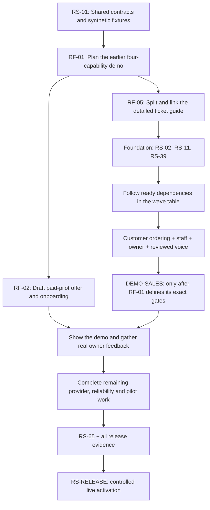
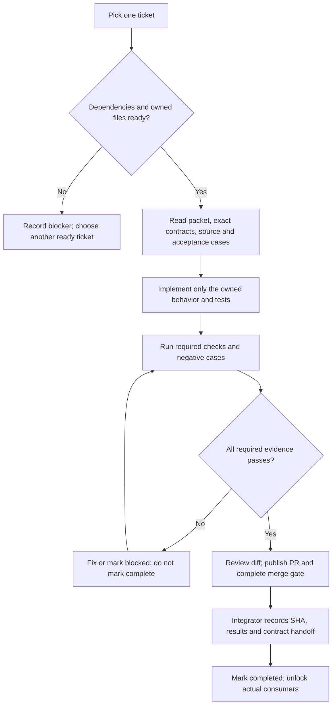
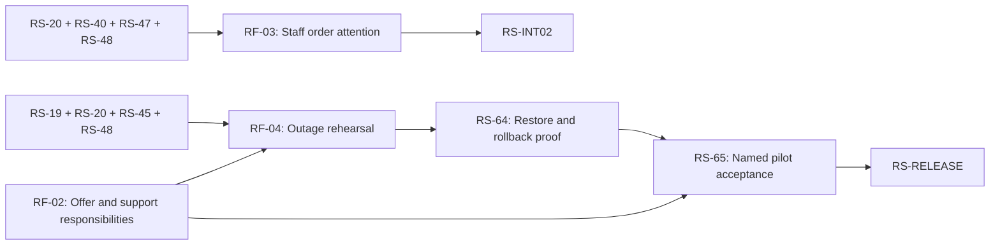

# OrderlyApp — ticket execution flow

**Full end-to-end checklist:** [All 77 entries and numbered tasks](#7-complete-numbered-plan--every-ticket-through-release).

Start with **RS-01 → RF-01 → RF-05**, then implement the ready foundation tickets. Draft the commercial offer in RF-02 alongside implementation. Do not execute tickets simply by increasing their number: **RS-67 comes before RS-04**, for example.

This is a navigation companion to [development.md](../development.md#18-restaurant-service-implementation-tickets), not a replacement for its detailed packets. It includes the PR55 review amendments. No ticket is completed by creating this guide. The baseline below is calculated from section18.7’s dependency graph; RF follow-ups add the gates explained here. Recheck merged code and evidence before selecting work.

## 1. Start here

This first diagram expresses priorities, not every dependency. `DEMO-SALES` is still a proposed milestone: **RF-01 must publish its concrete task list, safe simulation boundary and validated revised DAG.** Until then, the conservative baseline in section3 remains the executable ordering. Do not bypass RS-59’s current integration gates or assume provider implementation is unnecessary for the current graph.

| Pick | Task | What must exist when you finish |
|---|---|---|
| 1 | [RS-01](../development.md#rs-01) | Shared synthetic contract fixtures and passing Python/TypeScript checks, including the three review corrections; unresolved live provider/policy inputs remain explicitly blocked |
| 2 | [RF-01](../development.md#rf-01) | Exact earlier-demo prerequisites, bounded child tickets if needed, updated dependency graph/waves, five-minute walkthrough and no-real-send criteria |
| 3 | [RF-05](../development.md#rf-05) | A concise master index, individual detailed tickets, one maintained contract source and validated links/coverage; no lost acceptance requirements |
| Alongside the build | [RF-02](../development.md#rf-02) | Draft pilot offer, onboarding responsibilities and success criteria; demonstrated claims and payment status require actual evidence |
| First implementation wave after planning | RS-02, RS-11, RS-39 | Additive restaurant schema; pricing/receipt input contract; light/dark theme foundation |

RS-01 freezes the reviewed synthetic shapes that can be implemented. It does not invent real tax rules, provider payloads or legal policy. RF-01 changes any affected drafts and fixture examples together. This guide does not count as completion of RF-01 or RF-05.

## 2. How to complete one ticket

Before starting, inspect current source and confirm that upstream contracts are implemented/frozen as required. Fixture-based UI preparation is allowed only where the packet permits it; it does not satisfy a provider merge gate. Check which files another ticket owns before doing parallel work.

For completion, record the ticket ID, changed files, exact source commit, checks and their results, manual evidence when required, remaining limitations and consumers unlocked. A successful build is not a payment, privacy, concurrency or device acceptance result. Missing PostgreSQL/provider/device evidence stays blocked. The integration owner updates statuses and shared documentation after review; implementers do not race to edit the master guide.

If a required input is blocked, take another dependency-ready task. Never silently substitute synthetic behavior into live acceptance. Review the cumulative diff and contract changes after every five completed packets, as required by the main plan.

## 3. Full baseline implementation order

The table covers **all 67 RS tickets, four integration checkpoints and the release gate**. W numbers are dependency levels, not calendar weeks. Tickets in one row may run in parallel only if their exact file ownership and upstream evidence permit it. A single developer can complete them one at a time in the listed order.

You do not need every unrelated ticket in an earlier row to finish before starting a ready task. Check the selected packet’s direct dependencies. External-input tickets may have a permitted synthetic portion; their live portion stays blocked. RF-01 must regenerate this table if it changes the graph.

| Baseline wave | Tickets and outcomes |
|---|---|
| W0 | [RS-01](../development.md#rs-01): Freeze live-v1 envelopes and synthetic consumer fixtures |
| W1 | [RS-02](../development.md#rs-02): Add live restaurant configuration and table storage [RS-11](../development.md#rs-11): Freeze restaurant-specific pricing and receipt inputs [RS-39](../development.md#rs-39): Apply light/dark tokens with pre-paint preference restoration |
| W2 | [RS-03](../development.md#rs-03): Add restaurant-owned order, receipt and action ledgers [RS-67](../development.md#rs-67): Provision a disabled live restaurant without adopting mock data |
| W3 | [RS-04](../development.md#rs-04): Add memberships and an explicit initial-owner bootstrap |
| W4 | [RS-05](../development.md#rs-05): Verify Clerk session tokens in the backend |
| W5 | [RS-06](../development.md#rs-06): Authorize restaurant roles and revoke staff membership |
| W6 | [RS-07](../development.md#rs-07): Extend the same-origin gateway for explicit live routes [RS-09](../development.md#rs-09): Read and update restaurant branding and ordering hours |
| W7 | [RS-08](../development.md#rs-08): Provide staff sign-in and active restaurant selection [RS-10](../development.md#rs-10): Publish owner menu edits and staff availability edits [RS-41](../development.md#rs-41): Create a typed live API adapter with safe uncertainty |
| W8 | [RS-12](../development.md#rs-12): Create active table links without granting order access [RS-40](../development.md#rs-40): Build live role shells and stable accessible feedback |
| W9 | [RS-13](../development.md#rs-13): Serve a scoped live menu and current availability [RS-16](../development.md#rs-16): Store owner-defined public promotion rules [RS-50](../development.md#rs-50): Provide owner settings, tables and staff membership screens [RS-51](../development.md#rs-51): Provide owner menu pricing and staff availability controls |
| W10 | [RS-14](../development.md#rs-14): Persist a separate revisioned live basket [RS-24](../development.md#rs-24): Persist contacts and separate channel-consent evidence [RS-42](../development.md#rs-42): Render menu-first live ordering with fulfillment context [RS-66](../development.md#rs-66): Edit public offers in the owner marketing workspace |
| W11 | [RS-15](../development.md#rs-15): Calculate one versioned live quote [RS-26](../development.md#rs-26): Suppress a channel through an unguessable unsubscribe link [RS-27](../development.md#rs-27): Store campaign drafts, approvals and recipient work [RS-43](../development.md#rs-43): Render one live basket with responsive summary and review [RS-55](../development.md#rs-55): Capture editable browser speech with manual fallback |
| W12 | [RS-17](../development.md#rs-17): Apply promotion checks to live quotes [RS-28](../development.md#rs-28): Create and edit owner campaign drafts [RS-56](../development.md#rs-56): Parse voice against only the selected live catalog [RS-63](../development.md#rs-63): Specify retention, export and deletion policy before destructive work |
| W13 | [RS-18](../development.md#rs-18): Commit or replay one live order atomically [RS-29](../development.md#rs-29): Freeze and approve a bounded campaign preview [RS-52](../development.md#rs-52): Create a draft-first marketing screen [RS-57](../development.md#rs-57): Apply reviewed voice proposals through the same basket path |
| W14 | [RS-19](../development.md#rs-19): Read live receipts through revocable guest access [RS-30](../development.md#rs-30): Validate restaurant-owned provider configuration without exposing secrets [RS-53](../development.md#rs-53): Review exact campaign recipients, content and maximum cost |
| W15 | [RS-20](../development.md#rs-20): Read a bounded staff queue and selected order [RS-25](../development.md#rs-25): Capture optional customer marketing consent independently [RS-31](../development.md#rs-31): Send one approved SMS through MSG91 [RS-32](../development.md#rs-32): Send one approved email through SendGrid **RS-INT01**: Identity, catalog and live checkout integration |
| W16 | [RS-21](../development.md#rs-21): Apply versioned staff order transitions [RS-33](../development.md#rs-33): Claim recipient work with durable leases and cost reservations [RS-44](../development.md#rs-44): Review and submit a live pay-at-restaurant order [RS-47](../development.md#rs-47): Render the staff queue with stale-data protection |
| W17 | [RS-22](../development.md#rs-22): Record exactly one full payment [RS-34](../development.md#rs-34): Dispatch claimed work and reconcile durable outcomes [RS-45](../development.md#rs-45): Recover an uncertain live order across reload and theme changes [RS-48](../development.md#rs-48): Use one order-detail controller across phone and wide layouts |
| W18 | [RS-23](../development.md#rs-23): Append payment reversals and close settlement work [RS-35](../development.md#rs-35): Authenticate and reduce SendGrid event callbacks [RS-36](../development.md#rs-36): Reconcile SMS delivery using authenticated provider evidence [RS-46](../development.md#rs-46): Show receipt/status and separate optional marketing opt-in |
| W19 | [RS-37](../development.md#rs-37): Pause campaigns and expose safe reconciliation status [RS-49](../development.md#rs-49): Record payment and reversal through explicit inline forms |
| W20 | [RS-38](../development.md#rs-38): Read operational and campaign summaries without revenue claims [RS-58](../development.md#rs-58): Isolate synthetic role demos and deny all external side effects **RS-INT02**: Customer/staff/payment integration |
| W21 | [RS-54](../development.md#rs-54): Display campaign outcomes and owner activity summaries [RS-60](../development.md#rs-60): Expose live readiness, safe logs and worker heartbeat |
| W22 | [RS-61](../development.md#rs-61): Declare an opt-in worker and compatible deployment sequence **RS-INT03**: Campaign, worker and feedback integration |
| W23 | [RS-59](../development.md#rs-59): Present a connected sales demo with visible simulation labels |
| W24 | [RS-62](../development.md#rs-62): Add live contract and critical-path tests to existing CI |
| W25 | **RS-INT04**: Whole synthetic service and compatibility |
| W26 | [RS-64](../development.md#rs-64): Prove backup, restore and compatible rollback in isolation |
| W27 | [RS-65](../development.md#rs-65): Collect pilot pricing, provider and real-device acceptance evidence |
| W28 | **RS-RELEASE**: Controlled release after all mandatory evidence |

### Insert the follow-ups at these points

| Follow-up | Earliest useful point | Mandatory gate |
|---|---|---|
| RF-01 | After RS-01 synthetic contract work | Before scheduling the new early-demo milestone; publish and validate the revised graph first |
| RF-05 | After RF-01 plan edits settle | Before large-scale delegation; serialize documentation changes and refresh this guide’s links after extraction |
| RF-02 | Draft after RF-01, alongside implementation | Offer claims require demo proof; commercial evidence must be supplied to RS-65 |
| RF-03 | After RS-20, RS-40, RS-47 and RS-48 — baseline W17 completed for these providers | Must pass before RS-INT02; no concurrent edits with RS-48’s queue ownership |
| RF-04 | After RS-19, RS-20, RS-45 and RS-48; after RF-02 when support/onboarding wording overlaps | Rehearse and pass before RS-64/65 outage acceptance |

The last diagram shows added gates only. All other dependencies in the wave table and detailed DAG remain required.

## 4. What each checkpoint proves

| Checkpoint | What must work | What it does not establish |
|---|---|---|
| RS-INT01 | Tenant/guest isolation, atomic order submission, same-attempt recovery and immutable receipts | Real restaurant pricing/policy approval |
| RS-INT02, including RF-03 | Customer-to-staff flow, separate order/payment states, reversal and staff attention | Actual bank settlement or online payment |
| RS-INT03 | Approved campaign, bounded reservations, suppression, crash handling and authenticated-feedback logic under the specified test setup | Live provider onboarding, real recipient consent or sales uplift |
| DEMO-SALES, once specified by RF-01 | Ordering, management, simulated marketing and reviewed voice in an isolated demonstration | Permission for real orders, payments or messages |
| RS-INT04 | Connected synthetic service, UI behavior and mock compatibility | Full live launch readiness |
| RS-64 plus RF-04 | Recovery/rollback and safe manual-service rehearsal with retained uncertainty | Acceptance on an untested deployment target |
| RS-65 plus RF-02 | Named restaurant, device, provider, policy and commercial evidence | Payment received without actual payment evidence |
| RS-RELEASE | All mandatory task/gate evidence, named target, safe activation and support ownership | Automatic completion of future online payments, delivery or aggregator work |

## 5. Collect live inputs early

Start collecting these while foundation work proceeds; do not wait until RS-65 to discover they are missing.

| Input | Collect | Affected work |
|---|---|---|
| U1 | Actual pricing, tax/charge rules, business identity and receipt examples | RS-11, live quote/checkout and pilot acceptance |
| U2 | Retention, deletion/export, backup and recovery policy | RS-63/64/65; add any policy implementation tickets before activation |
| U3 | Restaurant-owned provider accounts, sender/template eligibility, charge ceilings and authenticated reconciliation evidence | RS-30–37 and real channel acceptance |
| U4 | Pilot owner/staff, devices, languages, workload, support and agreed success criteria | RF-02/03/04, RS-65 and release |

Missing input may block live acceptance without blocking a packet’s explicitly permitted synthetic work. If resolving an input reveals new implementation requirements, create bounded tickets and update the graph; do not hide them inside a release checklist.

## 6. The immediate next action

Open [RS-01](../development.md#rs-01), implement its permitted synthetic contracts/fixtures and prove its acceptance cases. Apply [the three contract corrections](../development.md#18171-contract-corrections-required-before-fixture-freeze). Then complete [RF-01](../development.md#rf-01) and refresh this execution guide from its validated graph.

This guide is an execution map. It does not run implementations, mark tickets completed, publish a PR or deploy a service.

## 7. Complete numbered plan — every ticket through release

This is **one safe serial execution order** for the current restaurant-service scope: **77 entries = 67 RS tickets + 5 RF follow-ups + 4 integration checkpoints + 1 release gate**. It includes every current ticket through live release, not just the beginning. Earlier ST/history/discovery roadmap tickets retain their separate scope and evidence; online payments, delivery and aggregators have no implementation tickets in this scope and are not invented here.

**Numbering:** `Step 01` is a position in this suggested execution order. `RS-01` is the stable ticket ID. `RS-01.01` is its first task in this guide. The new task suffixes label the existing implementation steps (and a final acceptance/handoff task); RF task lists summarize their source packets. They do not replace the packet's acceptance criteria, owned files or security rules. The dependency graph and exact source packet remain authoritative if implementation changes.

**Important:** this conservative sequence reaches the end without pretending RF-01 has already redesigned the early-demo path. Completing RF-01 may insert child tickets or move dependency-safe demo work earlier; update this guide and revalidate the order then. External U1–U4 inputs may block completion even when a ticket's synthetic portion is done. RF-02 can be drafted early; do not fabricate customer evidence to check it off. Independent ready work may proceed while external input is pending.

### 7.1 Every ticket in one diagram

Arrows below mean **suggested next ticket for one implementer**, not that every adjacent pair has a runtime dependency. Direct prerequisites appear in each ticket checklist. The full source DAG still governs parallel work.

```mermaid
flowchart TD
    subgraph B0["Execution steps 01–10"]
        N1["01 · RS-01"]
        N2["02 · RF-01"]
        N3["03 · RF-05"]
        N4["04 · RF-02"]
        N5["05 · RS-02"]
        N6["06 · RS-11"]
        N7["07 · RS-39"]
        N8["08 · RS-03"]
        N9["09 · RS-67"]
        N10["10 · RS-04"]
    end
    subgraph B1["Execution steps 11–20"]
        N11["11 · RS-05"]
        N12["12 · RS-06"]
        N13["13 · RS-07"]
        N14["14 · RS-09"]
        N15["15 · RS-08"]
        N16["16 · RS-10"]
        N17["17 · RS-41"]
        N18["18 · RS-12"]
        N19["19 · RS-40"]
        N20["20 · RS-13"]
    end
    subgraph B2["Execution steps 21–30"]
        N21["21 · RS-16"]
        N22["22 · RS-50"]
        N23["23 · RS-51"]
        N24["24 · RS-14"]
        N25["25 · RS-24"]
        N26["26 · RS-42"]
        N27["27 · RS-66"]
        N28["28 · RS-15"]
        N29["29 · RS-26"]
        N30["30 · RS-27"]
    end
    subgraph B3["Execution steps 31–40"]
        N31["31 · RS-43"]
        N32["32 · RS-55"]
        N33["33 · RS-17"]
        N34["34 · RS-28"]
        N35["35 · RS-56"]
        N36["36 · RS-63"]
        N37["37 · RS-18"]
        N38["38 · RS-29"]
        N39["39 · RS-52"]
        N40["40 · RS-57"]
    end
    subgraph B4["Execution steps 41–50"]
        N41["41 · RS-19"]
        N42["42 · RS-30"]
        N43["43 · RS-53"]
        N44["44 · RS-20"]
        N45["45 · RS-25"]
        N46["46 · RS-31"]
        N47["47 · RS-32"]
        N48["48 · RS-INT01"]
        N49["49 · RS-21"]
        N50["50 · RS-33"]
    end
    subgraph B5["Execution steps 51–60"]
        N51["51 · RS-44"]
        N52["52 · RS-47"]
        N53["53 · RS-22"]
        N54["54 · RS-34"]
        N55["55 · RS-45"]
        N56["56 · RS-48"]
        N57["57 · RF-03"]
        N58["58 · RF-04"]
        N59["59 · RS-23"]
        N60["60 · RS-35"]
    end
    subgraph B6["Execution steps 61–70"]
        N61["61 · RS-36"]
        N62["62 · RS-46"]
        N63["63 · RS-37"]
        N64["64 · RS-49"]
        N65["65 · RS-38"]
        N66["66 · RS-58"]
        N67["67 · RS-INT02"]
        N68["68 · RS-54"]
        N69["69 · RS-60"]
        N70["70 · RS-61"]
    end
    subgraph B7["Execution steps 71–77"]
        N71["71 · RS-INT03"]
        N72["72 · RS-59"]
        N73["73 · RS-62"]
        N74["74 · RS-INT04"]
        N75["75 · RS-64"]
        N76["76 · RS-65"]
        N77["77 · RS-RELEASE"]
    end
    N1 --> N2
    N2 --> N3
    N3 --> N4
    N4 --> N5
    N5 --> N6
    N6 --> N7
    N7 --> N8
    N8 --> N9
    N9 --> N10
    N10 --> N11
    N11 --> N12
    N12 --> N13
    N13 --> N14
    N14 --> N15
    N15 --> N16
    N16 --> N17
    N17 --> N18
    N18 --> N19
    N19 --> N20
    N20 --> N21
    N21 --> N22
    N22 --> N23
    N23 --> N24
    N24 --> N25
    N25 --> N26
    N26 --> N27
    N27 --> N28
    N28 --> N29
    N29 --> N30
    N30 --> N31
    N31 --> N32
    N32 --> N33
    N33 --> N34
    N34 --> N35
    N35 --> N36
    N36 --> N37
    N37 --> N38
    N38 --> N39
    N39 --> N40
    N40 --> N41
    N41 --> N42
    N42 --> N43
    N43 --> N44
    N44 --> N45
    N45 --> N46
    N46 --> N47
    N47 --> N48
    N48 --> N49
    N49 --> N50
    N50 --> N51
    N51 --> N52
    N52 --> N53
    N53 --> N54
    N54 --> N55
    N55 --> N56
    N56 --> N57
    N57 --> N58
    N58 --> N59
    N59 --> N60
    N60 --> N61
    N61 --> N62
    N62 --> N63
    N63 --> N64
    N64 --> N65
    N65 --> N66
    N66 --> N67
    N67 --> N68
    N68 --> N69
    N69 --> N70
    N70 --> N71
    N71 --> N72
    N72 --> N73
    N73 --> N74
    N74 --> N75
    N75 --> N76
    N76 --> N77
```

### 7.2 Numbered ticket index

| Step | Ticket | Outcome | Task numbers |
|---|---|---|---|
| 01 | [RS-01](#run-rs-01) | Freeze live-v1 envelopes and synthetic consumer fixtures | RS-01.01–RS-01.05 |
| 02 | [RF-01](#run-rf-01) | Define an earlier complete synthetic sales demo | RF-01.01–RF-01.05 |
| 03 | [RF-05](#run-rf-05) | Split the master guide without losing executable ticket context | RF-05.01–RF-05.05 |
| 04 | [RF-02](#run-rf-02) | Prepare the paid-pilot offer and evidence checklist | RF-02.01–RF-02.05 |
| 05 | [RS-02](#run-rs-02) | Add live restaurant configuration and table storage | RS-02.01–RS-02.05 |
| 06 | [RS-11](#run-rs-11) | Freeze restaurant-specific pricing and receipt inputs | RS-11.01–RS-11.05 |
| 07 | [RS-39](#run-rs-39) | Apply light/dark tokens with pre-paint preference restoration | RS-39.01–RS-39.05 |
| 08 | [RS-03](#run-rs-03) | Add restaurant-owned order, receipt and action ledgers | RS-03.01–RS-03.05 |
| 09 | [RS-67](#run-rs-67) | Provision a disabled live restaurant without adopting mock data | RS-67.01–RS-67.05 |
| 10 | [RS-04](#run-rs-04) | Add memberships and an explicit initial-owner bootstrap | RS-04.01–RS-04.05 |
| 11 | [RS-05](#run-rs-05) | Verify Clerk session tokens in the backend | RS-05.01–RS-05.05 |
| 12 | [RS-06](#run-rs-06) | Authorize restaurant roles and revoke staff membership | RS-06.01–RS-06.05 |
| 13 | [RS-07](#run-rs-07) | Extend the same-origin gateway for explicit live routes | RS-07.01–RS-07.05 |
| 14 | [RS-09](#run-rs-09) | Read and update restaurant branding and ordering hours | RS-09.01–RS-09.05 |
| 15 | [RS-08](#run-rs-08) | Provide staff sign-in and active restaurant selection | RS-08.01–RS-08.05 |
| 16 | [RS-10](#run-rs-10) | Publish owner menu edits and staff availability edits | RS-10.01–RS-10.05 |
| 17 | [RS-41](#run-rs-41) | Create a typed live API adapter with safe uncertainty | RS-41.01–RS-41.05 |
| 18 | [RS-12](#run-rs-12) | Create active table links without granting order access | RS-12.01–RS-12.05 |
| 19 | [RS-40](#run-rs-40) | Build live role shells and stable accessible feedback | RS-40.01–RS-40.05 |
| 20 | [RS-13](#run-rs-13) | Serve a scoped live menu and current availability | RS-13.01–RS-13.05 |
| 21 | [RS-16](#run-rs-16) | Store owner-defined public promotion rules | RS-16.01–RS-16.05 |
| 22 | [RS-50](#run-rs-50) | Provide owner settings, tables and staff membership screens | RS-50.01–RS-50.05 |
| 23 | [RS-51](#run-rs-51) | Provide owner menu pricing and staff availability controls | RS-51.01–RS-51.05 |
| 24 | [RS-14](#run-rs-14) | Persist a separate revisioned live basket | RS-14.01–RS-14.05 |
| 25 | [RS-24](#run-rs-24) | Persist contacts and separate channel-consent evidence | RS-24.01–RS-24.05 |
| 26 | [RS-42](#run-rs-42) | Render menu-first live ordering with fulfillment context | RS-42.01–RS-42.05 |
| 27 | [RS-66](#run-rs-66) | Edit public offers in the owner marketing workspace | RS-66.01–RS-66.05 |
| 28 | [RS-15](#run-rs-15) | Calculate one versioned live quote | RS-15.01–RS-15.05 |
| 29 | [RS-26](#run-rs-26) | Suppress a channel through an unguessable unsubscribe link | RS-26.01–RS-26.05 |
| 30 | [RS-27](#run-rs-27) | Store campaign drafts, approvals and recipient work | RS-27.01–RS-27.05 |
| 31 | [RS-43](#run-rs-43) | Render one live basket with responsive summary and review | RS-43.01–RS-43.05 |
| 32 | [RS-55](#run-rs-55) | Capture editable browser speech with manual fallback | RS-55.01–RS-55.05 |
| 33 | [RS-17](#run-rs-17) | Apply promotion checks to live quotes | RS-17.01–RS-17.05 |
| 34 | [RS-28](#run-rs-28) | Create and edit owner campaign drafts | RS-28.01–RS-28.05 |
| 35 | [RS-56](#run-rs-56) | Parse voice against only the selected live catalog | RS-56.01–RS-56.05 |
| 36 | [RS-63](#run-rs-63) | Specify retention, export and deletion policy before destructive work | RS-63.01–RS-63.05 |
| 37 | [RS-18](#run-rs-18) | Commit or replay one live order atomically | RS-18.01–RS-18.06 |
| 38 | [RS-29](#run-rs-29) | Freeze and approve a bounded campaign preview | RS-29.01–RS-29.05 |
| 39 | [RS-52](#run-rs-52) | Create a draft-first marketing screen | RS-52.01–RS-52.05 |
| 40 | [RS-57](#run-rs-57) | Apply reviewed voice proposals through the same basket path | RS-57.01–RS-57.05 |
| 41 | [RS-19](#run-rs-19) | Read live receipts through revocable guest access | RS-19.01–RS-19.05 |
| 42 | [RS-30](#run-rs-30) | Validate restaurant-owned provider configuration without exposing secrets | RS-30.01–RS-30.05 |
| 43 | [RS-53](#run-rs-53) | Review exact campaign recipients, content and maximum cost | RS-53.01–RS-53.05 |
| 44 | [RS-20](#run-rs-20) | Read a bounded staff queue and selected order | RS-20.01–RS-20.05 |
| 45 | [RS-25](#run-rs-25) | Capture optional customer marketing consent independently | RS-25.01–RS-25.05 |
| 46 | [RS-31](#run-rs-31) | Send one approved SMS through MSG91 | RS-31.01–RS-31.05 |
| 47 | [RS-32](#run-rs-32) | Send one approved email through SendGrid | RS-32.01–RS-32.05 |
| 48 | [RS-INT01](#run-rs-int01) | Identity, catalog and live checkout | RS-INT01.01–RS-INT01.06 |
| 49 | [RS-21](#run-rs-21) | Apply versioned staff order transitions | RS-21.01–RS-21.05 |
| 50 | [RS-33](#run-rs-33) | Claim recipient work with durable leases and cost reservations | RS-33.01–RS-33.06 |
| 51 | [RS-44](#run-rs-44) | Review and submit a live pay-at-restaurant order | RS-44.01–RS-44.05 |
| 52 | [RS-47](#run-rs-47) | Render the staff queue with stale-data protection | RS-47.01–RS-47.05 |
| 53 | [RS-22](#run-rs-22) | Record exactly one full payment | RS-22.01–RS-22.05 |
| 54 | [RS-34](#run-rs-34) | Dispatch claimed work and reconcile durable outcomes | RS-34.01–RS-34.05 |
| 55 | [RS-45](#run-rs-45) | Recover an uncertain live order across reload and theme changes | RS-45.01–RS-45.05 |
| 56 | [RS-48](#run-rs-48) | Use one order-detail controller across phone and wide layouts | RS-48.01–RS-48.05 |
| 57 | [RF-03](#run-rf-03) | Make new and waiting orders noticeable to staff | RF-03.01–RF-03.05 |
| 58 | [RF-04](#run-rf-04) | Rehearse manual service during outages without duplicate orders | RF-04.01–RF-04.05 |
| 59 | [RS-23](#run-rs-23) | Append payment reversals and close settlement work | RS-23.01–RS-23.05 |
| 60 | [RS-35](#run-rs-35) | Authenticate and reduce SendGrid event callbacks | RS-35.01–RS-35.05 |
| 61 | [RS-36](#run-rs-36) | Reconcile SMS delivery using authenticated provider evidence | RS-36.01–RS-36.05 |
| 62 | [RS-46](#run-rs-46) | Show receipt/status and separate optional marketing opt-in | RS-46.01–RS-46.05 |
| 63 | [RS-37](#run-rs-37) | Pause campaigns and expose safe reconciliation status | RS-37.01–RS-37.05 |
| 64 | [RS-49](#run-rs-49) | Record payment and reversal through explicit inline forms | RS-49.01–RS-49.05 |
| 65 | [RS-38](#run-rs-38) | Read operational and campaign summaries without revenue claims | RS-38.01–RS-38.05 |
| 66 | [RS-58](#run-rs-58) | Isolate synthetic role demos and deny all external side effects | RS-58.01–RS-58.05 |
| 67 | [RS-INT02](#run-rs-int02) | Customer and staff operational/payment handoff | RS-INT02.01–RS-INT02.06 |
| 68 | [RS-54](#run-rs-54) | Display campaign outcomes and owner activity summaries | RS-54.01–RS-54.05 |
| 69 | [RS-60](#run-rs-60) | Expose live readiness, safe logs and worker heartbeat | RS-60.01–RS-60.05 |
| 70 | [RS-61](#run-rs-61) | Declare an opt-in worker and compatible deployment sequence | RS-61.01–RS-61.05 |
| 71 | [RS-INT03](#run-rs-int03) | Campaign approval, worker and feedback handoff | RS-INT03.01–RS-INT03.06 |
| 72 | [RS-59](#run-rs-59) | Present a connected sales demo with visible simulation labels | RS-59.01–RS-59.05 |
| 73 | [RS-62](#run-rs-62) | Add live contract and critical-path tests to existing CI | RS-62.01–RS-62.05 |
| 74 | [RS-INT04](#run-rs-int04) | Whole synthetic service and compatibility | RS-INT04.01–RS-INT04.06 |
| 75 | [RS-64](#run-rs-64) | Prove backup, restore and compatible rollback in isolation | RS-64.01–RS-64.05 |
| 76 | [RS-65](#run-rs-65) | Collect pilot pricing, provider and real-device acceptance evidence | RS-65.01–RS-65.05 |
| 77 | [RS-RELEASE](#run-rs-release) | Controlled live release and final acceptance | RS-RELEASE.01–RS-RELEASE.09 |

### 7.3 Task-by-task checklist

All boxes start unchecked. This guide records planned work, not a new acceptance assessment.

#### Step 01 — RS-01: Freeze live-v1 envelopes and synthetic consumer fixtures

**Source:** [Full ticket / gate](../development.md#rs-01). **Status:** Not completed.

**Prerequisites in this serial plan:** Approved plan and repository evidence; no earlier ticket.

- [ ] **RS-01.01** — Copy exact proposed payloads and errors into the contract document; identify implementation-only versus U1–U4-dependent fields.
- [ ] **RS-01.02** — Create valid JSON request/response fixtures for each route group and schema-version discriminants.
- [ ] **RS-01.03** — Write TypeScript and Python fixture readers with assertions for required fields, enum values, nullability and negative cases; do not generate application behavior.
- [ ] **RS-01.04** — Add the required cases below in this ticket’s test files; record command/output and request/schema versions. Supply the documentation delta and diff review before marking complete.
- [ ] **RS-01.05** — Verify all numbered acceptance criteria and required evidence in the source packet; review/merge under the applicable authorization, record source SHA and handoff, then update completion status. Unrun or blocked checks are not passes.

**Then:** proceed to [RF-01](#run-rf-01) when ready, or choose another dependency-ready task while blocked.

#### Step 02 — RF-01: Define an earlier complete synthetic sales demo

**Source:** [Full ticket / gate](../development.md#rf-01). **Status:** Not completed.

**Prerequisites in this serial plan:** RS-01

- [ ] **RF-01.01** — Inventory every provider, route and fixture needed by the four-capability demo.
- [ ] **RF-01.02** — Separate simulated marketing/demo evidence from live provider activation; define bounded child tickets for missing work.
- [ ] **RF-01.03** — Update affected contracts, exact ownership, dependency graph, waves and early-demo acceptance gates together.
- [ ] **RF-01.04** — Write the five-minute walkthrough, prove the revised graph is acyclic and hand off the implementation prerequisites; do not claim the demo is built.
- [ ] **RF-01.05** — Verify all numbered acceptance criteria and required evidence in the source packet; review/merge under the applicable authorization, record source SHA and handoff, then update completion status. Unrun or blocked checks are not passes.

**Then:** proceed to [RF-05](#run-rf-05) when ready, or choose another dependency-ready task while blocked.

#### Step 03 — RF-05: Split the master guide without losing executable ticket context

**Source:** [Full ticket / gate](../development.md#rf-05). **Status:** Not completed.

**Prerequisites in this serial plan:** RF-01

- [ ] **RF-05.01** — Inventory all original tickets, follow-ups, statuses, contract references, dependency edges and evidence links before moving text.
- [ ] **RF-05.02** — Move detailed packets to individual files and maintain one draft contract source; preserve full contract context for exported builder handoffs.
- [ ] **RF-05.03** — Reduce the master guide to roadmap/status/decisions/gates, preserve historical evidence and repair relative links and execution-guide links.
- [ ] **RF-05.04** — Compare before/after inventories, validate links and sample checkout/worker/UI handoffs; review the move-only diff and leave implementation statuses unchanged.
- [ ] **RF-05.05** — Verify all numbered acceptance criteria and required evidence in the source packet; review/merge under the applicable authorization, record source SHA and handoff, then update completion status. Unrun or blocked checks are not passes.

**Then:** proceed to [RF-02](#run-rf-02) when ready, or choose another dependency-ready task while blocked.

#### Step 04 — RF-02: Prepare the paid-pilot offer and evidence checklist

**Source:** [Full ticket / gate](../development.md#rf-02). **Status:** Not completed.

**Prerequisites in this serial plan:** RF-01, RF-05

- [ ] **RF-02.01** — Draft setup/recurring charges, included service, exclusions, messaging/hosting responsibility and payment terms; mark undecided values explicitly.
- [ ] **RF-02.02** — Document menu/table/staff onboarding, training, support owner, pilot duration and exit/data-handoff responsibilities.
- [ ] **RF-02.03** — Define jointly agreed pilot metrics, baseline, observation window and continue/revise/stop decision; keep evidence private where appropriate.
- [ ] **RF-02.04** — Review every sales claim against demonstrated evidence; hand the commercial checklist to RS-65. Customer agreement and paid status remain blocked until real evidence exists.
- [ ] **RF-02.05** — Verify all numbered acceptance criteria and required evidence in the source packet; review/merge under the applicable authorization, record source SHA and handoff, then update completion status. Unrun or blocked checks are not passes.

**Then:** proceed to [RS-02](#run-rs-02) when ready, or choose another dependency-ready task while blocked.

#### Step 05 — RS-02: Add live restaurant configuration and table storage

**Source:** [Full ticket / gate](../development.md#rs-02). **Status:** Not completed.

**Prerequisites in this serial plan:** RF-05, RS-01

- [ ] **RS-02.01** — Add only the two DB-A tables and their checks/indexes; never seed or activate restaurants in migration.
- [ ] **RS-02.02** — Prove disabled defaults, table uniqueness per restaurant and FK isolation.
- [ ] **RS-02.03** — Apply 001–007 twice with the existing migration runner; retain migration checksums.
- [ ] **RS-02.04** — Add the required cases below in this ticket’s test files; record command/output and request/schema versions. Supply the documentation delta and diff review before marking complete.
- [ ] **RS-02.05** — Verify all numbered acceptance criteria and required evidence in the source packet; review/merge under the applicable authorization, record source SHA and handoff, then update completion status. Unrun or blocked checks are not passes.

**Then:** proceed to [RS-11](#run-rs-11) when ready, or choose another dependency-ready task while blocked.

#### Step 06 — RS-11: Freeze restaurant-specific pricing and receipt inputs

**Source:** [Full ticket / gate](../development.md#rs-11). **Status:** Not completed.

**Prerequisites in this serial plan:** RF-05, RS-01

- [ ] **RS-11.01** — Write synthetic input/output vectors for zero discount, capped discount, rounding boundary and total.
- [ ] **RS-11.02** — Request verified business/tax/receipt values only from authorized owner/accountant; record source/date, not credentials.
- [ ] **RS-11.03** — Set live_ready=false while any field lacks evidence; do not infer Indian tax rates from sample code.
- [ ] **RS-11.04** — Add the required cases below in this ticket’s test files; record command/output and request/schema versions. Supply the documentation delta and diff review before marking complete.
- [ ] **RS-11.05** — Verify all numbered acceptance criteria and required evidence in the source packet; review/merge under the applicable authorization, record source SHA and handoff, then update completion status. Unrun or blocked checks are not passes.

**Then:** proceed to [RS-39](#run-rs-39) when ready, or choose another dependency-ready task while blocked.

#### Step 07 — RS-39: Apply light/dark tokens with pre-paint preference restoration

**Source:** [Full ticket / gate](../development.md#rs-39). **Status:** Not completed.

**Prerequisites in this serial plan:** RF-05, RS-01

- [ ] **RS-39.01** — Implement tiny allowlisted bootstrap in root layout; confirm actual CSP and first hydration shape without suppressing unrelated errors.
- [ ] **RS-39.02** — Scope flat colors/type/focus/link tokens to live task screens while honoring global native color-scheme.
- [ ] **RS-39.03** — Use IBM Plex Sans with visible fallback; verify licensed asset/build availability with installed Next. Keep16px minimum meaningful text, rem sizing and3px focus outline/offset.
- [ ] **RS-39.04** — Add the required cases below in this ticket’s test files; record command/output and request/schema versions. Supply the documentation delta and diff review before marking complete.
- [ ] **RS-39.05** — Verify all numbered acceptance criteria and required evidence in the source packet; review/merge under the applicable authorization, record source SHA and handoff, then update completion status. Unrun or blocked checks are not passes.

**Then:** proceed to [RS-03](#run-rs-03) when ready, or choose another dependency-ready task while blocked.

#### Step 08 — RS-03: Add restaurant-owned order, receipt and action ledgers

**Source:** [Full ticket / gate](../development.md#rs-03). **Status:** Not completed.

**Prerequisites in this serial plan:** RF-05, RS-01, RS-02

- [ ] **RS-03.01** — Create DB-B tables and immutable-history database protections; only operational status/version and active access may mutate.
- [ ] **RS-03.02** — Add replay uniqueness and one active full payment constraint through a locked order plus event-derived state; do not make old guest_orders live.
- [ ] **RS-03.03** — Exercise guest cleanup on a guest linked to a live receipt.
- [ ] **RS-03.04** — Add the required cases below in this ticket’s test files; record command/output and request/schema versions. Supply the documentation delta and diff review before marking complete.
- [ ] **RS-03.05** — Verify all numbered acceptance criteria and required evidence in the source packet; review/merge under the applicable authorization, record source SHA and handoff, then update completion status. Unrun or blocked checks are not passes.

**Then:** proceed to [RS-67](#run-rs-67) when ready, or choose another dependency-ready task while blocked.

#### Step 09 — RS-67: Provision a disabled live restaurant without adopting mock data

**Source:** [Full ticket / gate](../development.md#rs-67). **Status:** Not completed.

**Prerequisites in this serial plan:** RF-05, RS-01, RS-02

- [ ] **RS-67.01** — Validate file schema using bounded input (64KiB), no secrets/contact data; require explicit target environment.
- [ ] **RS-67.02** — Insert new catalog identity and disabled live settings in one transaction; output safe ID only.
- [ ] **RS-67.03** — Document order: provision -> bootstrap verified owner -> settings/menu/tables/pricing -> acceptance -> enable via operator gate. No self-service tenant enrollment.
- [ ] **RS-67.04** — Add the required cases below in this ticket’s test files; record command/output and request/schema versions. Supply the documentation delta and diff review before marking complete.
- [ ] **RS-67.05** — Verify all numbered acceptance criteria and required evidence in the source packet; review/merge under the applicable authorization, record source SHA and handoff, then update completion status. Unrun or blocked checks are not passes.

**Then:** proceed to [RS-04](#run-rs-04) when ready, or choose another dependency-ready task while blocked.

#### Step 10 — RS-04: Add memberships and an explicit initial-owner bootstrap

**Source:** [Full ticket / gate](../development.md#rs-04). **Status:** Not completed.

**Prerequisites in this serial plan:** RF-05, RS-01, RS-03, RS-67

- [ ] **RS-04.01** — Create membership table, unique key and role checks.
- [ ] **RS-04.02** — Implement CLI using get_connection; require existing disabled restaurant and exact Clerk subject, no email-based inference.
- [ ] **RS-04.03** — Record bootstrap audit event without credentials; document that production invocation needs verified operator access.
- [ ] **RS-04.04** — Add the required cases below in this ticket’s test files; record command/output and request/schema versions. Supply the documentation delta and diff review before marking complete.
- [ ] **RS-04.05** — Verify all numbered acceptance criteria and required evidence in the source packet; review/merge under the applicable authorization, record source SHA and handoff, then update completion status. Unrun or blocked checks are not passes.

**Then:** proceed to [RS-05](#run-rs-05) when ready, or choose another dependency-ready task while blocked.

#### Step 11 — RS-05: Verify Clerk session tokens in the backend

**Source:** [Full ticket / gate](../development.md#rs-05). **Status:** Not completed.

**Prerequisites in this serial plan:** RF-05, RS-01, RS-04

- [ ] **RS-05.01** — Add maintained JWT verification dependency and lock its resolved version; do not implement RSA primitives.
- [ ] **RS-05.02** — Validate issuer, algorithm, time claims and configured azp against fixed trusted URLs; reject token-supplied jwks/jku URLs.
- [ ] **RS-05.03** — Use 5-second JWKS timeout and fail closed without stale unbounded keys; expose only verified sub to membership lookup.
- [ ] **RS-05.04** — Add the required cases below in this ticket’s test files; record command/output and request/schema versions. Supply the documentation delta and diff review before marking complete.
- [ ] **RS-05.05** — Verify all numbered acceptance criteria and required evidence in the source packet; review/merge under the applicable authorization, record source SHA and handoff, then update completion status. Unrun or blocked checks are not passes.

**Then:** proceed to [RS-06](#run-rs-06) when ready, or choose another dependency-ready task while blocked.

#### Step 12 — RS-06: Authorize restaurant roles and revoke staff membership

**Source:** [Full ticket / gate](../development.md#rs-06). **Status:** Not completed.

**Prerequisites in this serial plan:** RF-05, RS-01, RS-05

- [ ] **RS-06.01** — Read verified identity from CON-05; never trust role or restaurant in token/browser.
- [ ] **RS-06.02** — Scope queries by restaurant; lock restaurant/membership for updates and preserve at least one owner.
- [ ] **RS-06.03** — Mount additive router once in main.py; serialize later router edits through this owner.
- [ ] **RS-06.04** — Add the required cases below in this ticket’s test files; record command/output and request/schema versions. Supply the documentation delta and diff review before marking complete.
- [ ] **RS-06.05** — Verify all numbered acceptance criteria and required evidence in the source packet; review/merge under the applicable authorization, record source SHA and handoff, then update completion status. Unrun or blocked checks are not passes.

**Then:** proceed to [RS-07](#run-rs-07) when ready, or choose another dependency-ready task while blocked.

#### Step 13 — RS-07: Extend the same-origin gateway for explicit live routes

**Source:** [Full ticket / gate](../development.md#rs-07). **Status:** Not completed.

**Prerequisites in this serial plan:** RF-05, RS-01, RS-06

- [ ] **RS-07.01** — Enumerate exact live path patterns and methods; reject arbitrary upstream paths and extra query keys.
- [ ] **RS-07.02** — Forward the Clerk bearer header only across the fixed trusted upstream boundary, never logs.
- [ ] **RS-07.03** — Preserve existing cookie rewrite, no-store and timeout classifications for mock requests.
- [ ] **RS-07.04** — Add the required cases below in this ticket’s test files; record command/output and request/schema versions. Supply the documentation delta and diff review before marking complete.
- [ ] **RS-07.05** — Verify all numbered acceptance criteria and required evidence in the source packet; review/merge under the applicable authorization, record source SHA and handoff, then update completion status. Unrun or blocked checks are not passes.

**Then:** proceed to [RS-09](#run-rs-09) when ready, or choose another dependency-ready task while blocked.

#### Step 14 — RS-09: Read and update restaurant branding and ordering hours

**Source:** [Full ticket / gate](../development.md#rs-09). **Status:** Not completed.

**Prerequisites in this serial plan:** RF-05, RS-01, RS-06

- [ ] **RS-09.01** — Validate non-overlapping Hours intervals and normalize ordering before persistence.
- [ ] **RS-09.02** — Update version under lock; stale edit409 version_conflict with current settings.
- [ ] **RS-09.03** — Name/brand/hours affect future catalog/quote only; never mutate snapshots.
- [ ] **RS-09.04** — Add the required cases below in this ticket’s test files; record command/output and request/schema versions. Supply the documentation delta and diff review before marking complete.
- [ ] **RS-09.05** — Verify all numbered acceptance criteria and required evidence in the source packet; review/merge under the applicable authorization, record source SHA and handoff, then update completion status. Unrun or blocked checks are not passes.

**Then:** proceed to [RS-08](#run-rs-08) when ready, or choose another dependency-ready task while blocked.

#### Step 15 — RS-08: Provide staff sign-in and active restaurant selection

**Source:** [Full ticket / gate](../development.md#rs-08). **Status:** Not completed.

**Prerequisites in this serial plan:** RF-05, RS-01, RS-07

- [ ] **RS-08.01** — Install @clerk/nextjs compatible with current Next/React and lock it, without unrelated upgrades.
- [ ] **RS-08.02** — Keep Clerk provider confined to staff subtree so guest ordering does not depend on identity provider availability.
- [ ] **RS-08.03** — Load memberships after sign-in; show denied/empty state with owner-contact guidance; discard staff data on sign-out or restaurant change.
- [ ] **RS-08.04** — Add the required cases below in this ticket’s test files; record command/output and request/schema versions. Supply the documentation delta and diff review before marking complete.
- [ ] **RS-08.05** — Verify all numbered acceptance criteria and required evidence in the source packet; review/merge under the applicable authorization, record source SHA and handoff, then update completion status. Unrun or blocked checks are not passes.

**Then:** proceed to [RS-10](#run-rs-10) when ready, or choose another dependency-ready task while blocked.

#### Step 16 — RS-10: Publish owner menu edits and staff availability edits

**Source:** [Full ticket / gate](../development.md#rs-10). **Status:** Not completed.

**Prerequisites in this serial plan:** RF-05, RS-01, RS-09

- [ ] **RS-10.01** — Use existing canonical modifier validation and integer amount primitives.
- [ ] **RS-10.02** — Increment restaurant catalog_version in the same transaction as item changes; availability-only route rejects pricing fields.
- [ ] **RS-10.03** — Never query/update item by id without restaurant predicate.
- [ ] **RS-10.04** — Add the required cases below in this ticket’s test files; record command/output and request/schema versions. Supply the documentation delta and diff review before marking complete.
- [ ] **RS-10.05** — Verify all numbered acceptance criteria and required evidence in the source packet; review/merge under the applicable authorization, record source SHA and handoff, then update completion status. Unrun or blocked checks are not passes.

**Then:** proceed to [RS-41](#run-rs-41) when ready, or choose another dependency-ready task while blocked.

#### Step 17 — RS-41: Create a typed live API adapter with safe uncertainty

**Source:** [Full ticket / gate](../development.md#rs-41). **Status:** Not completed.

**Prerequisites in this serial plan:** RF-05, RS-01, RS-07

- [ ] **RS-41.01** — Implement only documented routes; strict runtime response checks for receipt amounts/IDs/version.
- [ ] **RS-41.02** — Pass AbortSignal for reads, keep mutation identity outside transient component render.
- [ ] **RS-41.03** — Do not broaden lib/api.ts mock receipt decoder to accept live shapes.
- [ ] **RS-41.04** — Add the required cases below in this ticket’s test files; record command/output and request/schema versions. Supply the documentation delta and diff review before marking complete.
- [ ] **RS-41.05** — Verify all numbered acceptance criteria and required evidence in the source packet; review/merge under the applicable authorization, record source SHA and handoff, then update completion status. Unrun or blocked checks are not passes.

**Then:** proceed to [RS-12](#run-rs-12) when ready, or choose another dependency-ready task while blocked.

#### Step 18 — RS-12: Create active table links without granting order access

**Source:** [Full ticket / gate](../development.md#rs-12). **Status:** Not completed.

**Prerequisites in this serial plan:** RF-05, RS-01, RS-09, RS-10

- [ ] **RS-12.01** — Create or version-update table scoped to restaurant; require unique normalized label.
- [ ] **RS-12.02** — Return canonical shareable URL with safe URL encoding.
- [ ] **RS-12.03** — Reject other restaurant table and explain inactive assignment; do not reveal guest/order IDs in table response.
- [ ] **RS-12.04** — Add the required cases below in this ticket’s test files; record command/output and request/schema versions. Supply the documentation delta and diff review before marking complete.
- [ ] **RS-12.05** — Verify all numbered acceptance criteria and required evidence in the source packet; review/merge under the applicable authorization, record source SHA and handoff, then update completion status. Unrun or blocked checks are not passes.

**Then:** proceed to [RS-40](#run-rs-40) when ready, or choose another dependency-ready task while blocked.

#### Step 19 — RS-40: Build live role shells and stable accessible feedback

**Source:** [Full ticket / gate](../development.md#rs-40). **Status:** Not completed.

**Prerequisites in this serial plan:** RF-05, RS-01, RS-08, RS-39

- [ ] **RS-40.01** — Render semantic navigation/headings and same destinations on phone/desktop; no separate sidebar.
- [ ] **RS-40.02** — Implement field-linked summary with aria-describedby and error text; one live announcement per user action.
- [ ] **RS-40.03** — Define loading shell, unavailable Retry, successful empty states and pending button text without optimistic success.
- [ ] **RS-40.04** — Add the required cases below in this ticket’s test files; record command/output and request/schema versions. Supply the documentation delta and diff review before marking complete.
- [ ] **RS-40.05** — Verify all numbered acceptance criteria and required evidence in the source packet; review/merge under the applicable authorization, record source SHA and handoff, then update completion status. Unrun or blocked checks are not passes.

**Then:** proceed to [RS-13](#run-rs-13) when ready, or choose another dependency-ready task while blocked.

#### Step 20 — RS-13: Serve a scoped live menu and current availability

**Source:** [Full ticket / gate](../development.md#rs-13). **Status:** Not completed.

**Prerequisites in this serial plan:** RF-05, RS-01, RS-06, RS-10, RS-12

- [ ] **RS-13.01** — Mount live guest router separately from staff routes.
- [ ] **RS-13.02** — Build canonical catalog scoped to one restaurant; include unavailable rows for basket reconciliation.
- [ ] **RS-13.03** — Return404 for absent/disabled-discovery tenant and503 storage_unavailable on DB failure; never fixture fallback.
- [ ] **RS-13.04** — Add the required cases below in this ticket’s test files; record command/output and request/schema versions. Supply the documentation delta and diff review before marking complete.
- [ ] **RS-13.05** — Verify all numbered acceptance criteria and required evidence in the source packet; review/merge under the applicable authorization, record source SHA and handoff, then update completion status. Unrun or blocked checks are not passes.

**Then:** proceed to [RS-16](#run-rs-16) when ready, or choose another dependency-ready task while blocked.

#### Step 21 — RS-16: Store owner-defined public promotion rules

**Source:** [Full ticket / gate](../development.md#rs-16). **Status:** Not completed.

**Prerequisites in this serial plan:** RF-05, RS-01, RS-09, RS-12

- [ ] **RS-16.01** — Create versioned offer and redemption-counter storage with unique restaurant/code.
- [ ] **RS-16.02** — Validate and audit owner edits; campaign approval captures exact version.
- [ ] **RS-16.03** — Refuse max_redemptions below consumed count and never reset count on edit.
- [ ] **RS-16.04** — Add the required cases below in this ticket’s test files; record command/output and request/schema versions. Supply the documentation delta and diff review before marking complete.
- [ ] **RS-16.05** — Verify all numbered acceptance criteria and required evidence in the source packet; review/merge under the applicable authorization, record source SHA and handoff, then update completion status. Unrun or blocked checks are not passes.

**Then:** proceed to [RS-50](#run-rs-50) when ready, or choose another dependency-ready task while blocked.

#### Step 22 — RS-50: Provide owner settings, tables and staff membership screens

**Source:** [Full ticket / gate](../development.md#rs-50). **Status:** Not completed.

**Prerequisites in this serial plan:** RF-05, RS-01, RS-06, RS-09, RS-12, RS-40, RS-41

- [ ] **RS-50.01** — Split independent forms within one page; each tracks own version/pending/error state.
- [ ] **RS-50.02** — Preserve drafts during background refresh and explain409 before overwrite.
- [ ] **RS-50.03** — Display owner inputs still missing and table share URLs; never present configuration completion as live acceptance.
- [ ] **RS-50.04** — Add the required cases below in this ticket’s test files; record command/output and request/schema versions. Supply the documentation delta and diff review before marking complete.
- [ ] **RS-50.05** — Verify all numbered acceptance criteria and required evidence in the source packet; review/merge under the applicable authorization, record source SHA and handoff, then update completion status. Unrun or blocked checks are not passes.

**Then:** proceed to [RS-51](#run-rs-51) when ready, or choose another dependency-ready task while blocked.

#### Step 23 — RS-51: Provide owner menu pricing and staff availability controls

**Source:** [Full ticket / gate](../development.md#rs-51). **Status:** Not completed.

**Prerequisites in this serial plan:** RF-05, RS-01, RS-10, RS-40, RS-41

- [ ] **RS-51.01** — Render existing canonical modifier constraints without new custom widget library.
- [ ] **RS-51.02** — Validate client input for feedback but rely on backend; list field errors.
- [ ] **RS-51.03** — Owner price changes do not update shown historical receipts.
- [ ] **RS-51.04** — Add the required cases below in this ticket’s test files; record command/output and request/schema versions. Supply the documentation delta and diff review before marking complete.
- [ ] **RS-51.05** — Verify all numbered acceptance criteria and required evidence in the source packet; review/merge under the applicable authorization, record source SHA and handoff, then update completion status. Unrun or blocked checks are not passes.

**Then:** proceed to [RS-14](#run-rs-14) when ready, or choose another dependency-ready task while blocked.

#### Step 24 — RS-14: Persist a separate revisioned live basket

**Source:** [Full ticket / gate](../development.md#rs-14). **Status:** Not completed.

**Prerequisites in this serial plan:** RF-05, RS-01, RS-03, RS-13

- [ ] **RS-14.01** — Reuse guest verification and canonical validation with selected restaurant snapshot.
- [ ] **RS-14.02** — Lock live_carts row; compare revision; accepted mutation increments exactly once. DELETE also requires revision.
- [ ] **RS-14.03** — Keep existing guest_carts and mock API behavior independent; no adoption of mock basket.
- [ ] **RS-14.04** — Add the required cases below in this ticket’s test files; record command/output and request/schema versions. Supply the documentation delta and diff review before marking complete.
- [ ] **RS-14.05** — Verify all numbered acceptance criteria and required evidence in the source packet; review/merge under the applicable authorization, record source SHA and handoff, then update completion status. Unrun or blocked checks are not passes.

**Then:** proceed to [RS-24](#run-rs-24) when ready, or choose another dependency-ready task while blocked.

#### Step 25 — RS-24: Persist contacts and separate channel-consent evidence

**Source:** [Full ticket / gate](../development.md#rs-24). **Status:** Not completed.

**Prerequisites in this serial plan:** RF-05, RS-01, RS-04, RS-16

- [ ] **RS-24.01** — Create contact/consent/suppression tables and per-channel uniqueness.
- [ ] **RS-24.02** — Normalize India phone to validated E.164 and email conservatively; reject ambiguous/non-India phone at first pilot.
- [ ] **RS-24.03** — Implement eligibility lookup based on latest consent and suppression, not contact existence.
- [ ] **RS-24.04** — Add the required cases below in this ticket’s test files; record command/output and request/schema versions. Supply the documentation delta and diff review before marking complete.
- [ ] **RS-24.05** — Verify all numbered acceptance criteria and required evidence in the source packet; review/merge under the applicable authorization, record source SHA and handoff, then update completion status. Unrun or blocked checks are not passes.

**Then:** proceed to [RS-42](#run-rs-42) when ready, or choose another dependency-ready task while blocked.

#### Step 26 — RS-42: Render menu-first live ordering with fulfillment context

**Source:** [Full ticket / gate](../development.md#rs-42). **Status:** Not completed.

**Prerequisites in this serial plan:** RF-05, RS-01, RS-13, RS-40, RS-41

- [ ] **RS-42.01** — Fetch selected menu through CON-41, abort/ignore stale restaurant reads.
- [ ] **RS-42.02** — Use existing modifier definitions for required selection and unavailable feedback; do not calculate final tax/total here.
- [ ] **RS-42.03** — Retain menu identity and basket access when closed/empty; speak button remains reviewed/manual path.
- [ ] **RS-42.04** — Add the required cases below in this ticket’s test files; record command/output and request/schema versions. Supply the documentation delta and diff review before marking complete.
- [ ] **RS-42.05** — Verify all numbered acceptance criteria and required evidence in the source packet; review/merge under the applicable authorization, record source SHA and handoff, then update completion status. Unrun or blocked checks are not passes.

**Then:** proceed to [RS-66](#run-rs-66) when ready, or choose another dependency-ready task while blocked.

#### Step 27 — RS-66: Edit public offers in the owner marketing workspace

**Source:** [Full ticket / gate](../development.md#rs-66). **Status:** Not completed.

**Prerequisites in this serial plan:** RF-05, RS-01, RS-16, RS-40, RS-41

- [ ] **RS-66.01** — Render offer code/dates/minimum/percent/cap/redemption limit and explicit Save.
- [ ] **RS-66.02** — Show consumed count read-only; explain409 conflicts and reject shrinking below consumed.
- [ ] **RS-66.03** — Link draft campaign offer selection to saved offer ID/version; saving offer invalidates affected campaign previews.
- [ ] **RS-66.04** — Add the required cases below in this ticket’s test files; record command/output and request/schema versions. Supply the documentation delta and diff review before marking complete.
- [ ] **RS-66.05** — Verify all numbered acceptance criteria and required evidence in the source packet; review/merge under the applicable authorization, record source SHA and handoff, then update completion status. Unrun or blocked checks are not passes.

**Then:** proceed to [RS-15](#run-rs-15) when ready, or choose another dependency-ready task while blocked.

#### Step 28 — RS-15: Calculate one versioned live quote

**Source:** [Full ticket / gate](../development.md#rs-15). **Status:** Not completed.

**Prerequisites in this serial plan:** RF-05, RS-01, RS-11, RS-14

- [ ] **RS-15.01** — Calculate canonical line amounts in integer paise using CON-11; reuse item unit calculation only.
- [ ] **RS-15.02** — Digest canonical relevant menu/config/fulfillment/promotion inputs, not user-entered totals; use same calculator later in submission.
- [ ] **RS-15.03** — Return changed/unavailable item details without deleting basket; no default mock delivery/service fees.
- [ ] **RS-15.04** — Add the required cases below in this ticket’s test files; record command/output and request/schema versions. Supply the documentation delta and diff review before marking complete.
- [ ] **RS-15.05** — Verify all numbered acceptance criteria and required evidence in the source packet; review/merge under the applicable authorization, record source SHA and handoff, then update completion status. Unrun or blocked checks are not passes.

**Then:** proceed to [RS-26](#run-rs-26) when ready, or choose another dependency-ready task while blocked.

#### Step 29 — RS-26: Suppress a channel through an unguessable unsubscribe link

**Source:** [Full ticket / gate](../development.md#rs-26). **Status:** Not completed.

**Prerequisites in this serial plan:** RF-05, RS-01, RS-13, RS-24

- [ ] **RS-26.01** — Issue token when campaign recipient is frozen; store only digest and scope.
- [ ] **RS-26.02** — Do not unsubscribe on GET because mail scanners follow links.
- [ ] **RS-26.03** — Serialize suppression with recipient claim checks; response never echoes destination.
- [ ] **RS-26.04** — Add the required cases below in this ticket’s test files; record command/output and request/schema versions. Supply the documentation delta and diff review before marking complete.
- [ ] **RS-26.05** — Verify all numbered acceptance criteria and required evidence in the source packet; review/merge under the applicable authorization, record source SHA and handoff, then update completion status. Unrun or blocked checks are not passes.

**Then:** proceed to [RS-27](#run-rs-27) when ready, or choose another dependency-ready task while blocked.

#### Step 30 — RS-27: Store campaign drafts, approvals and recipient work

**Source:** [Full ticket / gate](../development.md#rs-27). **Status:** Not completed.

**Prerequisites in this serial plan:** RF-05, RS-01, RS-16, RS-24

- [ ] **RS-27.01** — Create schema with restaurant-qualified FKs and unique approval recipient key.
- [ ] **RS-27.02** — Retain raw recipient destination only where needed; no credentials in these tables, only server config alias.
- [ ] **RS-27.03** — Add indexes for due queued work and provider message correlation.
- [ ] **RS-27.04** — Add the required cases below in this ticket’s test files; record command/output and request/schema versions. Supply the documentation delta and diff review before marking complete.
- [ ] **RS-27.05** — Verify all numbered acceptance criteria and required evidence in the source packet; review/merge under the applicable authorization, record source SHA and handoff, then update completion status. Unrun or blocked checks are not passes.

**Then:** proceed to [RS-43](#run-rs-43) when ready, or choose another dependency-ready task while blocked.

#### Step 31 — RS-43: Render one live basket with responsive summary and review

**Source:** [Full ticket / gate](../development.md#rs-43). **Status:** Not completed.

**Prerequisites in this serial plan:** RF-05, RS-01, RS-14, RS-42

- [ ] **RS-43.01** — Own the live restaurant layout and LiveBasketProvider in lib/live-basket-context.tsx; mount it once above menu/basket/checkout. Move menu selection into this provider without changing its route or visible entry hierarchy.
- [ ] **RS-43.02** — Mutation pending disables conflicting controls;409 displays current server basket for review.
- [ ] **RS-43.03** — Summary reads existing data only; no duplicate cart/quote calculations or checkout action.
- [ ] **RS-43.04** — Add the required cases below in this ticket’s test files; record command/output and request/schema versions. Supply the documentation delta and diff review before marking complete.
- [ ] **RS-43.05** — Verify all numbered acceptance criteria and required evidence in the source packet; review/merge under the applicable authorization, record source SHA and handoff, then update completion status. Unrun or blocked checks are not passes.

**Then:** proceed to [RS-55](#run-rs-55) when ready, or choose another dependency-ready task while blocked.

#### Step 32 — RS-55: Capture editable browser speech with manual fallback

**Source:** [Full ticket / gate](../development.md#rs-55). **Status:** Not completed.

**Prerequisites in this serial plan:** RF-05, RS-01, RS-42

- [ ] **RS-55.01** — Create one recognition instance per user session, never always-listening.
- [ ] **RS-55.02** — Render listening/processing/error/manual states with text and keyboard controls.
- [ ] **RS-55.03** — Pass transcript only on Review proposal; capture never writes cart/order.
- [ ] **RS-55.04** — Add the required cases below in this ticket’s test files; record command/output and request/schema versions. Supply the documentation delta and diff review before marking complete.
- [ ] **RS-55.05** — Verify all numbered acceptance criteria and required evidence in the source packet; review/merge under the applicable authorization, record source SHA and handoff, then update completion status. Unrun or blocked checks are not passes.

**Then:** proceed to [RS-17](#run-rs-17) when ready, or choose another dependency-ready task while blocked.

#### Step 33 — RS-17: Apply promotion checks to live quotes

**Source:** [Full ticket / gate](../development.md#rs-17). **Status:** Not completed.

**Prerequisites in this serial plan:** RF-05, RS-01, RS-15, RS-16

- [ ] **RS-17.01** — Validate restaurant, active interval [start,end), minimum, remaining allocation and current version.
- [ ] **RS-17.02** — Include code/rule version in digest and receipt preview.
- [ ] **RS-17.03** — Require fresh review when offer changes; never quietly drop discount.
- [ ] **RS-17.04** — Add the required cases below in this ticket’s test files; record command/output and request/schema versions. Supply the documentation delta and diff review before marking complete.
- [ ] **RS-17.05** — Verify all numbered acceptance criteria and required evidence in the source packet; review/merge under the applicable authorization, record source SHA and handoff, then update completion status. Unrun or blocked checks are not passes.

**Then:** proceed to [RS-28](#run-rs-28) when ready, or choose another dependency-ready task while blocked.

#### Step 34 — RS-28: Create and edit owner campaign drafts

**Source:** [Full ticket / gate](../development.md#rs-28). **Status:** Not completed.

**Prerequisites in this serial plan:** RF-05, RS-01, RS-06, RS-16, RS-27

- [ ] **RS-28.01** — Validate channel-specific fields and restaurant-owned offer.
- [ ] **RS-28.02** — Return draft even when provider setup absent, with setup status separate.
- [ ] **RS-28.03** — Require version on changes; dispatched campaign is immutable, clone via new POST for new send.
- [ ] **RS-28.04** — Add the required cases below in this ticket’s test files; record command/output and request/schema versions. Supply the documentation delta and diff review before marking complete.
- [ ] **RS-28.05** — Verify all numbered acceptance criteria and required evidence in the source packet; review/merge under the applicable authorization, record source SHA and handoff, then update completion status. Unrun or blocked checks are not passes.

**Then:** proceed to [RS-56](#run-rs-56) when ready, or choose another dependency-ready task while blocked.

#### Step 35 — RS-56: Parse voice against only the selected live catalog

**Source:** [Full ticket / gate](../development.md#rs-56). **Status:** Not completed.

**Prerequisites in this serial plan:** RF-05, RS-01, RS-13, RS-55

- [ ] **RS-56.01** — Reuse safe text normalization from lib/voice.ts only; new live entry accepts catalog argument.
- [ ] **RS-56.02** — Recognize one item/quantity/modifier request and explicit basket navigation; unsupported operations ask manual clarification.
- [ ] **RS-56.03** — Require all required modifiers before valid add proposal; stale catalog invalidates proposal.
- [ ] **RS-56.04** — Add the required cases below in this ticket’s test files; record command/output and request/schema versions. Supply the documentation delta and diff review before marking complete.
- [ ] **RS-56.05** — Verify all numbered acceptance criteria and required evidence in the source packet; review/merge under the applicable authorization, record source SHA and handoff, then update completion status. Unrun or blocked checks are not passes.

**Then:** proceed to [RS-63](#run-rs-63) when ready, or choose another dependency-ready task while blocked.

#### Step 36 — RS-63: Specify retention, export and deletion policy before destructive work

**Source:** [Full ticket / gate](../development.md#rs-63). **Status:** Not completed.

**Prerequisites in this serial plan:** RF-05, RS-01, RS-03, RS-24, RS-27

- [ ] **RS-63.01** — Inventory live tables and personal identifiers; separate restaurant business records from guest access.
- [ ] **RS-63.02** — Obtain owner/jurisdiction guidance and encode durations, holds, export ownership and consent suppression needs.
- [ ] **RS-63.03** — Define redacted export example and backup restore handling; if policy requires new endpoints/jobs add explicit bounded child packets before activating them.
- [ ] **RS-63.04** — Add the required cases below in this ticket’s test files; record command/output and request/schema versions. Supply the documentation delta and diff review before marking complete.
- [ ] **RS-63.05** — Verify all numbered acceptance criteria and required evidence in the source packet; review/merge under the applicable authorization, record source SHA and handoff, then update completion status. Unrun or blocked checks are not passes.

**Then:** proceed to [RS-18](#run-rs-18) when ready, or choose another dependency-ready task while blocked.

#### Step 37 — RS-18: Commit or replay one live order atomically

**Source:** [Full ticket / gate](../development.md#rs-18). **Status:** Not completed.

**Prerequisites in this serial plan:** RF-05, RS-01, RS-15, RS-17

- [ ] **RS-18.01** — Reuse original transaction/replay principles without writing guest_orders.
- [ ] **RS-18.02** — Recalculate current quote in transaction; any digest change409 quote_changed and no writes; store immutable receipt and separate live order.
- [ ] **RS-18.03** — Record restaurant-scoped command with guest actor hash, not guest-cascade FK; grant access only to current guest session.
- [ ] **RS-18.04** — Apply COMMON guest/restaurant/aggregate Redis abuse limits before any new submit; safe authenticated replay still uses original identity. Reject limiter outage503 without committing a new order.
- [ ] **RS-18.05** — Add the required cases below in this ticket’s test files; record command/output and request/schema versions. Supply the documentation delta and diff review before marking complete.
- [ ] **RS-18.06** — Verify all numbered acceptance criteria and required evidence in the source packet; review/merge under the applicable authorization, record source SHA and handoff, then update completion status. Unrun or blocked checks are not passes.

**Then:** proceed to [RS-29](#run-rs-29) when ready, or choose another dependency-ready task while blocked.

#### Step 38 — RS-29: Freeze and approve a bounded campaign preview

**Source:** [Full ticket / gate](../development.md#rs-29). **Status:** Not completed.

**Prerequisites in this serial plan:** RF-05, RS-01, RS-26, RS-28

- [ ] **RS-29.01** — Build preview with a configurable maximum audience (synthetic ceiling500); over bound422 audience_too_large, no partial approval.
- [ ] **RS-29.02** — Recheck owner/offer/provider configuration/cost on approval; changed or expired snapshot409 approval_stale.
- [ ] **RS-29.03** — Create recipients and frozen budget atomically; if eligibility shrinks remove only, never expand without new preview.
- [ ] **RS-29.04** — Add the required cases below in this ticket’s test files; record command/output and request/schema versions. Supply the documentation delta and diff review before marking complete.
- [ ] **RS-29.05** — Verify all numbered acceptance criteria and required evidence in the source packet; review/merge under the applicable authorization, record source SHA and handoff, then update completion status. Unrun or blocked checks are not passes.

**Then:** proceed to [RS-52](#run-rs-52) when ready, or choose another dependency-ready task while blocked.

#### Step 39 — RS-52: Create a draft-first marketing screen

**Source:** [Full ticket / gate](../development.md#rs-52). **Status:** Not completed.

**Prerequisites in this serial plan:** RF-05, RS-01, RS-28, RS-40, RS-41

- [ ] **RS-52.01** — Read/list drafts, expose pending save and version conflict clearly.
- [ ] **RS-52.02** — Show unknown setup as unverified, not configured success.
- [ ] **RS-52.03** — Keep field drafts on failure; show linked error summary and safe exact count once preview exists.
- [ ] **RS-52.04** — Add the required cases below in this ticket’s test files; record command/output and request/schema versions. Supply the documentation delta and diff review before marking complete.
- [ ] **RS-52.05** — Verify all numbered acceptance criteria and required evidence in the source packet; review/merge under the applicable authorization, record source SHA and handoff, then update completion status. Unrun or blocked checks are not passes.

**Then:** proceed to [RS-57](#run-rs-57) when ready, or choose another dependency-ready task while blocked.

#### Step 40 — RS-57: Apply reviewed voice proposals through the same basket path

**Source:** [Full ticket / gate](../development.md#rs-57). **Status:** Not completed.

**Prerequisites in this serial plan:** RF-05, RS-01, RS-42, RS-43, RS-56

- [ ] **RS-57.01** — Mount capture/proposal alongside browsing without replacing menu-first hierarchy.
- [ ] **RS-57.02** — Reuse basket mutation owner; disable duplicate apply while pending.
- [ ] **RS-57.03** — On409/changed menu return proposal to review, never silently remap IDs.
- [ ] **RS-57.04** — Add the required cases below in this ticket’s test files; record command/output and request/schema versions. Supply the documentation delta and diff review before marking complete.
- [ ] **RS-57.05** — Verify all numbered acceptance criteria and required evidence in the source packet; review/merge under the applicable authorization, record source SHA and handoff, then update completion status. Unrun or blocked checks are not passes.

**Then:** proceed to [RS-19](#run-rs-19) when ready, or choose another dependency-ready task while blocked.

#### Step 41 — RS-19: Read live receipts through revocable guest access

**Source:** [Full ticket / gate](../development.md#rs-19). **Status:** Not completed.

**Prerequisites in this serial plan:** RF-05, RS-01, RS-18

- [ ] **RS-19.01** — Join live_guest_access to active guest and matching restaurant/order, never read by order UUID alone.
- [ ] **RS-19.02** — Read immutable snapshot plus current operational state; never reconstruct historical prices.
- [ ] **RS-19.03** — Add cleanup regression proving only access disappears.
- [ ] **RS-19.04** — Add the required cases below in this ticket’s test files; record command/output and request/schema versions. Supply the documentation delta and diff review before marking complete.
- [ ] **RS-19.05** — Verify all numbered acceptance criteria and required evidence in the source packet; review/merge under the applicable authorization, record source SHA and handoff, then update completion status. Unrun or blocked checks are not passes.

**Then:** proceed to [RS-30](#run-rs-30) when ready, or choose another dependency-ready task while blocked.

#### Step 42 — RS-30: Validate restaurant-owned provider configuration without exposing secrets

**Source:** [Full ticket / gate](../development.md#rs-30). **Status:** Not completed.

**Prerequisites in this serial plan:** RF-05, RS-01, RS-29

- [ ] **RS-30.01** — Validate config aliases against fixed server env names and restaurant-owned account identity.
- [ ] **RS-30.02** — Expose safe status only; mark rotation/version change as requiring fresh campaign preview.
- [ ] **RS-30.03** — Supply fake transport configuration to tests without any real network destination.
- [ ] **RS-30.04** — Add the required cases below in this ticket’s test files; record command/output and request/schema versions. Supply the documentation delta and diff review before marking complete.
- [ ] **RS-30.05** — Verify all numbered acceptance criteria and required evidence in the source packet; review/merge under the applicable authorization, record source SHA and handoff, then update completion status. Unrun or blocked checks are not passes.

**Then:** proceed to [RS-53](#run-rs-53) when ready, or choose another dependency-ready task while blocked.

#### Step 43 — RS-53: Review exact campaign recipients, content and maximum cost

**Source:** [Full ticket / gate](../development.md#rs-53). **Status:** Not completed.

**Prerequisites in this serial plan:** RF-05, RS-01, RS-29, RS-52

- [ ] **RS-53.01** — Load preview after explicit Review campaign; show setup reasons and cost ceiling.
- [ ] **RS-53.02** — Require reviewed max>=estimate and authoritative currency; no autofill approval on draft save.
- [ ] **RS-53.03** — Editing invalidates preview; unresolved approval response blocks alternative approval identity.
- [ ] **RS-53.04** — Add the required cases below in this ticket’s test files; record command/output and request/schema versions. Supply the documentation delta and diff review before marking complete.
- [ ] **RS-53.05** — Verify all numbered acceptance criteria and required evidence in the source packet; review/merge under the applicable authorization, record source SHA and handoff, then update completion status. Unrun or blocked checks are not passes.

**Then:** proceed to [RS-20](#run-rs-20) when ready, or choose another dependency-ready task while blocked.

#### Step 44 — RS-20: Read a bounded staff queue and selected order

**Source:** [Full ticket / gate](../development.md#rs-20). **Status:** Not completed.

**Prerequisites in this serial plan:** RF-05, RS-01, RS-06, RS-18, RS-30

- [ ] **RS-20.01** — Use restaurant-qualified keyset pagination and selected-order lookup.
- [ ] **RS-20.02** — Expose operation version and payment state separately; no token/contact marketing data.
- [ ] **RS-20.03** — Return current as_of timestamp, never synthetic empty on failure.
- [ ] **RS-20.04** — Add the required cases below in this ticket’s test files; record command/output and request/schema versions. Supply the documentation delta and diff review before marking complete.
- [ ] **RS-20.05** — Verify all numbered acceptance criteria and required evidence in the source packet; review/merge under the applicable authorization, record source SHA and handoff, then update completion status. Unrun or blocked checks are not passes.

**Then:** proceed to [RS-25](#run-rs-25) when ready, or choose another dependency-ready task while blocked.

#### Step 45 — RS-25: Capture optional customer marketing consent independently

**Source:** [Full ticket / gate](../development.md#rs-25). **Status:** Not completed.

**Prerequisites in this serial plan:** RF-05, RS-01, RS-19, RS-24, RS-26

- [ ] **RS-25.01** — Validate destination, bounded body and approved notice; do not bundle mandatory consent into checkout.
- [ ] **RS-25.02** — Persist proof of this affirmative event with guest access check and safe correlation ID.
- [ ] **RS-25.03** — Failure reports consent not saved but cannot roll back a successful order.
- [ ] **RS-25.04** — Add the required cases below in this ticket’s test files; record command/output and request/schema versions. Supply the documentation delta and diff review before marking complete.
- [ ] **RS-25.05** — Verify all numbered acceptance criteria and required evidence in the source packet; review/merge under the applicable authorization, record source SHA and handoff, then update completion status. Unrun or blocked checks are not passes.

**Then:** proceed to [RS-31](#run-rs-31) when ready, or choose another dependency-ready task while blocked.

#### Step 46 — RS-31: Send one approved SMS through MSG91

**Source:** [Full ticket / gate](../development.md#rs-31). **Status:** Not completed.

**Prerequisites in this serial plan:** RF-05, RS-01, RS-30

- [ ] **RS-31.01** — Read current official MSG91 send docs; store redacted request/response examples in test fixtures within this test module.
- [ ] **RS-31.02** — Implement selected template mapping only; reject text that cannot match verified template instead of falling back to arbitrary SMS.
- [ ] **RS-31.03** — Classify connect-before-write failure as safely_not_sent only with transport evidence; timeout/reset after write is uncertain.
- [ ] **RS-31.04** — Add the required cases below in this ticket’s test files; record command/output and request/schema versions. Supply the documentation delta and diff review before marking complete.
- [ ] **RS-31.05** — Verify all numbered acceptance criteria and required evidence in the source packet; review/merge under the applicable authorization, record source SHA and handoff, then update completion status. Unrun or blocked checks are not passes.

**Then:** proceed to [RS-32](#run-rs-32) when ready, or choose another dependency-ready task while blocked.

#### Step 47 — RS-32: Send one approved email through SendGrid

**Source:** [Full ticket / gate](../development.md#rs-32). **Status:** Not completed.

**Prerequisites in this serial plan:** RF-05, RS-01, RS-30

- [ ] **RS-32.01** — Use stdlib HTTPS client or existing supported client; no campaign-framework dependency.
- [ ] **RS-32.02** — Map only frozen content, recipient and safe correlation metadata.
- [ ] **RS-32.03** — Keep provider ID when present; missing ID with202 still accepted pending authenticated event correlation, not failed retry.
- [ ] **RS-32.04** — Add the required cases below in this ticket’s test files; record command/output and request/schema versions. Supply the documentation delta and diff review before marking complete.
- [ ] **RS-32.05** — Verify all numbered acceptance criteria and required evidence in the source packet; review/merge under the applicable authorization, record source SHA and handoff, then update completion status. Unrun or blocked checks are not passes.

**Then:** proceed to [RS-INT01](#run-rs-int01) when ready, or choose another dependency-ready task while blocked.

#### Step 48 — RS-INT01: Identity, catalog and live checkout

**Source:** [Full ticket / gate](../development.md#1811-integration-checkpoints). **Status:** Not completed.

**Prerequisites in this serial plan:** RF-05, RS-06, RS-14, RS-18, RS-19

- [ ] **RS-INT01.01** — Confirm CON-06/14/18/19 providers and fixtures match the candidate; apply additive schema on an isolated two-tenant database.
- [ ] **RS-INT01.02** — Submit takeaway and dine-in orders, preserving approved quote and immutable receipt for each; inactive/foreign table must fail with no writes.
- [ ] **RS-INT01.03** — Lose one response after commit and replay exact body/key. Count one order/command/cart clear; use guestB and foreign tenant to prove404 isolation.
- [ ] **RS-INT01.04** — Reset guestA and compare preserved business receipt/event bytes while access disappears. Run the exact backend files listed by this gate.
- [ ] **RS-INT01.05** — Write one row per scenario in `docs/qa/restaurant-service-int01.md`, with source/schema/fixture/result and defect owner. Unlock RS-44 only after reviewed PASS.
- [ ] **RS-INT01.06** — Verify all numbered acceptance criteria and required evidence in the source packet; review/merge under the applicable authorization, record source SHA and handoff, then update completion status. Unrun or blocked checks are not passes.

**Then:** proceed to [RS-21](#run-rs-21) when ready, or choose another dependency-ready task while blocked.

#### Step 49 — RS-21: Apply versioned staff order transitions

**Source:** [Full ticket / gate](../development.md#rs-21). **Status:** Not completed.

**Prerequisites in this serial plan:** RF-05, RS-01, RS-20

- [ ] **RS-21.01** — Lock membership and order; compare version; append event with actor/time/from/to/reason and increment once.
- [ ] **RS-21.02** — Persist key/body/result atomically via live_commands for response-loss replay.
- [ ] **RS-21.03** — For paid cancellation mark settlement_required=true derived from active payment, without issuing refund or restoring promo.
- [ ] **RS-21.04** — Add the required cases below in this ticket’s test files; record command/output and request/schema versions. Supply the documentation delta and diff review before marking complete.
- [ ] **RS-21.05** — Verify all numbered acceptance criteria and required evidence in the source packet; review/merge under the applicable authorization, record source SHA and handoff, then update completion status. Unrun or blocked checks are not passes.

**Then:** proceed to [RS-33](#run-rs-33) when ready, or choose another dependency-ready task while blocked.

#### Step 50 — RS-33: Claim recipient work with durable leases and cost reservations

**Source:** [Full ticket / gate](../development.md#rs-33). **Status:** Not completed.

**Prerequisites in this serial plan:** RF-05, RS-01, RS-31, RS-32

- [ ] **RS-33.01** — Use PostgreSQL work table; Redis is not a queue.
- [ ] **RS-33.02** — Lock campaign and contact in consistent order with suppression/approval edits.
- [ ] **RS-33.03** — Commit claim/reservation before transport; suppress invalid recipient without adding replacement.
- [ ] **RS-33.04** — Lock live_provider_configs restaurant/channel row before budget reservation; compute daily reserved+accepted+uncertain spend in Asia/Kolkata. Enforce configured daily and per-campaign caps; never release uncertain reservation at midnight. No verified maximum provider charge means no dispatch.
- [ ] **RS-33.05** — Add the required cases below in this ticket’s test files; record command/output and request/schema versions. Supply the documentation delta and diff review before marking complete.
- [ ] **RS-33.06** — Verify all numbered acceptance criteria and required evidence in the source packet; review/merge under the applicable authorization, record source SHA and handoff, then update completion status. Unrun or blocked checks are not passes.

**Then:** proceed to [RS-44](#run-rs-44) when ready, or choose another dependency-ready task while blocked.

#### Step 51 — RS-44: Review and submit a live pay-at-restaurant order

**Source:** [Full ticket / gate](../development.md#rs-44). **Status:** Not completed.

**Prerequisites in this serial plan:** RF-05, RS-01, RS-18, RS-41, RS-43, RS-INT01

- [ ] **RS-44.01** — Copy safe original checkout sequence/replay behavior without sharing mock/local-demo storage keys.
- [ ] **RS-44.02** — Require current quote review after catalog/promo change; focus field summary for definite validation errors.
- [ ] **RS-44.03** — Generate one UUID per intentional reviewed submission; lock duplicate click/navigation conflicts after send.
- [ ] **RS-44.04** — Add the required cases below in this ticket’s test files; record command/output and request/schema versions. Supply the documentation delta and diff review before marking complete.
- [ ] **RS-44.05** — Verify all numbered acceptance criteria and required evidence in the source packet; review/merge under the applicable authorization, record source SHA and handoff, then update completion status. Unrun or blocked checks are not passes.

**Then:** proceed to [RS-47](#run-rs-47) when ready, or choose another dependency-ready task while blocked.

#### Step 52 — RS-47: Render the staff queue with stale-data protection

**Source:** [Full ticket / gate](../development.md#rs-47). **Status:** Not completed.

**Prerequisites in this serial plan:** RF-05, RS-01, RS-20, RS-40, RS-41

- [ ] **RS-47.01** — Use one queue fetch owner and generation counter scoped restaurant; AbortController cancels superseded reads.
- [ ] **RS-47.02** — Keep selected order ID stable and never auto-select next after status move.
- [ ] **RS-47.03** — Expose active/all/settlement navigation without assuming empty means paid.
- [ ] **RS-47.04** — Add the required cases below in this ticket’s test files; record command/output and request/schema versions. Supply the documentation delta and diff review before marking complete.
- [ ] **RS-47.05** — Verify all numbered acceptance criteria and required evidence in the source packet; review/merge under the applicable authorization, record source SHA and handoff, then update completion status. Unrun or blocked checks are not passes.

**Then:** proceed to [RS-22](#run-rs-22) when ready, or choose another dependency-ready task while blocked.

#### Step 53 — RS-22: Record exactly one full payment

**Source:** [Full ticket / gate](../development.md#rs-22). **Status:** Not completed.

**Prerequisites in this serial plan:** RF-05, RS-01, RS-20, RS-21

- [ ] **RS-22.01** — Lock order; recheck role/version and prior command; reject partial/custom amount fields.
- [ ] **RS-22.02** — Append payment event with amount,currency,method,actor and time, update order version atomically.
- [ ] **RS-22.03** — Retain uncertainty on lost response; duplicate original key replays even if version now advanced.
- [ ] **RS-22.04** — Add the required cases below in this ticket’s test files; record command/output and request/schema versions. Supply the documentation delta and diff review before marking complete.
- [ ] **RS-22.05** — Verify all numbered acceptance criteria and required evidence in the source packet; review/merge under the applicable authorization, record source SHA and handoff, then update completion status. Unrun or blocked checks are not passes.

**Then:** proceed to [RS-34](#run-rs-34) when ready, or choose another dependency-ready task while blocked.

#### Step 54 — RS-34: Dispatch claimed work and reconcile durable outcomes

**Source:** [Full ticket / gate](../development.md#rs-34). **Status:** Not completed.

**Prerequisites in this serial plan:** RF-05, RS-01, RS-33

- [ ] **RS-34.01** — Recheck claim token/current config and suppression immediately before call; define in-flight boundary and expose pause as stops future dispatch, not cancellation of accepted sends.
- [ ] **RS-34.02** — Write result/event under claim/version guard; late worker cannot overwrite newer terminal evidence.
- [ ] **RS-34.03** — On process restart mark expired claimed as uncertain; never infer not-sent from missing ID.
- [ ] **RS-34.04** — Add the required cases below in this ticket’s test files; record command/output and request/schema versions. Supply the documentation delta and diff review before marking complete.
- [ ] **RS-34.05** — Verify all numbered acceptance criteria and required evidence in the source packet; review/merge under the applicable authorization, record source SHA and handoff, then update completion status. Unrun or blocked checks are not passes.

**Then:** proceed to [RS-45](#run-rs-45) when ready, or choose another dependency-ready task while blocked.

#### Step 55 — RS-45: Recover an uncertain live order across reload and theme changes

**Source:** [Full ticket / gate](../development.md#rs-45). **Status:** Not completed.

**Prerequisites in this serial plan:** RF-05, RS-01, RS-44

- [ ] **RS-45.01** — Validate stored envelope and restaurant identity; corrupt recovery shows blocked guidance, not editable submit.
- [ ] **RS-45.02** — Restore envelope before rendering checkout alternatives; theme/viewport changes never replace it.
- [ ] **RS-45.03** — If guest identity expired/reset, report access cannot be recovered in this session and direct staff assistance; never resubmit under a new guest.
- [ ] **RS-45.04** — Add the required cases below in this ticket’s test files; record command/output and request/schema versions. Supply the documentation delta and diff review before marking complete.
- [ ] **RS-45.05** — Verify all numbered acceptance criteria and required evidence in the source packet; review/merge under the applicable authorization, record source SHA and handoff, then update completion status. Unrun or blocked checks are not passes.

**Then:** proceed to [RS-48](#run-rs-48) when ready, or choose another dependency-ready task while blocked.

#### Step 56 — RS-48: Use one order-detail controller across phone and wide layouts

**Source:** [Full ticket / gate](../development.md#rs-48). **Status:** Not completed.

**Prerequisites in this serial plan:** RF-05, RS-01, RS-21, RS-47

- [ ] **RS-48.01** — Read detail on selection; require fresh detail/version before command.
- [ ] **RS-48.02** — Persist pending action identity in sessionStorage keyed restaurant/order/actor before command; storage failure disables action, not navigation.
- [ ] **RS-48.03** — Reconcile same key/body on uncertainty; refresh state after accepted result, never auto-advance selection.
- [ ] **RS-48.04** — Add the required cases below in this ticket’s test files; record command/output and request/schema versions. Supply the documentation delta and diff review before marking complete.
- [ ] **RS-48.05** — Verify all numbered acceptance criteria and required evidence in the source packet; review/merge under the applicable authorization, record source SHA and handoff, then update completion status. Unrun or blocked checks are not passes.

**Then:** proceed to [RF-03](#run-rf-03) when ready, or choose another dependency-ready task while blocked.

#### Step 57 — RF-03: Make new and waiting orders noticeable to staff

**Source:** [Full ticket / gate](../development.md#rf-03). **Status:** Not completed.

**Prerequisites in this serial plan:** RS-20, RS-40, RS-47, RS-48

- [ ] **RF-03.01** — Add a persistent Submitted count, waiting duration and the proposed five-minute cue using existing queue fields.
- [ ] **RF-03.02** — Announce newly observed Submitted IDs once per page session without moving focus; summarize initial load and reset correctly on restaurant change.
- [ ] **RF-03.03** — Preserve stale-state action disabling, selection and refresh-before-resume behavior; acceptance remains a server-confirmed transition.
- [ ] **RF-03.04** — Test repeated polls, new IDs, age threshold, both themes and delayed restaurant responses; record keyboard/screen-reader and actual staff rehearsal evidence for INT02.
- [ ] **RF-03.05** — Verify all numbered acceptance criteria and required evidence in the source packet; review/merge under the applicable authorization, record source SHA and handoff, then update completion status. Unrun or blocked checks are not passes.

**Then:** proceed to [RF-04](#run-rf-04) when ready, or choose another dependency-ready task while blocked.

#### Step 58 — RF-04: Rehearse manual service during outages without duplicate orders

**Source:** [Full ticket / gate](../development.md#rf-04). **Status:** Not completed.

**Prerequisites in this serial plan:** RF-02, RS-19, RS-20, RS-45, RS-48

- [ ] **RF-04.01** — Document manual counter/waiter takeover and separate local references for manual orders and uncertain digital attempts.
- [ ] **RF-04.02** — Define preservation of the original submission key/body and authorized staff reconciliation; a failed search is not proof of non-commit.
- [ ] **RF-04.03** — Rehearse pre-submit failure, commit-before-response loss, staff disconnect and service recovery using synthetic evidence.
- [ ] **RF-04.04** — Assign unresolved attempts at shift handover; prohibit automatic import/resend and duplicate fulfilment; provide evidence to RS-64/65.
- [ ] **RF-04.05** — Verify all numbered acceptance criteria and required evidence in the source packet; review/merge under the applicable authorization, record source SHA and handoff, then update completion status. Unrun or blocked checks are not passes.

**Then:** proceed to [RS-23](#run-rs-23) when ready, or choose another dependency-ready task while blocked.

#### Step 59 — RS-23: Append payment reversals and close settlement work

**Source:** [Full ticket / gate](../development.md#rs-23). **Status:** Not completed.

**Prerequisites in this serial plan:** RF-05, RS-01, RS-21, RS-22

- [ ] **RS-23.01** — Validate payment belongs to this restaurant/order and is not already reversed.
- [ ] **RS-23.02** — Atomic reversal + version + command result; never mutate receipt or accepted event.
- [ ] **RS-23.03** — Describe cash/refund action as performed outside app; require explicit owner reason.
- [ ] **RS-23.04** — Add the required cases below in this ticket’s test files; record command/output and request/schema versions. Supply the documentation delta and diff review before marking complete.
- [ ] **RS-23.05** — Verify all numbered acceptance criteria and required evidence in the source packet; review/merge under the applicable authorization, record source SHA and handoff, then update completion status. Unrun or blocked checks are not passes.

**Then:** proceed to [RS-35](#run-rs-35) when ready, or choose another dependency-ready task while blocked.

#### Step 60 — RS-35: Authenticate and reduce SendGrid event callbacks

**Source:** [Full ticket / gate](../development.md#rs-35). **Status:** Not completed.

**Prerequisites in this serial plan:** RF-05, RS-01, RS-25, RS-34

- [ ] **RS-35.01** — Use provider-supported verifier or cryptography primitive from vetted dependency, not custom signature math.
- [ ] **RS-35.02** — Bind account_alias to restaurant config and local delivery custom arg/provider correlation.
- [ ] **RS-35.03** — Unknown event correlation is stored as safe unmatched counter, never applied to arbitrary receipt/contact.
- [ ] **RS-35.04** — Add the required cases below in this ticket’s test files; record command/output and request/schema versions. Supply the documentation delta and diff review before marking complete.
- [ ] **RS-35.05** — Verify all numbered acceptance criteria and required evidence in the source packet; review/merge under the applicable authorization, record source SHA and handoff, then update completion status. Unrun or blocked checks are not passes.

**Then:** proceed to [RS-36](#run-rs-36) when ready, or choose another dependency-ready task while blocked.

#### Step 61 — RS-36: Reconcile SMS delivery using authenticated provider evidence

**Source:** [Full ticket / gate](../development.md#rs-36). **Status:** Not completed.

**Prerequisites in this serial plan:** RF-05, RS-01, RS-34

- [ ] **RS-36.01** — Investigate selected MSG91 account product and document exact authenticated correlation/status operation without secrets.
- [ ] **RS-36.02** — If callbacks lack verifiable authenticity, treat them only as hints to authenticated lookup; never trust source URL obscurity.
- [ ] **RS-36.03** — Reduce statuses idempotently and keep append-only evidence; escalate if no safe reconciliation exists.
- [ ] **RS-36.04** — Add the required cases below in this ticket’s test files; record command/output and request/schema versions. Supply the documentation delta and diff review before marking complete.
- [ ] **RS-36.05** — Verify all numbered acceptance criteria and required evidence in the source packet; review/merge under the applicable authorization, record source SHA and handoff, then update completion status. Unrun or blocked checks are not passes.

**Then:** proceed to [RS-46](#run-rs-46) when ready, or choose another dependency-ready task while blocked.

#### Step 62 — RS-46: Show receipt/status and separate optional marketing opt-in

**Source:** [Full ticket / gate](../development.md#rs-46). **Status:** Not completed.

**Prerequisites in this serial plan:** RF-05, RS-01, RS-19, RS-25, RS-45

- [ ] **RS-46.01** — Render exact immutable receipt plus safe current status/rejection reason.
- [ ] **RS-46.02** — Render last-known status with stale warning after read failure; distinguish first-load error.
- [ ] **RS-46.03** — Only submit opt-in for explicitly checked channel with approved notice; keep fields independent of order submission.
- [ ] **RS-46.04** — Add the required cases below in this ticket’s test files; record command/output and request/schema versions. Supply the documentation delta and diff review before marking complete.
- [ ] **RS-46.05** — Verify all numbered acceptance criteria and required evidence in the source packet; review/merge under the applicable authorization, record source SHA and handoff, then update completion status. Unrun or blocked checks are not passes.

**Then:** proceed to [RS-37](#run-rs-37) when ready, or choose another dependency-ready task while blocked.

#### Step 63 — RS-37: Pause campaigns and expose safe reconciliation status

**Source:** [Full ticket / gate](../development.md#rs-37). **Status:** Not completed.

**Prerequisites in this serial plan:** RF-05, RS-01, RS-23, RS-28, RS-35, RS-36

- [ ] **RS-37.01** — Apply pause under campaign lock used by claim; disclose in-flight sends may finish.
- [ ] **RS-37.02** — Expose accepted/delivered/failed/uncertain/suppressed counts separately.
- [ ] **RS-37.03** — Prevent edits or resume from bypassing renewed approval after content/config/offer change.
- [ ] **RS-37.04** — Add the required cases below in this ticket’s test files; record command/output and request/schema versions. Supply the documentation delta and diff review before marking complete.
- [ ] **RS-37.05** — Verify all numbered acceptance criteria and required evidence in the source packet; review/merge under the applicable authorization, record source SHA and handoff, then update completion status. Unrun or blocked checks are not passes.

**Then:** proceed to [RS-49](#run-rs-49) when ready, or choose another dependency-ready task while blocked.

#### Step 64 — RS-49: Record payment and reversal through explicit inline forms

**Source:** [Full ticket / gate](../development.md#rs-49). **Status:** Not completed.

**Prerequisites in this serial plan:** RF-05, RS-01, RS-22, RS-23, RS-48

- [ ] **RS-49.01** — Show controls by role but treat server role result as authority.
- [ ] **RS-49.02** — Keep input on definite error; field-linked summary; uncertain disables alternative payment attempt.
- [ ] **RS-49.03** — Display Paid only after confirmed response; owner reason explains external correction/refund.
- [ ] **RS-49.04** — Add the required cases below in this ticket’s test files; record command/output and request/schema versions. Supply the documentation delta and diff review before marking complete.
- [ ] **RS-49.05** — Verify all numbered acceptance criteria and required evidence in the source packet; review/merge under the applicable authorization, record source SHA and handoff, then update completion status. Unrun or blocked checks are not passes.

**Then:** proceed to [RS-38](#run-rs-38) when ready, or choose another dependency-ready task while blocked.

#### Step 65 — RS-38: Read operational and campaign summaries without revenue claims

**Source:** [Full ticket / gate](../development.md#rs-38). **Status:** Not completed.

**Prerequisites in this serial plan:** RF-05, RS-01, RS-23, RS-37

- [ ] **RS-38.01** — Use tenant/date-scoped aggregate queries and existing indexes.
- [ ] **RS-38.02** — Derive paid/net from append-only events, never order Completed state.
- [ ] **RS-38.03** — Return zero counts only after successful query; DB failure503.
- [ ] **RS-38.04** — Add the required cases below in this ticket’s test files; record command/output and request/schema versions. Supply the documentation delta and diff review before marking complete.
- [ ] **RS-38.05** — Verify all numbered acceptance criteria and required evidence in the source packet; review/merge under the applicable authorization, record source SHA and handoff, then update completion status. Unrun or blocked checks are not passes.

**Then:** proceed to [RS-58](#run-rs-58) when ready, or choose another dependency-ready task while blocked.

#### Step 66 — RS-58: Isolate synthetic role demos and deny all external side effects

**Source:** [Full ticket / gate](../development.md#rs-58). **Status:** Not completed.

**Prerequisites in this serial plan:** RF-05, RS-01, RS-07, RS-19, RS-23, RS-37, RS-41

- [ ] **RS-58.01** — Use deterministic synthetic seed module and explicit demo namespace, not production fallback.
- [ ] **RS-58.02** — Resolve guest-bound demo capability before authorizing demo staff-like actions; route into same domain functions with trusted demo scope.
- [ ] **RS-58.03** — Worker rejects demo restaurant at claim and immediately before network; fake delivery results labeled simulated.
- [ ] **RS-58.04** — Add the required cases below in this ticket’s test files; record command/output and request/schema versions. Supply the documentation delta and diff review before marking complete.
- [ ] **RS-58.05** — Verify all numbered acceptance criteria and required evidence in the source packet; review/merge under the applicable authorization, record source SHA and handoff, then update completion status. Unrun or blocked checks are not passes.

**Then:** proceed to [RS-INT02](#run-rs-int02) when ready, or choose another dependency-ready task while blocked.

#### Step 67 — RS-INT02: Customer and staff operational/payment handoff

**Source:** [Full ticket / gate](../development.md#1811-integration-checkpoints). **Status:** Not completed.

**Prerequisites in this serial plan:** RF-03, RF-05, RS-23, RS-46, RS-49

- [ ] **RS-INT02.01** — Use integrated customer/staff/cashier/owner screens, real test database and test-only identity fixtures; pin one Next/API source.
- [ ] **RS-INT02.02** — Customer submits; staff progresses the allowed states; verify completed order is still unpaid. Cashier records one full payment and customer sees separate payment status.
- [ ] **RS-INT02.03** — Lose payment response, reload and reconcile original key. Owner cancellation/reversal creates settlement/event evidence without rewriting receipt or issuing an online refund.
- [ ] **RS-INT02.04** — Delay detailA after selectingB, make queue stale, resize/change theme and deny action storage. No wrong-order/duplicate command may occur. Run listed browser files.
- [ ] **RS-INT02.05** — Store request/event/state assertions in `docs/qa/restaurant-service-int02.md`. UI failures return to RS-46/47–49; transaction failures return to RS-21–23.
- [ ] **RS-INT02.06** — Verify all numbered acceptance criteria and required evidence in the source packet; review/merge under the applicable authorization, record source SHA and handoff, then update completion status. Unrun or blocked checks are not passes.

**Then:** proceed to [RS-54](#run-rs-54) when ready, or choose another dependency-ready task while blocked.

#### Step 68 — RS-54: Display campaign outcomes and owner activity summaries

**Source:** [Full ticket / gate](../development.md#rs-54). **Status:** Not completed.

**Prerequisites in this serial plan:** RF-05, RS-01, RS-37, RS-38, RS-53

- [ ] **RS-54.01** — Render cost reservation separately from known provider acceptance, with unresolved indicator.
- [ ] **RS-54.02** — Expose settlement-required navigation; no accounting/ROI language.
- [ ] **RS-54.03** — Mutations pending disable conflicting controls, with refresh/reconciliation after uncertainty.
- [ ] **RS-54.04** — Add the required cases below in this ticket’s test files; record command/output and request/schema versions. Supply the documentation delta and diff review before marking complete.
- [ ] **RS-54.05** — Verify all numbered acceptance criteria and required evidence in the source packet; review/merge under the applicable authorization, record source SHA and handoff, then update completion status. Unrun or blocked checks are not passes.

**Then:** proceed to [RS-60](#run-rs-60) when ready, or choose another dependency-ready task while blocked.

#### Step 69 — RS-60: Expose live readiness, safe logs and worker heartbeat

**Source:** [Full ticket / gate](../development.md#rs-60). **Status:** Not completed.

**Prerequisites in this serial plan:** RF-05, RS-01, RS-34, RS-35, RS-58

- [ ] **RS-60.01** — Add heartbeat update on worker loop; map signal/stop cleanly without releasing uncertain claims.
- [ ] **RS-60.02** — Read migration/config state without external provider send probes.
- [ ] **RS-60.03** — Measure queue oldest-age, uncertain count and reserved budget per restaurant for operator reports; no new telemetry vendor.
- [ ] **RS-60.04** — Add the required cases below in this ticket’s test files; record command/output and request/schema versions. Supply the documentation delta and diff review before marking complete.
- [ ] **RS-60.05** — Verify all numbered acceptance criteria and required evidence in the source packet; review/merge under the applicable authorization, record source SHA and handoff, then update completion status. Unrun or blocked checks are not passes.

**Then:** proceed to [RS-61](#run-rs-61) when ready, or choose another dependency-ready task while blocked.

#### Step 70 — RS-61: Declare an opt-in worker and compatible deployment sequence

**Source:** [Full ticket / gate](../development.md#rs-61). **Status:** Not completed.

**Prerequisites in this serial plan:** RF-05, RS-01, RS-60, RS-63

- [ ] **RS-61.01** — Document new private Clerk/provider aliases without values and per-environment fixed URLs.
- [ ] **RS-61.02** — Add optional Compose worker profile and proposed Render worker declaration without changing actual hosted resources.
- [ ] **RS-61.03** — Document disabling marketing then live entrypoints as rollback while preserving stored business data and pending uncertainty.
- [ ] **RS-61.04** — Add the required cases below in this ticket’s test files; record command/output and request/schema versions. Supply the documentation delta and diff review before marking complete.
- [ ] **RS-61.05** — Verify all numbered acceptance criteria and required evidence in the source packet; review/merge under the applicable authorization, record source SHA and handoff, then update completion status. Unrun or blocked checks are not passes.

**Then:** proceed to [RS-INT03](#run-rs-int03) when ready, or choose another dependency-ready task while blocked.

#### Step 71 — RS-INT03: Campaign approval, worker and feedback handoff

**Source:** [Full ticket / gate](../development.md#1811-integration-checkpoints). **Status:** Not completed.

**Prerequisites in this serial plan:** RF-05, RS-37, RS-54, RS-66

- [ ] **RS-INT03.01** — Set two test workers, fake providers, current consent/config and a frozen approved campaign whose cap permits only one claim.
- [ ] **RS-INT03.02** — Withdraw consent and race claims/pause using coordinated connections. Confirm documented lock order, one reservation and no cap breach.
- [ ] **RS-INT03.03** — Make fake provider accept then crash before persistence. Restart: one network call, uncertain retained cost, no automatic resend; owner UI must show uncertainty.
- [ ] **RS-INT03.04** — Send signed/forged, duplicate, foreign-account and out-of-order feedback through the actual reducer boundaries. Only verified matching evidence changes delivery, and suppression remains effective.
- [ ] **RS-INT03.05** — Run listed claim/dispatch/event suites and save `docs/qa/restaurant-service-int03.md`. Real provider-account/live-send proof is separate U3/RS-65 evidence.
- [ ] **RS-INT03.06** — Verify all numbered acceptance criteria and required evidence in the source packet; review/merge under the applicable authorization, record source SHA and handoff, then update completion status. Unrun or blocked checks are not passes.

**Then:** proceed to [RS-59](#run-rs-59) when ready, or choose another dependency-ready task while blocked.

#### Step 72 — RS-59: Present a connected sales demo with visible simulation labels

**Source:** [Full ticket / gate](../development.md#rs-59). **Status:** Not completed.

**Prerequisites in this serial plan:** RF-05, RS-01, RS-46, RS-49, RS-54, RS-57, RS-58, RS-INT02, RS-INT03

- [ ] **RS-59.01** — Use scoped role capability only on demo surfaces; never mint Clerk owner membership.
- [ ] **RS-59.02** — Run customer submission -> staff acceptance/preparation/completion -> payment recording -> campaign preview in one demonstrable loop.
- [ ] **RS-59.03** — Expose voice typed fallback; label synthetic messages as preview/simulated, not delivered.
- [ ] **RS-59.04** — Add the required cases below in this ticket’s test files; record command/output and request/schema versions. Supply the documentation delta and diff review before marking complete.
- [ ] **RS-59.05** — Verify all numbered acceptance criteria and required evidence in the source packet; review/merge under the applicable authorization, record source SHA and handoff, then update completion status. Unrun or blocked checks are not passes.

**Then:** proceed to [RS-62](#run-rs-62) when ready, or choose another dependency-ready task while blocked.

#### Step 73 — RS-62: Add live contract and critical-path tests to existing CI

**Source:** [Full ticket / gate](../development.md#rs-62). **Status:** Not completed.

**Prerequisites in this serial plan:** RF-05, RS-01, RS-59, RS-61

- [ ] **RS-62.01** — Run live schemas through existing migration job before tests; isolated test data per test group.
- [ ] **RS-62.02** — Add synthetic backend route fixtures for staff identities and providers only under test environment with production guard.
- [ ] **RS-62.03** — Record SHA, commands, artifact paths and exact test outcomes; real-device/live-provider proof stays separate.
- [ ] **RS-62.04** — Add the required cases below in this ticket’s test files; record command/output and request/schema versions. Supply the documentation delta and diff review before marking complete.
- [ ] **RS-62.05** — Verify all numbered acceptance criteria and required evidence in the source packet; review/merge under the applicable authorization, record source SHA and handoff, then update completion status. Unrun or blocked checks are not passes.

**Then:** proceed to [RS-INT04](#run-rs-int04) when ready, or choose another dependency-ready task while blocked.

#### Step 74 — RS-INT04: Whole synthetic service and compatibility

**Source:** [Full ticket / gate](../development.md#1811-integration-checkpoints). **Status:** Not completed.

**Prerequisites in this serial plan:** RF-05, RS-59, RS-62, RS-63

- [ ] **RS-INT04.01** — Pin integrated synthetic build, disabled external transports and independent guestA/B demo scopes; include original mock receipt canaries.
- [ ] **RS-INT04.02** — Walk customer→staff→payment→owner campaign in each theme with keyboard/phone/zoom and typed voice fallback; retain visible simulation labels.
- [ ] **RS-INT04.03** — Try foreign/live IDs and forged demo authority; assert zero prohibited writes and zero provider calls, not just hidden UI controls.
- [ ] **RS-INT04.04** — Run web/backend/browser regression and compare mock receipt/guest behavior. Rehearse compatible app against retained schema in isolation; keep U2 policy acceptance separate.
- [ ] **RS-INT04.05** — Save criterion evidence in `docs/qa/restaurant-service-int04.md`, then unlock RS-64 rehearsal only after reviewed pass. Fake microphone or simulated send cannot close pilot criteria.
- [ ] **RS-INT04.06** — Verify all numbered acceptance criteria and required evidence in the source packet; review/merge under the applicable authorization, record source SHA and handoff, then update completion status. Unrun or blocked checks are not passes.

**Then:** proceed to [RS-64](#run-rs-64) when ready, or choose another dependency-ready task while blocked.

#### Step 75 — RS-64: Prove backup, restore and compatible rollback in isolation

**Source:** [Full ticket / gate](../development.md#rs-64). **Status:** Not completed.

**Prerequisites in this serial plan:** RF-04, RF-05, RS-01, RS-61, RS-62, RS-63, RS-INT04

- [ ] **RS-64.01** — Run native transaction-consistent backup/restore on dedicated staged data including two restaurants and both guest/mock/live records.
- [ ] **RS-64.02** — Interrupt API/DB/Redis/worker at specified boundaries, restore service, prove same-key recovery and no duplicate campaign sends.
- [ ] **RS-64.03** — Rehearse disabling send/live flags then old compatible app against retained additive schema; record operator and trigger.
- [ ] **RS-64.04** — Add the required cases below in this ticket’s test files; record command/output and request/schema versions. Supply the documentation delta and diff review before marking complete.
- [ ] **RS-64.05** — Verify all numbered acceptance criteria and required evidence in the source packet; review/merge under the applicable authorization, record source SHA and handoff, then update completion status. Unrun or blocked checks are not passes.

**Then:** proceed to [RS-65](#run-rs-65) when ready, or choose another dependency-ready task while blocked.

#### Step 76 — RS-65: Collect pilot pricing, provider and real-device acceptance evidence

**Source:** [Full ticket / gate](../development.md#rs-65). **Status:** Not completed.

**Prerequisites in this serial plan:** RF-02, RF-05, RS-01, RS-59, RS-64

- [ ] **RS-65.01** — Run named staff dine-in/takeaway/reject/cancel/payment/reversal cases and actual microphone/manual fallback.
- [ ] **RS-65.02** — Verify email and SMS acceptance/delivery/suppression/reconciliation separately using authorized recipients; simulated results are not live evidence.
- [ ] **RS-65.03** — Record buyer feedback and willingness to pay as observed, not assumed; absence does not justify revenue claims.
- [ ] **RS-65.04** — Add the required cases below in this ticket’s test files; record command/output and request/schema versions. Supply the documentation delta and diff review before marking complete.
- [ ] **RS-65.05** — Verify all numbered acceptance criteria and required evidence in the source packet; review/merge under the applicable authorization, record source SHA and handoff, then update completion status. Unrun or blocked checks are not passes.

**Then:** proceed to [RS-RELEASE](#run-rs-release) when ready, or choose another dependency-ready task while blocked.

#### Step 77 — RS-RELEASE: Controlled live release and final acceptance

**Source:** [Full ticket / gate](../development.md#1814-release-migration-rollback-and-observability-gates). **Status:** Not completed.

**Prerequisites in this serial plan:** Every other entry in this guide; all original release requirements and U1–U4 evidence.

- [ ] **RS-RELEASE.01** — Run existing web/unit/type/build, full PostgreSQL backend and browser suites on named source; required CI checks pass with zero required-test skips. Store actual results, not old green badges.
- [ ] **RS-RELEASE.02** — Apply additive007–012 migrations through current runner, with checksum/rerun/mixed-version evidence. Production schema changes require verified target and backup. Do not seed mock fixtures into live tenant.
- [ ] **RS-RELEASE.03** — Deploy API against new schema, worker initially send-disabled, then web. Confirm source/readiness/heartbeat and synthetic role journey. Enable live ordering only after real pricing/receipt and policy checks. Enable each marketing channel separately after account/consent/cap/authenticated feedback proof.
- [ ] **RS-RELEASE.04** — Rollback trigger: duplicate order/payment/send, cross-tenant access, invalid totals, missing suppression, uncertain worker auto-retry, unavailable recovery or unexpected provider spend. Owner immediately disables affected live/send capability, retains DB state, reconciles uncertain records and rolls back to proven compatible application version.
- [ ] **RS-RELEASE.05** — Observe safe request IDs, worker heartbeat/age, failures and reservations; verify support recipient and actual failure alert/runbook. No secrets/PII in CI, logs or evidence.
- [ ] **RS-RELEASE.06** — Record measured test menu/queue/audience bounds and query plans; no invented production SLA. Before changing pilot limits, rerun cap/race/latency checks at proposed scale. Deployment no-send check must show no egress for demo, not only a disabled button.
- [ ] **RS-RELEASE.07** — Named staff completes dine-in/takeaway, rejection/cancellation, full payment/reversal, both-theme keyboard/phone use and actual speech/manual fallback. Approved test recipients verify each channel and suppression. Marketing acceptance is separate from proof of buyer willingness to pay.
- [ ] **RS-RELEASE.08** — Retention/export/delete/backup policy must be approved and any required implementation delta separately ticketed before activation. No destructive policy job invented in this plan. Missing policy implementation or unsupported provider reconciliation keeps release NOT READY.
- [ ] **RS-RELEASE.09** — Verify all numbered acceptance criteria and required evidence in the source packet; review/merge under the applicable authorization, record source SHA and handoff, then update completion status. Unrun or blocked checks are not passes.

**Then:** the scoped first restaurant-service release is accepted only when the actual gate evidence passes. Future online payments require their own approved ticket plan.

